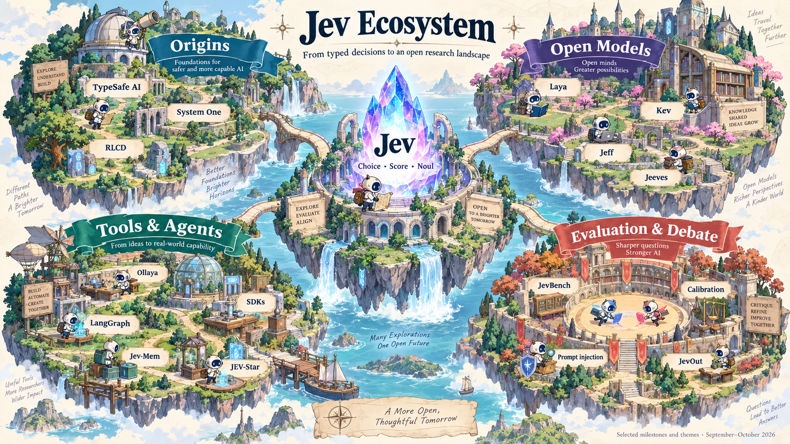

<p align="center"></p>

# AwesomeJev

[](LICENSE)



A curated, English-language directory of **TypeSafe AI’s Jev** and the emerging ecosystem of typed decision models: original releases, community discussions, open infrastructure, model weights, datasets, and research.

**Start with the original announcement:** [Introducing System One Models & Jev — September 15, 2026](https://typesafe.ai/blog/introducing-system-one-models-and-jev).

## Big News

-  **[2026-10-22]** OpenAI makes its Decisions API generally available, expanding the hosted typed-decision ecosystem. [Official announcement](https://openai.com/index/decisions-api/). GPT-6 Luna supports predicate, choice, and score answers, with caching, native JSON, question-level images, GPT-Live integration, and up to 400 questions per request. This is a proprietary hosted service.
-  **[2026-10-21]** Baseten releases mammoth-1 and elephant-1, open-weight decision models compatible with the System One interface. [Official announcement](https://www.baseten.co/blog/the-best-decision-models-in-the-world-mammoth-1-and-elephant-1/). MIT-licensed 27B and 9B weights, bundled serving files, and a technical report are public. Benchmark ranks are dated vendor claims; report and model cards differ on image-training provenance.
-  **[2026-10-21]** Composio announces Firewall, using Jev and specialized small models to check agent tool actions and returned content. [Official announcement](https://landing.composio.dev/blog/introducing-composio-firewall). The hosted feature is marked experimental in its documentation. Checks after execution cannot reverse an action, and classifier failures remain possible.
-  **[2026-10-19]** Cloudflare previews Clairic, extending Jev-inspired System One models to typed extraction and estimation. [Official announcement](https://blog.cloudflare.com/clairic-extraction-model/). Available as a hosted Workers AI preview. Open weights are planned, not a verified release; model outputs still require task-specific evaluation.
-  **[2026-10-15]** OpenRouter launches Armor beta, using Jev to screen agent tool calls against policy. [Official documentation](https://openrouter.ai/docs/guides/features/plugins/armor). Hosted integration with natural-language rules and Claude Code-compatible auto permissions through Ori. [Launch post](https://x.com/OpenRouter/status/2110838205654470840); beta behavior and classifier errors remain relevant.
-  **[2026-10-14]** TypeSafe releases Jev 1.14 preview with experimental images, Box localization, and longer context. [Official announcement](https://typesafe.ai/blog/jev-1-14). Opt-in features are not presented as production-ready. Images also work with Jev 1.13; Box requires 1.14. The announcement schedules the jev-latest alias change for a week later. As checked on October 25, the official model reference maps both jev-latest and jev-preview to 1.14.0; the exact alias-switch date is unverified.
-  **[2026-10-09]** TypeSafe announces an $870M Series A at a $7.5B valuation, led by a16z. [Official announcement](https://typesafe.ai/blog/series-ai). Financing and company plans; no new Jev model version is announced.
-  **[2026-10-09]** Microsoft launches Microsoft-Decision-1; Vercel adds TypeSafe-compatible access. [Microsoft announcement](https://commandline.microsoft.com/microsoft-decision-1-model-foundry/). Independent hosted decision model; performance claims are vendor-reported. [Vercel integration](https://vercel.com/changelog/microsoft-decision-1-now-available-on-ai-gateway).
-  **[2026-10-09]** Cloudflare releases Clef-omni for typed decisions over text, images, audio, and video. [Cloudflare announcement](https://blog.cloudflare.com/clef-faster-cheaper-multimodal/). Apache-2.0 weights and inference code are public. The same announcement updates Clef serving and lowers the hosted Flash price and context limit without replacing its weights.
-  **[2026-10-01]** Cloudflare releases Clef and Clef-flash, open-weight multimodal decision models with Jev-compatible interfaces. [Announcement](https://blog.cloudflare.com/clef-decision-models/). [Clef](https://huggingface.co/Cloudflare/clef) and [Clef-flash](https://huggingface.co/Cloudflare/clef-flash) weights and inference code are available. Launch discussion: [626 points / 217 comments on Hacker News](https://news.ycombinator.com/item?id=49923692), observed 2026-10-04.
-  **[2026-09-30]** JevSpawn proposes adaptive agentic inference with compositional action spaces. [Paper](https://arxiv.org/abs/2610.00437).
-  **[2026-09-30]** AutoTrust releases JEV-27B-VL, an independent open-weight model for typed decisions over text and images. [Announcement](https://huggingface.co/blog/autotrust/autotrustjev-27b-vl-a-decision-model-that-learned). [Apache-2.0 weights](https://huggingface.co/autotrust/JEV-27B-VL) and serving code are public. The author announcement has 165 Hugging Face upvotes, observed 2026-10-08. This is the September 30 release, added retrospectively.
-  **[2026-09-29]** Chinese-Jev introduces Chinese-language decision training and CJ-Bench. [Paper](https://arxiv.org/abs/2609.36965). Weights remain pending in the checked repository.
-  **[2026-09-29]** A broad Jev evaluation examines 37 datasets, calibration, and answer formats. [Paper](https://arxiv.org/abs/2609.37647).
-  **[2026-09-24]** JevOut investigates how natural-looking context can redirect typed decisions. [Paper](https://arxiv.org/abs/2609.30243).
-  **[2026-09-22]** Visual Jev explores efficient decisions over shared visual context. [Paper](https://arxiv.org/abs/2609.25845).
-  **[2026-09-21]** Jev-Mem introduces a System One controller for agent memory. [Paper](https://arxiv.org/abs/2609.23986).
-  **[2026-09-18]** Laya 0.1.0 is published on PyPI, an early runtime release in the open decision-model ecosystem. [Release](https://pypi.org/project/laya/0.1.0/). This dates the Python package, not the model checkpoints.
-  **[2026-09-16]** Vercel adds Jev to AI Gateway. [Announcement](https://vercel.com/changelog/typesafe-ai-jev-now-available-on-ai-gateway).
-  **[2026-09-15]** TypeSafe AI introduces Jev and System One models. [Original announcement](https://typesafe.ai/blog/introducing-system-one-models-and-jev).

Jev evaluates supplied state against typed questions and returns choices, scores, or yes/no probabilities. Hosted Jev is proprietary; public SDKs and independent open-weight alternatives are different artifacts. No official downloadable Jev weights or architecture paper were located in this review. Schema validity does not establish factual correctness, calibration on every distribution, or immunity to prompt injection. See the [official documentation](https://docs.typesafe.ai/introduction), [model limitations](https://docs.typesafe.ai/model-jaggedness/jev-1.13), and research below.

[Machine-readable catalog](data/resources.json) · [Paper citations](references.bib) · [Curation methodology](METHODOLOGY.md) · [Contributing](CONTRIBUTING.md)

| Explore | Entries | Subcategories | Coverage |
| --- | ---: | ---: | --- |
|  [1. Origins and official resources](#1-origins-and-official-resources) | **15** | 1 | Original announcement, documentation, and first-party references |
|  [2. Community discussion and writing](#2-community-discussion-and-writing) | **96** | 5 | Popular threads, technical articles, debates, and discovery directories |
|  [3. Infrastructure, models, and applications](#3-infrastructure-models-and-applications) | **330** | 9 | SDKs, integrations, open models, runtimes, benchmarks, and applications |
|  [4. Research papers](#4-research-papers) | **161** | 8 | 159 post-launch preprints/working papers + 2 historical-context papers |
| **Total** | **602** | **23** | Catalog entries; one project may appear in multiple resource types |

## Hands-on tutorials

**[2026-10-03]** [Jev beginner guide: typed decisions, support routing, and remote open-model experiments](tutorials/jev-hands-on/README.md). Includes a runnable official SDK example, offline policy/SDK tests, twelve synthetic tickets, and two measured Laya runs on one remote RTX 3090. See the [actual results and lessons](tutorials/jev-hands-on/RESULTS.md); official hosted Jev live results are pending API-key configuration.

## Contents

- [Hands-on tutorials](#hands-on-tutorials)
- [1. Origins and official resources](#1-origins-and-official-resources)
  - [Launch and first-party references](#launch-and-first-party-references)
- [2. Community discussion and writing](#2-community-discussion-and-writing)
  - [Popular Hacker News discussions](#popular-hacker-news-discussions)
  - [Technical blogs and tutorials](#technical-blogs-and-tutorials)
  - [Reddit debates](#reddit-debates)
  - [Discovery directories](#discovery-directories)
  - [Social posts and commentary](#social-posts-and-commentary)
- [3. Infrastructure, models, and applications](#3-infrastructure-models-and-applications)
  - [Official SDKs and tools](#official-sdks-and-tools)
  - [Hosted access and framework guides](#hosted-access-and-framework-guides)
  - [Browser and agent infrastructure](#browser-and-agent-infrastructure)
  - [Language clients and data systems](#language-clients-and-data-systems)
  - [Open-weight decision models](#open-weight-decision-models)
  - [Training pipelines and announced releases](#training-pipelines-and-announced-releases)
  - [Local runtimes and alternative implementations](#local-runtimes-and-alternative-implementations)
  - [Benchmarks, calibration, and datasets](#benchmarks-calibration-and-datasets)
  - [Examples, games, and learning projects](#examples-games-and-learning-projects)
- [4. Research papers](#4-research-papers)
  - [Surveys and broad evaluations](#surveys-and-broad-evaluations)
  - [Judging, calibration, and reliability](#judging-calibration-and-reliability)
  - [Robustness and security](#robustness-and-security)
  - [Agent memory, routing, and control](#agent-memory-routing-and-control)
  - [Open and alternative decision-model methods](#open-and-alternative-decision-model-methods)
  - [Networking and edge systems](#networking-and-edge-systems)
  - [Domain applications and multilingual models](#domain-applications-and-multilingual-models)
  - [Historical context cited in community debate](#historical-context-cited-in-community-debate)
- [License](#license)
- [Citation](#citation)

## 1. Origins and official resources

### Launch and first-party references

-  **[2026-09-15]** · Published · **[Introducing System One Models & Jev](https://typesafe.ai/blog/introducing-system-one-models-and-jev)** — `Official`. Diogo Almeida introduces Jev, the System One framing, RLCD, launch demonstrations, and the qualifications behind the reported performance gains. The starting point for this collection.
-  **[2026-09-22]** · **[TypeSafe manifesto](https://typesafe.ai/manifesto)** — `Official`. The company’s argument for models designed to make decisions inside software.
-  **[2026-09-10]** · Published · **[The Bitterest Lesson](https://typesafe.ai/blog/bitterest-lesson)** — `Official`. Founder’s research perspective on the objectives and data used to train useful models. Background to the Jev launch.
-  **[2026-06-19]** · Published · **[AI: too good to be true, too bad to be useful](https://typesafe.ai/blog/ai-too-good-to-be-true-too-bad-to-be-useful-typesafe-ai)** — `Official`. TypeSafe’s argument about the gap between conversational ability and dependable automation.
-  **[2026-09-20]** · Page updated · **[Introduction and quick start](https://docs.typesafe.ai/introduction)** — `Official`. The official entry point for sending state and typed questions to Jev.
-  **[2026-10-14]** · Page updated · **[Choice, Score, and Noul](https://docs.typesafe.ai/primitives)** — `Official`. Definitions of the original three decision primitives, including probability distributions and answer shapes. The Jev 1.14 announcement separately introduces the experimental Box type.
-  **[2026-10-02]** · Page updated · **[Confidence](https://docs.typesafe.ai/confidence)** — `Official`. How TypeSafe distinguishes answer probability from confidence and uses them in workflows.
-  **[2026-10-23]** · Page updated · **[Model reference](https://docs.typesafe.ai/models)** — `Official`. Official version identifiers, inputs, limits, and model aliases. The inspected page maps both jev-latest and jev-preview to Jev 1.14.0, with no separate preview build. Pinned model IDs avoid silent alias changes; experimental capabilities retain their documented opt-in requirements.
-  **[2026-10-02]** · Page updated · **[Jev 1.13 jaggedness](https://docs.typesafe.ai/model-jaggedness/jev-1.13)** — `Official`. First-party documentation of uneven capabilities and known weak spots. Essential context for evaluating launch claims.
-  **[2026-09-22]** · Page updated · **[Patterns and cookbooks](https://docs.typesafe.ai/cookbooks)** — `Official`. Implementation guides for routing, scoring, fan-out, classification, search, and other bounded decisions.
-  **[2026-09-15]** · Published · **[Workflow evaluations](https://evals.typesafe.ai/)** — `Official`. Vendor-run workflow comparisons, examples, and methodology; reference-model agreement is not the same as human ground truth.
-  **[2026-09-23]** · **[Documentation index](https://docs.typesafe.ai/llms.txt)** — `Official`. Machine-readable index of official documentation for deeper exploration.
-  **[2026-10-09]** · Published · **[TypeSafe A raises Series AI](https://typesafe.ai/blog/series-ai)** — `Official announcement`. TypeSafe announces an $870 million Series A at a $7.5 billion valuation, led by Andreessen Horowitz with Sequoia and DCVC participating, and Martin Casado joining the board. Outlines plans for more machine-native models and enterprise infrastructure; this is a financing announcement, not a new Jev model release. [Investor statement](https://a16z.com/announcement/investing-in-typesafe-ai/) · [Hacker News](https://news.ycombinator.com/item?id=50023450).
-  **[2026-10-07]** · Published · **[How Jack & Jill Cut Candidate Screening Costs By 88% With Jev](https://typesafe.ai/blog/jack-jill-jev-case-study)** — `Official case study`. TypeSafe customer case study comparing Jev with Gemini 3.1 Flash Lite for initial candidate screening across 150 roles. Reports lower token cost and median completion time, with no statistically significant recall difference. Annual savings are projections; the outcome measures retention of hiring-manager selections rather than hiring fairness.
-  **[2026-10-14]** · Published · **[Jev: For the builders AND dreamers (Jev 1.14)](https://typesafe.ai/blog/jev-1-14)** — `Official`. Announces Jev 1.14.0 on jev-preview, with multilingual improvements and opt-in experimental images, Box outputs, and longer context. Images also work with 1.13; Box requires 1.14. The announcement schedules the jev-latest switch for a week later and cautions that the experimental features are not production-ready. By the October 25 check, the official model reference maps both jev-latest and jev-preview to 1.14.0; the exact alias-switch time is not established. [Images](https://docs.typesafe.ai/images) · [Box](https://docs.typesafe.ai/primitives/box) · [Model reference](https://docs.typesafe.ai/models) · [Hacker News](https://news.ycombinator.com/item?id=50095353).


## 2. Community discussion and writing

Hacker News threads are ordered by observed points within the retrieved candidates. Counts are dated snapshots, not live metrics or a quality ranking. Measurement dates can differ between threads. The [catalog](data/resources.json) records per-entry attention metrics and sources; see the [methodology](METHODOLOGY.md#popularity) for the collection method. Blogs and Reddit threads are selected for their relevance; no cross-platform popularity claim is made.

### Popular Hacker News discussions

| Discussion | Points / comments | What it covers |
| --- | ---: | --- |
|  **Introducing System One Models and Jev**<br>**[2026-09-15]** · Submitted<br>[Discussion](https://news.ycombinator.com/item?id=49717558) · [Original](https://typesafe.ai/blog/introducing-system-one-models-and-jev) | 1,989 / 520 | Launch discussion with founder participation, questions about the API, architecture disclosure, calibration, and evaluation. |
|  **Jev in 25 Lines of Python**<br>**[2026-09-23]** · Submitted<br>[Discussion](https://news.ycombinator.com/item?id=49812769) · [Original](https://www.nobodywho.ai/posts/jev-in-25-lines/) | 691 / 212 | A deliberately minimal, explicitly satirical local implementation using option-token probabilities; the discussion probes what this does and does not reproduce. |
|  **Jev meets the Trolley Problem**<br>**[2026-10-15]** · Submitted<br>[Discussion](https://news.ycombinator.com/item?id=50106023) · [Original](https://zachlandes.com/trolley-problem/) | 622 / 243 | Discussion of Zach Landes’s trolley-problem experiment, prompt sensitivity, and the limits of interpreting hypothetical choices as evidence about model behavior. Links the original interactive analysis and its reproducibility materials. |
|  **Ollaya – Ollama for open-source, Jev-style decision models**<br>**[2026-09-25]** · Submitted<br>[Discussion](https://news.ycombinator.com/item?id=49848269) · [Original](https://ollaya.dev/) | 617 / 145 | Discussion of a local runtime for open decision models and compatibility with the TypeSafe interface. |
|  **Jeff – Jev-compatible 0.8B decision models, trained at home, ~30 ms**<br>**[2026-09-28]** · Submitted<br>[Discussion](https://news.ycombinator.com/item?id=49883844) · [Original](https://github.com/firelex/jeff) [](https://github.com/firelex/jeff) | 574 / 225 | Release discussion for Jeff’s small decision models, local inference, and training approach. |
|  **Kev: Tiny Jev-like family of decision models built on top of Qwen3.5**<br>**[2026-09-21]** · Submitted<br>[Discussion](https://news.ycombinator.com/item?id=49783999) · [Original](https://github.com/jaredpalmer/kev/tree/main) [](https://github.com/jaredpalmer/kev) | 462 / 211 | Kev release discussion covering open weights, implementation choices, comparisons, and model size. |
|  **We’re releasing Jev 1.14.0 along with experimental features for dreamers**<br>**[2026-10-14]** · Submitted<br>[Discussion](https://news.ycombinator.com/item?id=50095353) · [Announcement](https://typesafe.ai/blog/jev-1-14) | 330 / 121 | Discussion of the 1.14 preview release, experimental visual localization, longer context, and the boundary between stable automation and prototypes. Scores are a dated snapshot; the official announcement defines the release and feature status. |
|  **OpenAI is well positioned to fast-follow Jev**<br>**[2026-09-22]** · Submitted<br>[Discussion](https://news.ycombinator.com/item?id=49802161) · [Original](https://arcturus-labs.com/blog/2026/09/21/will-openai-eat-jevs-lunch/) | 328 / 233 | Debate about incumbent model providers, product differentiation, and Jev-style interfaces; market predictions are opinions. |
|  **Show HN: Jev Plays Pokémon Red**<br>**[2026-09-25]** · Submitted<br>[Discussion](https://news.ycombinator.com/item?id=49845172) · [Original](https://jev-pokemon.vercel.app/) | 282 / 124 | A Pokémon Red demonstration and discussion of the role of game state, legal actions, and the surrounding agent harness. |
|  **Jeeves. Reasoning improves Jev-like decision models**<br>**[2026-09-29]** · Submitted<br>[Discussion](https://news.ycombinator.com/item?id=49891290) · [Original](https://github.com/PostHog/jeeves) [](https://github.com/PostHog/jeeves) | 242 / 95 | Jeeves release discussion about adding reasoning to Jev-style classifiers. |
|  **Jev-Leftpad**<br>**[2026-09-21]** · Submitted<br>[Discussion](https://news.ycombinator.com/item?id=49784706) · [Original](https://github.com/f/jev-leftpad) [](https://github.com/f/jev-leftpad) | 234 / 87 | A humorous left-padding package powered by model decisions; useful as community history, not an infrastructure recommendation. |
|  **Language models for text classification: From bag-of-words to Jev**<br>**[2026-09-29]** · Submitted<br>[Discussion](https://news.ycombinator.com/item?id=49891203) · [Original](https://magazine.sebastianraschka.com/p/classifier-history-and-jev) | 213 / 10 | Discussion of Sebastian Raschka’s history of text classification and explanation of Jev-style decision interfaces. |
|  **I turned Jev into a (lousy) chatbot**<br>**[2026-09-20]** · Submitted<br>[Discussion](https://news.ycombinator.com/item?id=49778162) · [Original](https://github.com/kyle-pena-nlp/jevchat/) [](https://github.com/kyle-pena-nlp/jevchat) | 177 / 50 | An experiment generating text through repeated character choices, illustrating the limits of using Jev as a chatbot. |
|  **Reverse-engineered Jev-like model**<br>**[2026-09-16]** · Submitted<br>[Discussion](https://news.ycombinator.com/item?id=49731282) · [Original](https://github.com/vinnylarouge/jevlike) [](https://github.com/vinnylarouge/jevlike) | 169 / 24 | Early independently built Jev-like option scorer; “reverse-engineered” in the thread title does not establish access to TypeSafe’s architecture. |
|  **Show HN: JevBench, a reproducible benchmark for typed decision models**<br>**[2026-09-22]** · Submitted<br>[Discussion](https://news.ycombinator.com/item?id=49800574) · [Original](https://benchmarkheaven.com/jev-models) | 153 / 39 | Discussion of JevBench, its evaluation design, and cross-model comparisons. |
|  **The rise and fall of Jev hype: community debate**<br>**[2026-10-23]** · Submitted<br>[Discussion](https://news.ycombinator.com/item?id=50206361) · [Original essay](https://blog.alexewerlof.com/p/rise-and-fall-of-jev-eval-hype-vs-llm) | 91 / 65 | Discussion of Alex Ewerlof's October 19 essay, with disagreement over marketing, practical adoption, classifier economics, and the distinction between typed outputs and correctness. Commenters challenge the claim that reduced social attention implies product failure. This is community opinion rather than a controlled evaluation. |
|  **Jev Can't Be Calibrated**<br>**[2026-09-23]** · Submitted<br>[Discussion](https://news.ycombinator.com/item?id=49816899) · [Original](https://www.alexmolas.com/2026/09/23/jev-cant-be-calibrated.html) | 65 / 61 | Debate about distribution-dependent calibration and what a probability returned by Jev means. |

### Technical blogs and tutorials

-  **[2026-09-21]** · Published · **[Jev introduces a new shape of LLM—System One, aka Decision Models](https://simonwillison.net/2026/Sep/21/jev/)** — `Article`. Simon Willison explains the interface, experiments, open recreations, and the difficulty of inspecting a numeric decision.
-  **[2026-09-29]** · Published · **[Language Models for Text Classification: From Bag-of-Words to Jev](https://magazine.sebastianraschka.com/p/classifier-history-and-jev)** — `Article`. Sebastian Raschka places Jev in the history of classifiers, readout methods, and calibration; proposed internals are explicitly inferential.
-  **[2026-09-17]** · Published · **[Building a Harness with Jev](https://www.langchain.com/blog/building-a-harness-with-jev)** — `Article`. LangChain’s tutorial on integrating bounded decisions into an agent loop, including routing and evaluation.
-  **[2026-09-25]** · Published · **[Building Prod with Jev and LangGraph](https://www.langchain.com/blog/building-prod-with-jev-and-langgraph)** — `Article`. LangChain’s worked document-review workflow combines Jev classifications, graph orchestration, and escalation.
-  **[2026-09-21]** · Published · **[What is Jev? — Browserbase](https://www.browserbase.com/blog/what-is-jev)** — `Article`. Browserbase explains how Stagehand can use Jev for bounded browser actions and fall back to an LLM.
-  **[2026-09-18]** · Published · **[You could have built Jev](https://sgnt.ai/p/jev/)** — `Article`. Pete Sergeant explains option scoring and compares independent implementations; reproducing an interface does not prove model equivalence.
-  **[2026-09-23]** · Published · **[Jev can’t be calibrated](https://www.alexmolas.com/2026/09/23/jev-cant-be-calibrated.html)** — `Article`. Alex Molas argues that calibration must be checked against the deployment distribution rather than assumed from a model-wide claim.
-  **[2026-09-22]** · Published · **[Jev or a fine-tuned small model?](https://www.distillabs.ai/blog/jev-or-a-fine-tuned-small-model-we-built-a-pipeline-with-both-to-see-the-real-difference/)** — `Article`. Distil Labs reports a pipeline experiment comparing Jev and task-specific models on triage and invoice decisions. Results describe that vendor’s setup.
-  **[2026-10-01]** · Published · **[Introducing Clef: our open-source decision models, and new RL fine-tuning platform](https://blog.cloudflare.com/clef-decision-models/)** — `Publisher announcement`. Cloudflare introduces Jev-compatible multimodal decision models and describes its RL fine-tuning platform. Includes architecture and deployment details; benchmark comparisons are vendor-reported. [Clef](https://huggingface.co/Cloudflare/clef) · [Clef-flash](https://huggingface.co/Cloudflare/clef-flash) · [Hacker News](https://news.ycombinator.com/item?id=49923692).
-  **[2026-10-02]** · Published · **[Jev for Python engineers](https://vercel.com/blog/jev-for-python-engineers)** — `Technical tutorial`. Vercel demonstrates typed Choice, Score, and Noul calls through its experimental Python evaluation API, including classification and AST generation. The examples also discuss failure cases. [GitHub](https://github.com/vercel-labs/ai-python) [](https://github.com/vercel-labs/ai-python) · [AST example](https://github.com/vercel-labs/ai-python/blob/main/examples/models/gateway/jev_python_ast.py) [](https://github.com/vercel-labs/ai-python).
-  **[2026-10-02]** · Published · **[Jev is Poorly Calibrated](https://maximumeffort.substack.com/p/jev-is-poorly-calibrated)** — `Independent analysis`. Dylan Black tests option probabilities against known physical distributions and probes arithmetic failures. An author-run distribution-matching study, rather than a universal calibration verdict.
-  **[2026-10-04]** · Published · **[The $40M Moat Lasted Two Weeks](https://abuiliazeed.github.io/blog/the-moat-lasted-two-weeks.html)** — `Independent commentary`. Abuiliazeed discusses Clef and Strands Decider as evidence of growing competition around Jev-style decision interfaces. An opinion essay on model commoditization and agent architecture; its market conclusions and benchmark comparisons are the author’s interpretation.
-  **[2026-09-20]** · Published · **[System One models like Jev can train their own replacements](https://www.seangoedecke.com/system-one-models-can-train-their-own-replacements/)** — `Independent commentary`. Sean Goedecke proposes collecting inputs and decisions from a working Jev application to train a task-specific classifier. A distillation design argument, resurfaced in discussion, rather than a measured deployment study. [Hacker News](https://news.ycombinator.com/item?id=49959504).
-  **[2026-10-05]** · Published · **[Introducing d1: The most capable decision model, now with vision](https://www.liquid.ai/blog/d1-decision-model)** — `Publisher announcement`. Liquid AI announces text-and-image typed decisions and demonstrations adapted from Jev ecosystem projects. Its application comparisons are vendor-run single trials. The announcement separates hosted availability from plans for future open-weight models. [API documentation](https://docs.liquid.ai/lfm/models/decision-models) · [Hacker News](https://news.ycombinator.com/item?id=49967491).
-  **[2026-10-05]** · Page updated · **[Jev — AI Development Setup](https://stevekinney.com/courses/ai-development-setup/jev)** — `Technical guide`. Steve Kinney explains where typed decisions fit into coding-agent routing, tool selection, context compaction, and verification. Distinguishes model-based risk signals from deterministic enforcement and recommends versioned, measured integrations.
-  **[2026-10-05]** · Published · **[Jev Ultrafast: Pairing Browser Use with Jev](https://blog.nashtechglobal.com/jev-ultrafast-pairing-browser-use-with-jev/)** — `Technical article`. Tien Nguyen Anh describes Browser Use for page perception and actions, with Jev choosing among available next steps. An architectural tutorial referencing jev-ultrafast; its speed and cost discussion is not an independent benchmark. [Referenced project](https://github.com/browser-use/jev-ultrafast) [](https://github.com/browser-use/jev-ultrafast).
-  **[2026-10-05]** · Published · **[Q: Is Jev useful for voice agents? A: Let's benchmark it](https://veris.ai/blog/jev-turn-detection)** — `Article`. Veris compares a Jev turn gate with silence-based detection on 100 simulated voice tasks, three runs each. Reported interruptions fall from 52% to 11%, while median replies slow from 2.1 to 4.6 seconds and task completion barely changes; the two conditions also use different Pipecat versions. [Discussion](https://news.ycombinator.com/item?id=49982478).
-  **[2026-10-06]** · Published · **[Decide with Jev: Three Questions in One Request with the Laravel AI SDK](https://laravel-news.com/decide-with-jev-three-questions-in-one-request-with-the-laravel-ai-sdk)** — `Article`. Harris Raftopoulos demonstrates versioned Boolean, choice, and score questions in one request, a shared PHP service, answer decoding, and application-side dependencies between decisions. Includes the episode and example repository. [GitHub](https://github.com/harris21/decide-with-jev) [](https://github.com/harris21/decide-with-jev).
-  **[2026-09-30]** · Published · **[Generate Jev Schemas from TypeScript Types](https://typia.io/blog/jev/)** — `Article`. Jeongho Nam shows how Typia generates question maps and answer decoders from TypeScript types and comments, using the direct Jev SDK or Vercel AI SDK. The MIT-licensed implementation includes a Boolean-to-Noul adapter; schema validation does not establish decision accuracy. [Guide](https://typia.io/docs/utilization/jev) · [GitHub](https://github.com/samchon/typia) [](https://github.com/samchon/typia) · [Discussion](https://news.ycombinator.com/item?id=49981716).
-  **[2026-10-06]** · Published · **[An Independent Evaluation of TypeSafe's Jev](https://www.vals.ai/blogs/independent-evaluation-of-jev)** — `Article`. Vals evaluates twelve systems on 400 SEC-filing claim checks and a preregistered 396-question LegalBench slice. Jev matches several frontier models on claim verification but ranks last on this legal slice; its selective-automation test also exceeds the targeted error budget. Cost and latency findings are workload-specific. [Discussion](https://news.ycombinator.com/item?id=49984418).
-  **[2026-09-22]** · Published · **[Is Jev the right model for your agents?](https://blog.oodle.ai/is-jev-the-right-model-for-your-use-case-a-walkthrough-comparing-haiku-4-5-gpt-5-4-mini-and-gemini-3-5-flash/)** — `Article`. Akhilesh Krishnan compares Jev, Haiku 4.5, GPT-5.4-mini, and Gemini 3.5 Flash on two balanced 200-item support-escalation and model-routing datasets. Discusses latency, separate judge costs, and threshold sensitivity; the small samples and exploratory threshold adjustment limit generalization. [Discussion](https://news.ycombinator.com/item?id=49982760).
-  **[2026-10-01]** · Published · **[Jev plays chess](https://byrencheema.com/writing/jev-plays-chess/)** — `Article`. Byren Cheema reports 470 games and 1,000 held-out puzzles, with every legal move supplied as an option. The experiment separates fast, legal outputs from weak chess play and investigates attraction to moves described as checks; code and recorded results are linked. [GitHub](https://github.com/byrencheema/jev-chess) [](https://github.com/byrencheema/jev-chess) · [Discussion](https://news.ycombinator.com/item?id=49983198).
-  **[2026-10-06]** · Published · **[Jev isn't a better judge than Claude](https://deeplearningguy.github.io/blog/jev-vs-claude-judge)** — `Article`. DoubtBench author compares Jev and three Claude models on 7,455 HelpSteer2-derived judgments, including agreement with human uncertainty. Reports similar composite scores and weak tracking of annotator disagreement despite different cost and latency. Claude probabilities are generated in JSON, and reasoning effort and dataset scope limit the comparison. [GitHub](https://github.com/deeplearningguy/doubtbench) [](https://github.com/deeplearningguy/doubtbench).
-  **[2026-09-28]** · Published · **[Do Jev Decision Models work for mine operations?](https://hivekit.io/blog/do-jev-decision-models-work-for-mine-operations/)** — `Article`. Hivekit founder explains how Jev could interpret shift notes alongside deterministic scheduling calculations and safety constraints. Describes an application architecture and early integration direction, without a quantitative evaluation of mine operations.
-  **[2026-10-07]** · Published · **[Build a Custom Jev Connector and Shared Pipelines in Maia](https://www.maia.ai/resources/blog/building-typesafe-jev-connector-shared-pipelines-maia)** — `Article`. First-party walkthrough of creating a TypeSafe connector, managing credentials through a secrets manager, and sharing batch, table, and answer-unpacking pipelines. Demonstrates a Snowflake-targeted integration with reusable examples; it is a vendor tutorial rather than an independent benchmark.
-  **[2026-10-07]** · Published · **[What Is RSI-Jev? A Self-Improving Loop That Builds Jev-Style Decision Models](https://www.orcarouter.ai/blog/what-is-rsi-jev)** — `Article`. Technical guide to RSI-Jev release history, adaptive-depth decision heads, serving, and evaluation caveats. Focuses on v6.0-VL while acknowledging v6.1-VL; performance figures come from the project, and the article explicitly says OrcaRouter does not host RSI-Jev. [GitHub](https://github.com/Shanghua-Gao/RSI-Jev) [](https://github.com/Shanghua-Gao/RSI-Jev).
-  **[2026-09-30]** · Published · **[JEV-27B-VL: a decision model that learned to see without image training](https://huggingface.co/blog/autotrust/autotrustjev-27b-vl-a-decision-model-that-learned)** — `Article`. AutoTrust announces its independent multimodal decision model and explains reuse of a text-trained decision head with a vision-capable backbone. Reports a cover-image recommendation experiment on 200 users; these publisher-run findings do not establish general visual reliability. [Weights](https://huggingface.co/autotrust/JEV-27B-VL) · [Demo code](https://github.com/yuhai-china/JEV-27B-DEMO) [](https://github.com/yuhai-china/JEV-27B-DEMO).
-  **[2026-10-08]** · Published · **[A lifejacket for scientists drowning in papers](https://sina.bio/posts/decision-language-models.html)** — `Article`. A. Sina Booeshaghi describes author.link and compares Jev with OpenAI Decisions for paper relevance using a 66-paper author-specific test and RELISH. Distinguishes relevance from scientific quality and cautions that a returned score is not a validated probability of usefulness. [Hacker News](https://news.ycombinator.com/item?id=50013328).
-  **[2026-10-08]** · Published · **[Classifying Emails with Jev and the OpenAI Decisions API](https://builders.abnormal.ai/p/classifying-emails-with-jev-and-the)** — `Article`. Shrivu Shankar compares 40 model configurations on 1,985 non-public synthetic emails with 40% attacks. Contrasts calibration, recall at high precision, and attack-type classification; a fine-tuned Kev improves one metric while degrading another. The selected prevalence and private synthetic data limit generalization. [Hacker News](https://news.ycombinator.com/item?id=50007041).
-  **[2026-10-08]** · Published · **[Jev for Analytics: 5 Use Cases on Real Data](https://motherduck.com/videos/jev-for-analytics-use-cases/)** — `Video tutorial`. Mehdi Ouazza demonstrates MotherDuck’s prompt_jev() SQL function on agent logs, Hacker News sentiment, sales calls, and job listings, with a consumer-complaints introduction. Shows context, fallback choices, and confidence-based review; these are vendor demonstrations rather than an independent benchmark.
-  **[2026-10-09]** · Published · **[Investing in TypeSafe AI](https://a16z.com/announcement/investing-in-typesafe-ai/)** — `Investor announcement`. Andreessen Horowitz explains its investment thesis around Jev and decision models as software components. Offers the lead investor’s perspective on developer adoption and software economics; adoption, speed, and cost claims are investor statements rather than independent measurements.
-  **[2026-10-06]** · Published · **[What we learned building 38 projects with Jev in 12 hours](https://gc.ai/blog/what-we-learned-building-38-projects-with-jev-in-12-hours)** — `Engineering article`. GC AI reports hackathon experiments in clause screening, streaming citation checks, alert triage, and a Slack pet. Explains narrow question design, context cleanup, confidence-based routing, and failures on arithmetic and broad judgments. The findings come from small internal experiments, not a general benchmark. [Hacker News](https://news.ycombinator.com/item?id=50026409).
-  **[2026-10-09]** · Published · **[Introducing Clef-omni, a faster Clef, and a cheaper Clef-flash](https://blog.cloudflare.com/clef-faster-cheaper-multimodal/)** — `Provider announcement`. Cloudflare introduces an independent Jev-compatible model for text, images, audio, and video. The announcement also describes faster Clef serving and a Clef-flash hosted price reduction with a shorter hosted context window; existing Clef and Flash weights are unchanged. Performance comparisons are vendor evaluations. [Clef-omni weights](https://huggingface.co/Cloudflare/clef-omni) · [Hacker News](https://news.ycombinator.com/item?id=50025236).
-  **[2026-10-08]** · Published · **[If LLMs Can Decide Without Fine-Tuning, Do We Still Need Models Like Jev?](https://itsodeleo.github.io/posts/local-decision-workflow/)** — `Independent experiment`. Local experiments compare answer-logit scoring from general models with Jeff, Laya, and other decision implementations on small fixed tasks. TypeSafe Jev itself was not tested. Model size, quantization, prompts, and runtime differ, so the results do not isolate the effect of decision-model training. [Hacker News](https://news.ycombinator.com/item?id=50032037).
-  **[2026-10-06]** · Published · **[Jev and the Return of Fuzziness](https://xiaofengyue.com/2026-10-06/jev)** — `Opinion essay`. Reflects on Jev as a way to expose graded judgments inside deterministic software, relating decision interfaces to fuzzy reasoning and routing. This is a conceptual essay; its illustrative API examples are not a verified SDK reference. [Hacker News](https://news.ycombinator.com/item?id=50031776).
-  **[2026-10-09]** · Published · **[Using Jev in Domain Abuse Review: A Workflow Design](https://abtdomain.com/blog/2026/10/using-jev-in-domain-abuse-review-a-workflow-design/)** — `Workflow case study`. ABTdomain describes a staged brand-protection prototype combining name classification, deterministic domain checks, and a narrowly framed use assessment. Tests use 100 Apple-containing names, including manual controls. Outputs support human review; the prototype is not a validated legal judgment system. [Hacker News](https://news.ycombinator.com/item?id=50035784).
-  **[2026-10-11]** · Published · **[How developers see Jev: praise, skepticism, and Chinese-language experiments](https://roamer-tech.com/jev-developer-community-reactions)** — `Community retrospective`. Traditional Chinese overview of launch debates, calibration concerns, and task-specific tests, including the author’s website-navigation experience. The page is dated October 11 but explicitly bases its community evidence on September 27; historical attention figures are not current measurements.
-  **[2026-10-12]** · Published · **[Using Jev to make your agents write the code and design the app the way you do](https://blog.a7ul.com/agents-code-your-way.html)** — `Practitioner article`. Atul describes scoped, testable review rules inspired by Jev, with a CLI that turns code diffs and screenshots into per-rule judgments. Filed actually uses Perplexity’s decider in production, including for images. Examples include illustrative numbers, and tuning rule wording on a few cases can overfit. [Hacker News](https://news.ycombinator.com/item?id=50063649).
-  **[2026-10-12]** · Published · **[Using Jev With LangChain: Model Routing and Guardrails](https://aisocialjournal.com/blog/2026/10/12/jev-with-langchain)** — `Community tutorial`. Dinesh Gopal demonstrates TypeSafeClassifier composition, model routing, and experimental tool-call screening with loan-intake examples. The blocking middleware does not request human approval, and only listed tools are classified. Examples illustrate integration patterns rather than measured safety or cost guarantees. [Example code](https://github.com/dineshgopal29/the-agentic-advantage/blob/main/jev_langchain/loan_triage_classifier.py) [](https://github.com/dineshgopal29/the-agentic-advantage).
-  **[2026-10-13]** · Published · **[What I Actually Use Jev For](https://james-carr.org/posts/2026-10-13-what-i-actually-use-jev-for/)** — `Article`. James Carr documents 629 Jev calls from two weeks of Oh My Pi sessions, primarily semantic code search plus reasoning-effort selection. Includes concrete traces and reported costs; this is a personal usage report, not a controlled accuracy or productivity benchmark.
-  **[2026-10-14]** · Published · **[LLM vs Decision models like Jev and use-cases](https://grigio.org/llm-vs-decision-models-like-jev-and-use-cases/)** — `Article`. Compares local decision models and a chat model on eight triage questions, discussing latency, prompt caching, and failure cases. The small workload illustrates tradeoffs rather than establishing general rankings, and its timed rows are local alternatives rather than the hosted Jev service.
-  **[2026-10-14]** · Published · **[Introducing Lumma-Fev-27B](https://huggingface.co/blog/FrontiersMind/lumma-fev-27b)** — `Article`. Author release report for a fully fine-tuned multilingual decision model. Compares Jev on held-out decisions and public tasks, reporting gains on its decision workload and weaker reasoning results. Only Noul and Choice were trained and evaluated; Score support remains untested. [Weights](https://huggingface.co/FrontiersMind/Lumma-fev-27B).
-  **[2026-10-14]** · Published · **[Can Jev's Box find AI-image hallucinations?](https://github.com/RINNECODER/jev-box-study)** [](https://github.com/RINNECODER/jev-box-study) — `Article and code`. Independent field report and demo exploring Jev 1.14 images and Box. Documents how prompt framing, crop scale, discovery, and repeated judgments affect detections. The author labels the evaluations small and hand-picked; the examples do not establish general AI-image detection accuracy.
-  **[2026-10-14]** · Published · **[Are all System One models created equal?](https://parallel.ai/blog/are-all-system-one-models-created-equal)** — `Article`. Parallel compares eight decision models on four human-labeled search-production tasks. Examines prompt tuning, reranking, page-change detection, and serving configurations. Its specialized reranker outperforms the general decision models in the reported test; cost and latency conclusions depend on the deployment setup. [Discussion](https://news.ycombinator.com/item?id=50109686).
-  **[2026-10-14]** · Published · **[Jev Meets the Trolley Problem](https://zachlandes.com/trolley-problem/)** — `Article / interactive experiment`. Interactive comparison of Jev and other decision models across trolley-problem variants, wordings, and description orders. Links recorded responses and analysis materials. Shows sensitivity to framing; these hypothetical judgments do not establish real-world intentions, moral competence, or calibrated deployment safety. [Code and results (license unspecified)](https://github.com/zachlandes/trolley-bench) [](https://github.com/zachlandes/trolley-bench) · [Discussion](https://news.ycombinator.com/item?id=50106023).
-  **[2026-10-15]** · Page updated · **[How to build typed decisions with Jev](https://flaviocopes.com/jev/)** — `Tutorial`. Flavio Copes explains typed questions, SDK calls, parallel question batches, confidence gates, and practical integration patterns. The updated guide covers experimental images, Box, and longer context alongside limitations and proposed personal workflows; illustrative examples are not independent performance validation.
-  **[2026-10-08]** · Published · **[How to use Jev with Claude Code, Codex and Cursor](https://flaviocopes.com/jev-coding-agents/)** — `Tutorial`. Guide to giving coding agents the official TypeSafe skill and current API documentation, then reviewing the integrations they produce. Explains batching, candidate selection, and keeping deterministic arithmetic in code; the coding agent retains its generative model. [Official skill repository](https://github.com/typesafe-ai/skills) [](https://github.com/typesafe-ai/skills).
-  **[2026-10-15]** · Published · **[Jev gets experimental image input, and Jev 1.14 can locate objects in images](https://blog.invidelabs.com/jev-1-14-experimental-vision/)** — `Article`. Invide Labs explains image inputs, Box coordinates, model aliases, and experimental feature headers. Emphasizes that Box still returns coordinates when an object is absent, requiring a separate presence judgment. This is a technical walkthrough of the official release, not a benchmark.
-  **[2026-10-15]** · Published · **[Jev is NOT a state-of-the-art reranker (but it's close)](https://www.kapa.ai/blog/jev-reranker-benchmark)** — `Article / evaluation`. Kapa evaluates Jev 1.13 and 1.14 against specialized rerankers on 1,000 company-knowledge cases, ranking the same 50 candidates and scoring the top ten. Jev 1.14 comes close to Voyage rerank-3, which leads the reported quality, cost, and latency comparison. Results depend on the dataset and serving setup. [Discussion](https://news.ycombinator.com/item?id=50115347).
-  **[2026-10-16]** · Page updated · **[JEV as a Hallucination Filter: Let the LLM Write, Let JEV Check](https://www.analyticsvidhya.com/blog/2026/10/rag-hallucination-filter-using-jev/)** — `Tutorial`. Python tutorial that checks candidate answers against source evidence with Jev and escalates uncertain cases to a stronger model. In eight illustrative cases, it blocks 16 planted errors but also 13 of 40 acceptable drafts; best-of-five adds no benefit over the first draft. Includes code and baseline comparisons, not a general reliability guarantee.
-  **[2026-10-16]** · Page updated · **[What Is Jev? TypeSafe's Decision Model Explained for Developers](https://openrouter.ai/blog/insights/what-is-jev/)** — `Guide`. OpenRouter guide to Choice, Score, Noul, and experimental Box questions, with recorded API examples and explanations of probability distributions and confidence. The October update covers Jev 1.14 image input, context behavior, and gateway access; typed outputs still require task-specific validation.
-  **[2026-09-25]** · Published · **[Semantic assertions: Using Jev to make rigid tests flex](https://www.qawolf.com/blog/semantic-assertions-using-jev)** — `Technical article`. QA Wolf explains Jev-backed semantic assertions and bounded navigation for Playwright flows. Jev judges permitted variation in wording or navigation, while deterministic checks verify saved records and other required effects. Uncertain judgments and evaluator errors fail assertions; examples describe the vendor integration rather than an independent benchmark. [Discussion](https://news.ycombinator.com/item?id=50083881).
-  **[2026-10-15]** · Published · **[Build an Automatic AI Accountant With Muse, Unsiloed, and Jev](https://www.unsiloed.ai/blog/build-automatic-ai-accountant-muse-unsiloed-jev)** — `Tutorial`. Worked bookkeeping workflow: Unsiloed extracts document fields with citations, deterministic code checks totals and candidate matches, Jev makes typed categorization judgments, and Muse coordinates review. Demonstrates how extraction uncertainty and unresolved questions reach the owner; one example month does not validate autonomous accounting accuracy.
-  **[2026-10-12]** · Published · **[What is Jev good for? — Sayora](https://sayora.ai/many-hands/what-is-jev-good-for/)** — `Article / application study`. Plain-language guide with an author-run receptionist retrieval experiment on 168 questions across four business websites. Compares selecting page descriptions with embedding retrieval, including questions the sites cannot answer. Discusses missed details, description quality, and fallback; the vendor experiment is limited to its sampled sites and questions.
-  **[2026-10-17]** · Published · **[Running a Small Decision Model (Jev) in Production](https://xtrusio.com/blog/running-small-decision-model-jev-production)** — `Production report`. Production account of pinned Jev 1.13 checking source support and comparing editorial pages, with Claude handling writing and escalation. Distinguishes teacher agreement from factual accuracy and reports frequent claim-check fallbacks. Jev API charges alone exclude total pipeline cost, latency, repeatability, and the cost of human review or errors.
-  **[2026-10-17]** · Page updated · **[TypeSafe Jev: 444x Claimed, 8.6x to 580x Measured](https://capitalandcompute.net/blog/typesafe-jev-system-one-models-cost-use-cases/)** — `Analysis`. Cost analysis comparing vendor claims with workload-specific outside tests and the effect of escalation on total spending. Highlights different comparators, input sizes, and answer keys. Its blended-cost examples assume each abstention triggers one successful fallback call; the illustrated abstention rate is not transferable to every workload.
-  **[2026-10-17]** · Published · **[Make Your Own Interlinear with Jev](https://openbible.info/blog/2026/10/make-your-own-interlinear-with-jev/)** — `Article / application`. OpenBible demonstrates aligning an English Bible translation with Greek or Hebrew tokens using 179 focused policies, with manual corrections and JSON export. The author reports 80% token agreement with an existing ASV alignment, not independently established correctness. Includes a browser tool and batch code; the author recommends reviewing the first-pass output. [Interactive aligner](https://www.openbible.info/labs/make-your-own-interlinear/) · [Code](https://github.com/openbibleinfo/American-Standard-Version-Bible-Alignment-Data/tree/main/jev) [](https://github.com/openbibleinfo/American-Standard-Version-Bible-Alignment-Data).
-  **[2026-10-17]** · Published · **[Jev can see now: typed decisions over images](https://ottoport.ai/blog/jev-image-decisions)** — `Technical article`. Gateway-provider walkthrough of Jev 1.14 image questions using a product photo with matching and mismatching listing text. Demonstrates typed judgments and bounding boxes, including a box returned for an absent object. Explains why presence checks, workload-specific evaluation, and the experimental image API limitations matter.
-  **[2026-10-18]** · Published · **[Can AI set the focal point of a photo?](https://workflows-of-ai.com/blog/can-ai-set-the-focal-point-of-a-photo)** — `Article / evaluation`. Author-run comparison of focal-point selection methods on 19 Pexels photos, three prompt lengths, and repeated runs. Measures distance from one editor's chosen point and whether crops retain it. Jev boxes trade some localization quality for lower reported cost and latency; the small, subjectively labeled set limits generalization. [Discussion](https://news.ycombinator.com/item?id=50139703).
-  **[2026-10-10]** · Published · **[Building Clinical AI Agents with LangChain and Jev Decision: Healthcare Trustworthy AI Lab v2](https://medium.com/@gbenga-awodokun/building-clinical-ai-agents-with-langchain-and-jev-decision-healthcare-trustworthy-ai-lab-v2-1b81e271f1c9)** — `Tutorial / experience report`. Illustrative LangGraph medical-scribe workflow separating specialty routing, note generation, and escalation, with Jev as an alternative decision component. Links runnable teaching code and discusses the author's operational cost and latency observations. These observations do not establish clinical correctness or make model judgments deterministic. [Code](https://github.com/newadays/scribe-health-ai-agent) [](https://github.com/newadays/scribe-health-ai-agent) · [Discussion](https://news.ycombinator.com/item?id=50142310).
-  **[2026-10-18]** · Published · **[Beyond the @mention](https://www.runtype.com/blog/jev-in-the-group-chat)** — `Product article / preview`. Runtype describes using Jev to judge whether Slack messages match an agent charter, then score relevant earlier conversation for context. Optional shadow mode exposes proposed wake-ups without acting. Judge mode is a product preview; the article uses illustrative scenarios and does not establish a general intervention-accuracy benchmark. [Discussion](https://news.ycombinator.com/item?id=50158770).
-  **[2026-10-05]** · Published · **[Where Jev Fits in a Large-Scale Data Pipeline](https://trychannel3.com/blog/where-jev-fits)** — `Engineering article`. Channel3 compares hierarchical category selection, scoring thousands of categories, and embedding retrieval followed by Jev reranking for product classification. The author reports the strongest accuracy-cost tradeoff from reranking 30 retrieved candidates. Results describe the company's workload and evaluation, rather than a general advantage over other models. [Discussion](https://news.ycombinator.com/item?id=50158441).
-  **[2026-10-16]** · Published · **[Ranking a Backlog with Jev](https://feniix-hq.net/blog/ranking-a-backlog-with-jev/)** — `Article / evaluation`. Uses four typed Jev questions and deterministic aggregation to rank 447 issues from Biome and Hindsight. Small changes in calibration samples can flip trust thresholds. Includes MIT-licensed code; evaluation uses model judgments rather than maintainer ground truth, and quoted costs are estimates rather than metered billing. [Code](https://github.com/Spantree/backlog-ranker) [](https://github.com/Spantree/backlog-ranker) · [Discussion](https://news.ycombinator.com/item?id=50157795).
-  **[2026-10-15]** · Published · **[Jev as a judge: How counterfeit policy steers Jev](https://securitylabs.datadoghq.com/articles/jev-as-a-judge-how-counterfeit-policy-steers-jev/)** — `Security research article`. Datadog evaluates policy-like instructions embedded in untrusted classifier inputs. Across four prompt-injection datasets, reported Noul recall falls from 82.90% to 3.88%; a separate simulated tool-risk gate is also steered. The benchmark measures detection, not downstream agent compromise, and illustrates why typed outputs alone do not enforce authorization.
-  **[2026-10-14]** · Published · **[Jev models make agents faster. Hooked control planes steal the difference.](https://pentad.ai/PLRN/031/)** — `Technical research note`. Pentad models how serial network-based control checks can dominate fast decision-model calls and limit end-to-end agent speedups. Applies an Amdahl-style analysis to published latency assumptions and argues for integrated controls. These are architecture projections, not a controlled benchmark of a deployed Jev agent or proof that all hook-based systems behave alike. [Discussion](https://news.ycombinator.com/item?id=50167932).
-  **[2026-10-21]** · Published · **[Jev vs structured outputs: when to use each](https://flaviocopes.com/jev-structured-outputs/)** — `Technical tutorial`. Flavio Copes compares JSON validity, schema constraints, and typed decision probabilities through a support-inbox example. Covers explicit routing policies, abstention, calibration, coverage, and end-to-end evaluation. The example responses and thresholds are illustrative, not measured performance or recommended production settings.
-  **[2026-10-19]** · Published · **[The rise and fall of Jev hype](https://blog.alexewerlof.com/p/rise-and-fall-of-jev-eval-hype-vs-llm)** — `Critical commentary`. Alex Ewerlöf uses Jev as a case study in AI marketing, hype cycles, and the distinction between typed output and correct judgment. An opinion essay, not a new controlled evaluation. Its claim that Jev cannot see is outdated relative to the official October 14 image-preview announcement. [Official image-preview announcement](https://typesafe.ai/blog/jev-1-14) · [Hacker News discussion](https://news.ycombinator.com/item?id=50206361).
-  **[2026-10-20]** · Published · **[Jev: Bounded semantic judgments for messy text](https://developers.redhat.com/articles/2026/10/20/jev-bounded-semantic-judgments-messy-text)** — `Technical tutorial`. Red Hat tutorial separating semantic classification, deterministic business rules, and generated text through a coffee-shop workflow. Explains Choice, Noul, Score, review thresholds, and the hosted deployment boundary. Its sample answers are invented illustrations; running a client beside vLLM does not make the proprietary Jev model locally available.
-  **[2026-10-21]** · Published · **[Base Labs: mammoth-1 and elephant-1 release and technical report](https://www.baseten.co/blog/the-best-decision-models-in-the-world-mammoth-1-and-elephant-1/)** — `Vendor announcement and technical report`. Baseten introduces 27B and 9B Qwen3.5-derived decision models, their 6.21-million-example recipe, shared-prefix inference, and Jev Decision Index comparisons. Weights are public under MIT. Public evaluation tasks informed development; rankings are dated snapshots. The report describes text-only post-training, while current model cards claim text-and-image training, an unresolved documentation discrepancy. [Technical report](https://labs.baseten.co/articles/mammoth-1-and-elephant-1-frontier-decision-models) · [Mammoth weights](https://huggingface.co/baselabs/mammoth-1) · [Elephant weights](https://huggingface.co/baselabs/elephant-1) · [Discussion](https://news.ycombinator.com/item?id=50184557).
-  **[2026-10-20]** · Published · **[Train Muse Glimmer for free: Our recipe for out-betting Jev](https://fireworks.ai/blog/train-muse-glimmer-for-free)** — `Vendor tutorial and experiment`. Fireworks publishes a Kalshi decision-training recipe and historical evaluation against Jev. Tuned Glimmer gains 11.2 accuracy points on held-out topic families, but only the tuned model receives calibration. The hypothetical trading backtest omits liquidity and slippage; a separate serving-speed comparison changes both precision and runtime. [Cookbook](https://github.com/fw-ai/cookbook/blob/main/training/examples/decision/kalshi_v1/README.md) [](https://github.com/fw-ai/cookbook) · [Dataset](https://huggingface.co/datasets/fireworks-ai/kalshi-decision-v1).
-  **[2026-10-20]** · Published · **[How To Use Decision Models for Evals](https://hamel.dev/blog/posts/decision-model-evals/index.html)** — `Evaluation tutorial`. Hamel Husain and Antaripa Saha compare six model configurations on 98 labeled production traces. Separates decision-threshold tuning from probability calibration, uses held-out folds, and compares API cost. The original conversations are private, the sample is small, and precision/recall requirements during selection do not guarantee performance on new traces.
-  **[2026-10-21]** · Published · **[Building a cheaper review loop for coding agents using Jev](https://oxtan-maker.github.io/parallix/articles/jev-review-evidence/)** — `Practitioner report`. Magnus Ekdahl describes bounded repair reviews in Parallix: Jev cleared 41 of 114 re-reviews, with general-model fallback, human approval, and downstream gates retained. One confirmed defect passed Jev. The 29% review-work and 35% API-cost savings are projections from unmatched cohorts, not measured general improvements. [Code](https://github.com/oxtan-maker/parallix) [](https://github.com/oxtan-maker/parallix).

### Reddit debates

-  **[2026-09-17]** · **[Laya author’s prior-work discussion](https://www.reddit.com/r/LocalLLaMA/comments/1wihgum/i_literally_built_the_jev_architecture_one_year/)** — `Discussion`. First-person account linking earlier sales-prediction and confidence-routing work. Architectural equivalence and priority claims are disputed and are not established by this thread.
-  **[2026-09-23]** · **[Is Jev a new model class or a classifier?](https://www.reddit.com/r/LocalLLaMA/comments/1woe70t/jev_isnt_new_tech_its_marketing_targets_people/)** — `Discussion`. Community debate about novelty, zero-shot classification, and the difference between a useful product and a new architecture.

### Discovery directories

-  **[2026-09-17]** · Repository created · **[Awesome Jev / TypeSafe — AbdelStark](https://github.com/AbdelStark/awesome-typesafe-jev)** [](https://github.com/AbdelStark/awesome-typesafe-jev) — `Directory`. Broad community directory of integrations, demos, and independent tests. Used for discovery; listed projects should be checked at their original sources.
-  **[2026-09-19]** · Repository created · **[Awesome Jev — heyjunpenn](https://github.com/heyjunpenn/awesome-jev)** [](https://github.com/heyjunpenn/awesome-jev) — `Directory`. Larger community project catalog useful for discovering the long tail of Jev applications.
-  **[2026-09-18]** · Repository created · **[Awesome Jev — Amal-David](https://github.com/Amal-David/awesome-jev)** [](https://github.com/Amal-David/awesome-jev) — `Directory`. Community collection with projects, skills, demonstrations, and a curated social-post gallery.
-  **[2026-10-10]** · Repository created · **[VoltAgent Jev Ecosystem](https://github.com/VoltAgent/typesafe-jev-ecosystem)** [](https://github.com/VoltAgent/typesafe-jev-ecosystem) — `Community directory`. MIT community directory grouping Jev integrations, compatible models, clients, agent tools, and research. Useful for discovering upstream projects; its inclusion criteria, star counts, and capability descriptions are curator claims rather than independent verification.

### Social posts and commentary

-  **[2026-10-24]** · Published · **[The Noul-output leak joke](https://x.com/CompleteSkeptic/status/2113810106177773587)** — `Community satire`. Diogo Almeida posts a mock disclosure linking to a Gist containing only 101 evenly spaced numbers from 0.00 to 1.00. Direct inspection finds no customer records or identifiers in that file. The numeric list supports reading the post as a joke about bounded outputs, not evidence of a customer-data breach. [Numeric-list Gist](https://gist.github.com/diogo149/810037374943dae22ff251941346b4e8).


## 3. Infrastructure, models, and applications

Official clients, hosted access, independent weights, and local implementations are labeled separately. A compatible API does not imply the same architecture, training data, calibration, or capability as TypeSafe’s Jev. Model and data licenses remain those of their respective publishers.

### Official SDKs and tools

-  **[2026-09-04]** · Repository created · **[TypeSafe Python SDK](https://github.com/typesafe-ai/typesafe-sdk-python)** [](https://github.com/typesafe-ai/typesafe-sdk-python) — `Official open-source code`. Official synchronous and asynchronous Python client for Jev.
-  **[2026-09-04]** · Repository created · **[TypeSafe JavaScript / TypeScript SDK](https://github.com/typesafe-ai/typesafe-sdk-js)** [](https://github.com/typesafe-ai/typesafe-sdk-js) — `Official open-source code`. Official client with inferred answer types and typed question helpers.
-  **[2026-08-24]** · Repository created · **[TypeSafe Agent Skills](https://github.com/typesafe-ai/skills)** [](https://github.com/typesafe-ai/skills) — `Official open-source code`. Official integration guidance for coding agents and skill-compatible tools.
-  **[2026-08-08]** · Repository created · **[System One Adapter](https://github.com/typesafe-ai/system-one-adapter-python)** [](https://github.com/typesafe-ai/system-one-adapter-python) — `Official open-source code`. Official adapter that runs the decision interface over other LLM APIs for comparisons; it does not expose Jev weights.
-  **[2026-09-28]** · Repository created · **[WorkflowEvals](https://github.com/typesafe-ai/WorkflowEvals)** [](https://github.com/typesafe-ai/WorkflowEvals) — `Official open-source code`. Source code for TypeSafe’s workflow evaluations. Its reference answers come from other models.
-  **[2026-09-23]** · Repository created · **[TypeSafe n8n nodes](https://github.com/typesafe-ai/n8n-nodes-typesafe-ai)** [](https://github.com/typesafe-ai/n8n-nodes-typesafe-ai) — `Official open-source code`. Official repository for connecting the TypeSafe API to n8n workflows.

### Hosted access and framework guides

-  **[2026-09-16]** · Published · **[Vercel AI Gateway](https://vercel.com/changelog/typesafe-ai-jev-now-available-on-ai-gateway)** — `Hosted integration`. Provider announcement and usage examples for accessing Jev through AI Gateway.
-  **[2026-09-18]** · **[Cloudflare Jev access](https://developers.cloudflare.com/ai/models/typesafe/jev/)** — `Hosted integration`. Provider-maintained Jev model page and structured evaluation examples.
-  **[2026-10-03]** · **[OpenRouter Jev playground](https://openrouter.ai/labs/jev/compile)** — `Hosted integration`. Provider playground for turning a task into typed Jev questions.
-  **[2026-09-17]** · Published · **[Netlify AI Gateway](https://docs.netlify.com/build/ai-gateway/overview/)** — `Hosted integration`. Provider documentation covering gateway configuration and TypeSafe integration. [Announcement](https://www.netlify.com/changelog/typesafe-jev-ai-gateway/).
-  **[2026-10-02]** · Published · **[Vercel AI SDK for Python: experimental Jev evaluation](https://github.com/vercel-labs/ai-python)** [](https://github.com/vercel-labs/ai-python) — `Hosted integration`. Apache-2.0 Python SDK with an experimental typed evaluation API for Jev through AI Gateway. Supports Choice, Score, and Noul questions; the date refers to the integration article, not repository creation. [Integration article](https://vercel.com/blog/jev-for-python-engineers) · [License](https://github.com/vercel-labs/ai-python/blob/main/LICENSE) [](https://github.com/vercel-labs/ai-python).
-  **[2026-10-05]** · Published · **[Liquid d1 with vision — hosted decision API](https://docs.liquid.ai/lfm/models/decision-models)** — `Hosted model`. Independent hosted alternative using Jev-style Choice, Score, and Noul requests. The October 5 announcement adds image inputs to Liquid’s own API; Vercel and OpenRouter support text only in that announcement. Public d1 weights were not located. [Vision announcement](https://www.liquid.ai/blog/d1-decision-model) · [Playground](https://d1.liquid.ai/).
-  **[2026-10-09]** · Published · **[Microsoft-Decision-1](https://commandline.microsoft.com/microsoft-decision-1-model-foundry/)** — `Hosted model`. Independent hosted Qwen3.5-9B-based decision-scoring model introduced by Microsoft. Vercel documents access through a TypeSafe-compatible API. Supports fixed-option probabilities, ratings, and rubric grading; published speed, calibration, and robustness results are vendor evaluations. No downloadable weights were located in the launch materials. [Foundry model card](https://ai.azure.com/catalog/models/Microsoft-Decision-1) · [Vercel integration](https://vercel.com/changelog/microsoft-decision-1-now-available-on-ai-gateway) · [Hacker News](https://news.ycombinator.com/item?id=50024913).
-  **[2026-10-12]** · Published · **[SubQ Snap](https://subq.ai/introducing-subq-snap)** — `Independent hosted model`. Subquadratic’s hosted public-preview decision model exposes a TypeSafe-compatible System One endpoint for Choice, Score, and Noul. Documents a 384K-token context and image input, with limited preview capacity. Comparisons against Jev, including chunked long-context baselines, are vendor-reported. No downloadable weights or training code are linked in the announcement. [Decisions API](https://docs.subq.ai/endpoints/decisions-api/) · [Hacker News](https://news.ycombinator.com/item?id=50058833).
-  **[2026-10-13]** · Published · **[Langfuse System One-compatible evaluators](https://langfuse.com/changelog/2026-10-13-system-one-compatible-decision-models)** — `Framework integration`. Langfuse extends its TypeSafe evaluator connection with custom upstream URLs, including SubQ Snap and self-hosted Strands Decider. Stores typed answers, probabilities, and execution traces for online, batch, and experiment evaluations. Langfuse Cloud requires publicly reachable HTTPS endpoints for custom providers; local servers need self-hosted configuration. [Documentation](https://langfuse.com/docs/evaluation/evaluation-methods/decision-models) · [GitHub](https://github.com/langfuse/langfuse) [](https://github.com/langfuse/langfuse).
-  **[2026-10-13]** · Published · **[ScaleDown Classify-1 on OpenRouter](https://openrouter.ai/scaledown/classify-1)** — `Hosted integration`. Independent hosted decision model with a Jev-compatible request interface for caller-defined Choice, yes/no, and ordered-scale questions. The provider listing documents text, image, and document inputs with a one-million-token context. This entry records hosted availability, not an open-weight release or independently verified benchmark result.
-  **[2026-10-16]** · Repository created · **[Magpie Free Gateways](https://github.com/lesnolie/magpie-free-gateways)** [](https://github.com/lesnolie/magpie-free-gateways) — `Open-source code`. MIT-licensed Magpie plugin that discovers free models from gateway catalogs and exposes Jev as a native System One classifier through OpenCode Zen. Keeps decision calls separate from chat routes. Availability and pricing depend on the live upstream catalogs; the repository is not a model-weight release.
-  **[2026-10-16]** · Repository created · **[ComfyUI Jev Decision](https://github.com/2426269/ComfyUI-Jev-Decision)** [](https://github.com/2426269/ComfyUI-Jev-Decision) — `Open-source code`. MIT-licensed semantic-judgment node for ComfyUI with Noul, Choice, and Score outputs, typed context inputs, workflow examples, and prompt-preservation checks. The repository includes small labeled evaluations and integration evidence; those examples do not establish broad judgment reliability.
-  **[2026-10-16]** · Published · **[MotherDuck prompt_jev() image support](https://motherduck.com/blog/motherduck-announce-jev-image/)** — `Hosted integration`. Hosted SQL integration extends prompt_jev() to image BLOBs for yes/no, choice, score, and box questions, including joins and grouped image analysis. MotherDuck demonstrates food classification, confidence-based filtering, and artwork exploration. The vendor examples illustrate workload-specific accuracy and throughput, with optional fallback for uncertain cases.
-  **[2026-10-19]** · Page updated · **[Keen Code task classification with decision models](https://mochow13.github.io/keen-code/docs/task-classification-using-decision-models.html)** — `Integration guide`. Optional per-turn Jev classification routes coding tasks by complexity and consequence, using configurable probability thresholds and bounded conversation context. Escalation can increase model capability during a task; invalid decisions and timeouts preserve the active model. The guide documents integration behavior, not demonstrated task-success improvements. [GitHub](https://github.com/mochow13/keen-code) [](https://github.com/mochow13/keen-code).
-  **[2026-10-19]** · Published · **[Cloudflare Clairic extraction model preview](https://blog.cloudflare.com/clairic-extraction-model/)** — `Hosted preview; weights announced`. Jev-inspired System One extraction model hosted on Workers AI. Returns typed spans, computed values, estimates, and forecasts from text and optional images, extending beyond choosing predefined options. Cloudflare documents confidence outputs and a preview API; open weights are planned, not a verified release, and published performance comparisons are vendor-run. [Model documentation](https://developers.cloudflare.com/workers-ai/models/clairic/) · [Discussion](https://news.ycombinator.com/item?id=50155907).
-  **[2026-10-19]** · **[Nace Drex Max](https://www.nace.ai/drex)** — `Hosted model; Max weights not verified`. Hosted multimodal decision model with System One-compatible typed questions and probabilities, aimed at screenshot and browser-agent decisions. Nace reports public Decision Index comparisons against Jev 1.14, with both gains and losses across tasks. These are vendor measurements; this Max entry does not inherit the separate Drex 2.0 weight-release or license claims. [API guide](https://console.nace.ai/docs/drex/guides/drex-max) · [Dated coverage](https://www.marktechpost.com/2026/10/19/nace-ai-drex-max-multimodal-decision-model/).
-  **[2026-10-22]** · Published · **[OpenAI Decisions API: general availability](https://openai.com/index/decisions-api/)** — `Proprietary hosted API`. Hosted GPT-6 Luna alternative in the typed-decision ecosystem, returning predicate, choice, and score answers. The October 22 general release adds shared-context caching, native JSON, question-level images, GPT-Live integration, and up to 400 questions per request. This is a proprietary service; vendor latency comparisons are workload-specific. [Developer guide](https://developers.openai.com/api/docs/guides/decisions) · [Changelog](https://developers.openai.com/api/docs/changelog) · [Discussion](https://news.ycombinator.com/item?id=50210765).

### Browser and agent infrastructure

-  **[2026-09-16]** · Repository created · **[Jev Ultrafast](https://github.com/browser-use/jev-ultrafast)** [](https://github.com/browser-use/jev-ultrafast) — `Open-source code`. Browser Use’s agent represents available browser actions as candidates and uses Jev to select operations and targets.
-  **[2026-09-17]** · Repository created · **[Jev Browser](https://github.com/jkudish/jev-browser)** [](https://github.com/jkudish/jev-browser) — `Open-source code`. Playwright navigation exposed as a library, CLI, and MCP server, with bounded action selection.
-  **[2026-09-16]** · Repository created · **[Jev MCP — Python](https://github.com/blakestone-x/jev-mcp)** [](https://github.com/blakestone-x/jev-mcp) — `Open-source code`. MCP server exposing classification, scoring, checking, matching, and screening through Jev.
-  **[2026-09-17]** · Repository created · **[Jev MCP — Node](https://github.com/jkudish/jev-mcp)** [](https://github.com/jkudish/jev-mcp) — `Open-source code`. MCP tools for evidence checks, ranking, candidate selection, extraction, and patch review.
-  **[2026-09-20]** · Repository created · **[Jev-Mem](https://github.com/libingzheren/Jev-Mem)** [](https://github.com/libingzheren/Jev-Mem) — `Open-source code`. Agent memory architecture using fast decisions for organization and retrieval, with a separate model for answer synthesis. [Paper](https://arxiv.org/abs/2609.23986).
-  **[2026-10-03]** · Repository created · **[Jev Form Fill](https://github.com/takasek/jev-form-fill)** [](https://github.com/takasek/jev-form-fill) — `Open-source code`. MIT-licensed Chrome extension that uses Jev to propose exact source-text values for form fields. Users review proposals before applying them; readback and undo are provided, while form submission remains manual. Requires hosted API access.
-  **[2026-09-22]** · Repository created · **[jev-map](https://github.com/krishhgg/jev-map)** [](https://github.com/krishhgg/jev-map) — `Open-source code`. MIT-licensed Python CLI and MCP server mapping functions to tests through static analysis and optional Jev-scored links. Records the evidence behind each link; missing links do not establish that a test can safely be skipped.
-  **[2026-09-30]** · Repository created · **[dotpals](https://github.com/Rikinshah787/dotpals)** [](https://github.com/Rikinshah787/dotpals) — `Open-source code`. MIT-licensed local observer for coding-agent changes, commands, and test output. Optional Jev or local Laya checks interpret unclear test results; the cloud option sends a redacted output excerpt to TypeSafe. Its broader checks also use deterministic logic. [Discussion](https://news.ycombinator.com/item?id=49968767).
-  **[2026-10-04]** · Repository created · **[jev-mcp-router](https://github.com/ini8labs/jev-mcp-router)** [](https://github.com/ini8labs/jev-mcp-router) — `Open-source code`. MIT-licensed MCP gateway using Jev yes/no decisions to shortlist servers and tools before an LLM sees their schemas. Includes a maintainer-run, 111-request evaluation over 649 tools; reported savings trade off against tool-selection coverage.
-  **[2026-10-06]** · Repository created · **[Jevline](https://github.com/tsale/jevline)** [](https://github.com/tsale/jevline) — `Source available`. Experimental incident reconstruction from a confirmed malicious seed and exported telemetry. Jev judges which connected entities belong to the incident, producing a timeline and evidence table. Relatedness scores are not maliciousness verdicts, and results require analyst review; no repository license was declared in GitHub metadata. [Demo](https://jev-incident-timeline.vercel.app/).
-  **[2026-10-06]** · Repository created · **[Orbs](https://github.com/nikuscs/orbs)** [](https://github.com/nikuscs/orbs) — `Open-source code`. MIT-licensed multi-bot chat application with local Bun or Cloudflare hosting. Explicit mentions select bots; otherwise Jev scores who should reply. A local daemon executes turns through the separately installed Pi agent.
-  **[2026-10-08]** · Repository created · **[jev-max](https://github.com/saloni-garg/jev-max)** [](https://github.com/saloni-garg/jev-max) — `Open-source code`. Jev-powered browser agent that pierces shadow DOM and iframes into one indexed action table, with a vision fallback for canvas, uploads, drag-and-drop, multi-tab control, and an MCP server for any agent host.
-  **[2026-10-09]** · Repository created · **[Jev Agent Control](https://github.com/Krzysztof-Cieslak/jev-agent-control)** [](https://github.com/Krzysztof-Cieslak/jev-agent-control) — `Open-source code`. MIT OpenCode V2 server plugin that uses Jev to choose primary agents and reassess unfinished work at execution boundaries. Follows configured agent models, supports confidence thresholds and manual overrides, and reports testing against OpenCode 2.0.24.
-  **[2026-10-08]** · Repository created · **[Codex Route Advisor](https://github.com/kenming/codex-route-advisor)** [](https://github.com/kenming/codex-route-advisor) — `Open-source code`. MIT planning skill that decomposes development work and recommends model, reasoning-effort, and tool allocation. Optional Jev assessment has a fallback when unavailable or uncertain. It produces a dispatch plan; the host coordinator retains execution and validation responsibility, and it does not switch the main chat model.
-  **[2026-10-08]** · Repository created · **[Competitor Monitor with Jev](https://github.com/mastra-ai/template-competitor-monitor-jev)** [](https://github.com/mastra-ai/template-competitor-monitor-jev) — `Open-source application`. Apache-2.0 Mastra template that compares public competitor pages with stored snapshots, asks Jev to classify changes, and uses an LLM to explain source-linked evidence. Preserves before/after excerpts and review states; unchanged captures can skip classification.
-  **[2026-10-10]** · Repository created · **[decisionkit](https://github.com/adityajha2005/decisionkit)** [](https://github.com/adityajha2005/decisionkit) — `Open-source code`. MIT CLI, Claude Code plugin, and MCP server for typed decisions through Jev directly or via OpenRouter, OpenAI Decisions, or Claude. Preserves provider identity and errors. Claude returns self-reported probabilities; the included comparison uses 100 author-written tasks and does not establish a general accuracy ranking.
-  **[2026-10-10]** · Repository created · **[Jev Pilot](https://github.com/sunu-dev/jev-pilot)** [](https://github.com/sunu-dev/jev-pilot) — `Experimental open-source code`. Apache-2.0 experimental CLI proxy that asks Jev to recommend model capability and reasoning effort for Codex CLI and Claude Code. Supports allowed-model scopes and local usage reports. Long Codex sessions have had unresolved stream interruptions; task quality and subscription-quota savings remain unvalidated.
-  **[2026-10-10]** · Repository created · **[skimmer](https://github.com/dorkitude/skimmer)** [](https://github.com/dorkitude/skimmer) — `Open-source code`. MIT Go CLI that asks Jev which chunks of pages, local files, or list items help a stated goal. Retains source line references and keeps chunks when judging fails. Filtering can reduce downstream context, but the examples do not establish general answer-quality improvements.
-  **[2026-10-10]** · Repository created · **[Jev Harness — Apixly](https://github.com/apixly-ai/jev-harness)** [](https://github.com/apixly-ai/jev-harness) — `Open-source code`. MIT Python runtime for Jev-selected tools and parameters drawn from fresh candidate sets. Separates observations, bounded execution, and independent completion checks, with browser and workspace examples. Historical live evidence uses small fixtures; the runtime is not a sandbox or an exactly-once execution service.
-  **[2026-10-11]** · Repository created · **[DeciLabel](https://github.com/EvanProgramming/decilabel)** [](https://github.com/EvanProgramming/decilabel) — `Open-source code`. MIT GitHub Action that uses Jev or other decision providers to add evidence-supported labels to issues and pull requests. Preserves existing labels, respects recorded human removals, and abstains on uncertain or malformed answers. Its Jev threshold evaluation is specific to one repository taxonomy.
-  **[2026-10-11]** · Repository created · **[Smart Find](https://github.com/eduardoalba00/smart-find)** [](https://github.com/eduardoalba00/smart-find) — `Open-source application`. MIT Chrome extension that splits a page into passages, asks Jev which passages answer a question, and highlights matching source text. Sends page text to TypeSafe when a search is requested. Reported latency and answer coverage come from a small author-run test.
-  **[2026-10-12]** · Repository created · **[PBI Orchestration with Jev](https://github.com/reeschan/pbi-orchestration-jev)** [](https://github.com/reeschan/pbi-orchestration-jev) — `Open-source code`. MIT Claude Code skill that splits work into bounded items and routes them using deterministic facts plus Jev judgments of novelty, coupling, and ambiguity. Sends short task briefs and reports to Jev; verification commands decide completion. Includes capped rework loops and fallback routing, without a controlled end-to-end quality evaluation.
-  **[2026-10-11]** · Repository created · **[Jev Skill Router](https://github.com/kelasdev/jev-skill-router)** [](https://github.com/kelasdev/jev-skill-router) — `Open-source code`. MIT OpenCode plugin using two gated Jev calls to select at most one skill, with abstention and whole-document budget checks. Larger skill catalogs first use BM25 retrieval. Its reported 96% top-one result is an offline retrieval baseline on 30 requests with synthetic distractors, not a live Jev selector accuracy measurement.
-  **[2026-10-12]** · Repository created · **[JevReader](https://github.com/Es00bac/JevReader)** [](https://github.com/Es00bac/JevReader) — `Public source prototype`. Python MCP prototype combining local outlines, BM25 retrieval, and Jev judgments over code or document previews. Returns line-referenced chunks and skipped ranges; falls back to outlines or candidates when judging fails. Previews reach TypeSafe through a remote adapter. Public source is available, but no repository-wide license or controlled quality comparison was identified.
-  **[2026-10-11]** · Repository created · **[jevcrawl](https://github.com/RayenMlayeh/jevcrawl)** [](https://github.com/RayenMlayeh/jevcrawl) — `Open-source code`. Apache-2.0 crawler and MCP server using Jev to score links and passages, returning verbatim excerpts with source offsets. Reports small WebWalkerQA experiments with a shared downstream answering model; accuracy differences are less certain than cost differences. It does not execute page JavaScript, and typed scoring alone does not establish prompt-injection immunity. [Hacker News](https://news.ycombinator.com/item?id=50080450).
-  **[2026-10-12]** · Repository created · **[brojev](https://github.com/barockok/brojev)** [](https://github.com/barockok/brojev) — `Open-source code`. Independent Go browser agent and Claude Code plugin using Chrome DevTools Protocol and Jev-selected operations and targets. Keeps a browser daemon and profiles across calls, validates actionability, and returns control on uncertainty or repeated failures. Text generation may use a helper model. Main code is MIT, with Apache-2.0 Playwright-derived portions.
-  **[2026-10-12]** · Repository created · **[Jev Phone](https://github.com/dongxinsuperman/jev-phone)** [](https://github.com/dongxinsuperman/jev-phone) — `Independent decision-model SDK`. MIT Python SDK that binds numbered screenshot candidates to device-tree coordinates for Android, iOS, and HarmonyOS taps. Despite its name, the documented default uses OpenAI Decisions through OpenRouter, not TypeSafe Jev. The caller supplies each target; planning and business assertions remain outside the SDK. Published millisecond timings distinguish local work from model round trips and full steps.
-  **[2026-10-14]** · Repository created · **[JevGPT research runtime](https://github.com/sunyasheng/JevGPT)** [](https://github.com/sunyasheng/JevGPT) — `Open-source code`. Combines deliberative research planning with parallel Jev evidence inspection, returning selected original passages. Publishes runtime, frozen configurations, evaluation scripts, and run records for fixed-corpus research tasks. Code is Apache-2.0 and the linked trajectories are labeled CC-BY-4.0; reported gains are experiment-specific. [Paper](https://arxiv.org/abs/2610.18272) · [Run dataset](https://huggingface.co/datasets/yashengsun/JevGPT-runs).
-  **[2026-09-18]** · Repository created · **[Jev Claude Code plugin](https://github.com/sebastianbugal/jev)** [](https://github.com/sebastianbugal/jev) — `Open-source code`. MIT-licensed plugin that turns plain-language requests into typed Jev questions through OpenRouter. Returns labels and probabilities for classification, triage, scoring, and review, with a plain Node implementation. Source inspection only; the plugin and its credential flow were not installed or executed.
-  **[2026-10-15]** · Repository created · **[jevreel](https://github.com/DeepAleph/jevreel)** [](https://github.com/DeepAleph/jevreel) — `Open-source code`. MIT-licensed MCP tools and an agent skill for finding video moments using labeled contact sheets and Jev image judgments. Rechecks selected windows on full frames and supports caption-based searches. Operates on extracted still images rather than native video inference; demonstration timings are author-reported.
-  **[2026-10-15]** · Repository created · **[JevAgentHarness](https://github.com/JevAgentHarness/JevAgentHarness)** [](https://github.com/JevAgentHarness/JevAgentHarness) — `Code and author-reported adapters`. MIT-licensed local proxy and research harness that use decision-model judgments to route agent work between fast and strong generative models, with threshold fitting and per-step logs. The author’s release table identifies AgentDecision-4B as a Qwen3-4B LoRA adapter under CC BY-NC 4.0. Its model link and release status are corroborated through the author’s documentation. [Paper](https://arxiv.org/abs/2610.21412) · [AgentDecision-4B adapter](https://huggingface.co/JevAgentHarness/AgentDecision-4B).
-  **[2026-10-14]** · Repository created · **[pi-skimmer](https://github.com/jon-devlapaz/pi-skimmer)** [](https://github.com/jon-devlapaz/pi-skimmer) — `Open-source code`. MIT-licensed Pi extension that asks Jev to retain relevant text chunks or selected JSON records. Documents explicit session consent, bounded requests, recovery files, and preservation of unjudged inputs. Field selection limits what the judge receives; it does not redact the retained records.
-  **[2026-10-15]** · Repository created · **[Ailuros](https://github.com/0x4272616E646F6E/ailuros)** [](https://github.com/0x4272616E646F6E/ailuros) — `Open-source code`. Early Apache-2.0 ingress decision service using Jev or compatible models to classify requests before proxy admission. Provides Envoy and forward-auth integrations, configurable thresholds, redaction, and failure behavior. Model latency and classification errors remain part of every inspected request path.
-  **[2026-10-08]** · Repository created · **[Pointsman](https://github.com/Kai-Leee/pointsman)** [](https://github.com/Kai-Leee/pointsman) — `Open-source code`. Apache-2.0 Jev routing client, evaluation tools, and usage dashboard for coding agents, formerly Jev Router. Connects bounded decisions to task dependencies and worker dispatch; advanced DAG experiments live on a research branch. Reported savings come from scoped comparisons rather than a general performance guarantee.
-  **[2026-10-16]** · Repository created · **[agent-reflex](https://github.com/psygreg/agent-reflex)** [](https://github.com/psygreg/agent-reflex) — `Open-source code`. Apache-2.0 OpenCode plugin using Jev or compatible local decision models for history compaction, reasoning-effort selection, syntax checks, and shell-command screening. Documents provider-specific request handling and optional classifier fallback. These model-based checks are fallible workflow components.
-  **[2026-10-15]** · Published · **[OpenRouter Armor](https://openrouter.ai/docs/guides/features/plugins/armor)** — `Hosted beta`. Beta tool-call classifier that uses Jev to assess proposed actions against natural-language rules and conversation context. Supports hard-deny, soft-deny, and allow policies, plus Claude Code-compatible auto permissions through Ori. It is a hosted integration; its policy judgments remain probabilistic. [Launch announcement](https://x.com/OpenRouter/status/2110838205654470840).
-  **[2026-10-17]** · Repository created · **[twosystems](https://github.com/shashikantdev3/twosystems)** [](https://github.com/shashikantdev3/twosystems) — `Early development / design`. Early Apache-2.0 project designing agent-loop detection and context-recovery suggestions through deterministic rules and optional Jev or other decision models. Describes a proposed randomized evaluation of intervention savings. The README explicitly says development is early and nothing is published; package and marketplace availability are not established.
-  **[2026-10-17]** · Repository created · **[KiraAI Jev reply trigger](https://github.com/xxynet/kira-ai-plugin-jev)** [](https://github.com/xxynet/kira-ai-plugin-jev) — `Source available; license unspecified`. KiraAI 3 plugin that asks Jev whether an incoming message merits a reply, using the active persona and bounded session history. Validates the probability before applying a configurable threshold; another chat component writes the response. Source is public, but no repository license was identified.
-  **[2026-10-18]** · Repository created · **[JevArchive](https://github.com/happydesk213124/JevArchive)** [](https://github.com/happydesk213124/JevArchive) — `Source available; license unspecified`. RisuAI memory plugin combining embeddings with Jev relevance scores to retrieve original conversation sentences instead of generated summaries. Tracks characters, relationships, promises, and optional scene cues. Its small author-run memory scenario is not a general retention benchmark. Source is public; no repository license was identified.
-  **[2026-10-18]** · Repository created · **[Pi Durable News Agent](https://github.com/disler/pi-durable-news-agent)** [](https://github.com/disler/pi-durable-news-agent) — `Open-source code`. MIT-licensed news agent combining scheduled feed collection, checkpointed workflows, and a review interface. Jev filters and ranks items and assesses hype, facts, and signal before deeper research. The repository demonstrates durable orchestration patterns; its recovery and editorial-quality claims have not been independently benchmarked.
-  **[2026-10-19]** · Repository created · **[Jev MCP decision recipes](https://github.com/nothingzhl/jev-mcp)** [](https://github.com/nothingzhl/jev-mcp) — `Source-available prototype; license unspecified`. TypeScript CLI and stdio MCP prototype for candidate ranking, quality gates, and failure triage. Uses versioned recipes, schema validation, retries, and SQLite run metadata around a Jev adapter. Live effectiveness and threshold calibration remain unfinished. Source is public; no repository license was identified.
-  **[2026-10-19]** · Repository created · **[Glimpse Jev desktop agent](https://github.com/Viverun/glimpse-jev)** [](https://github.com/Viverun/glimpse-jev) — `Source available; noncommercial license`. GNOME Wayland computer-use harness separating planning from Jev control selection and completion checks, with memory support. The author reports small live-task and OSWorld-subset experiments whose outcomes differ substantially. Code uses PolyForm Noncommercial 1.0.0; it is source available with noncommercial restrictions, not unrestricted open-source software.
-  **[2026-10-20]** · Repository created · **[ClauJev](https://github.com/Civalski/claujev)** [](https://github.com/Civalski/claujev) — `Open-source plugin`. MIT-licensed Claude Code plugin using Jev for request triage, effort selection, command review, edit-rule checks, and completion checks. Turns typed judgments into configurable workflow actions and confirmation prompts. The author's cost and latency observations are informal usage reports; model checks can make mistakes and do not replace application permissions.
-  **[2026-10-19]** · Repository created · **[Decision Model Guard](https://github.com/patronus-protect/decision-model-guard)** [](https://github.com/patronus-protect/decision-model-guard) — `Open-source guard framework`. MIT-licensed guard framework combining untrusted-content scanning, erase-and-check comparisons, decision policies, and evaluation tools around classifiers and Jev-style models. Offers CLI, server, and ONNX paths. Recorded demonstrations and held-out stress tests support specific cases; they do not establish that arbitrary prompt injection can be prevented.
-  **[2026-10-21]** · Repository created · **[Keepsake](https://github.com/brianbolze/keepsake)** [](https://github.com/brianbolze/keepsake) — `Open-source application`. MIT-licensed Chrome extension and local Node/SQLite library for X likes and bookmarks, exposed through a CLI and MCP server. Jev classifies saved text and ranks it for semantic queries; keyword search remains available without a key. Imports are partial, and classification sends post text and fetched excerpts to TypeSafe.
-  **[2026-10-20]** · Repository created · **[Genkit flows on Kubernetes, routed by a decision model](https://github.com/xavidop/genkit-k8s-flows-jev)** [](https://github.com/xavidop/genkit-k8s-flows-jev) — `Open-source workflow example`. MIT-licensed Go example using Genkit flows as Kubernetes pod steps orchestrated by senro. Gemini drafts replies; Jev triages tickets and checks drafts against a playbook. A second run receives the first decision as parameters, and rejected drafts skip the send step. A workflow demonstration, not a validated customer-support benchmark.
-  **[2026-10-21]** · Repository created · **[jev-effort-router](https://github.com/hasanzaman22/jev-effort-router)** [](https://github.com/hasanzaman22/jev-effort-router) — `Open-source plugin`. MIT-licensed Claude Code plugin that uses Jev to select reasoning effort from prompt difficulty and risk while retaining the chosen model. Uncertain decisions favor more effort, with a keyword fallback when credentials are absent. Depends on early-access Claude Code mods; claimed savings are not a controlled quality-cost evaluation.
-  **[2026-09-19]** · Repository created · **[Jev Browser Skill](https://github.com/zurfyx/jev-browser-skill)** [](https://github.com/zurfyx/jev-browser-skill) — `Open-source reference skill`. MIT-licensed browser-control reference implementation with recorded traces and an interactive explainer. Enumerates page controls, asks Jev to choose operations and targets, and validates the returned keys. It supplies text externally and limits visible controls; the short recorded demo does not establish general browser-task reliability. [Interactive explainer](https://jev-browser.rovira.sh) · [Discussion](https://news.ycombinator.com/item?id=50181149).
-  **[2026-10-22]** · Repository created · **[Amplifier decision contracts](https://github.com/microsoft/amplifier-lib-decisions)** [](https://github.com/microsoft/amplifier-lib-decisions) — `Open-source experimental library`. Experimental MIT-licensed contracts for bounded predicates, choices, and ordinal scores across Jev, OpenAI Decisions, and Microsoft Decision-1 providers. Preserves missing, refused, invalid, unavailable, and abstained outcomes. Confidence remains vendor-specific; registering a backend neither selects it nor authorizes execution.
-  **[2026-10-22]** · Repository created · **[Amplifier TypeSafe Jev provider](https://github.com/microsoft/amplifier-module-provider-jev)** [](https://github.com/microsoft/amplifier-module-provider-jev) — `Open-source experimental integration`. Experimental MIT-licensed provider for hosted Jev with bounded HTTP transport, cancellation, and redacted errors. Uses the shared decision contract and explicit consumer selection; it is not a chat provider. Images and Box execution are disabled, and external-state consent is separate from permission to act. [Shared contracts](https://github.com/microsoft/amplifier-lib-decisions) [](https://github.com/microsoft/amplifier-lib-decisions).
-  **[2026-10-22]** · Repository created · **[Amplifier bounded UI controller](https://github.com/microsoft/amplifier-bundle-ui-use)** [](https://github.com/microsoft/amplifier-bundle-ui-use) — `Open-source experimental controller`. Experimental MIT-licensed browser/computer controller with optional Jev-backed selection over observed candidates. Shares execution and visible-result verification with ordinary model selection and stops on uncertain action effects. DOM coverage is limited, Box execution is disabled, and a model DONE vote does not establish task success. [Jev provider](https://github.com/microsoft/amplifier-module-provider-jev) [](https://github.com/microsoft/amplifier-module-provider-jev).
-  **[2026-10-23]** · Repository created · **[Jev DevTools](https://github.com/diegoag64/jev-devtools)** [](https://github.com/diegoag64/jev-devtools) — `Open-source developer tool`. Experimental MIT-licensed React inspector and Node adapter showing captured Choice, Score, Noul, and Box requests, retries, and explicitly defined flows. History is bounded and process-local; diagrams do not expose hidden reasoning. The documented verification uses fixtures, with live inference unverified and no distributed or edge-runtime aggregation.
-  **[2026-10-23]** · Repository created · **[DSH automatic reasoning-effort routing](https://github.com/prgrmrwy/dsh-auto-model-routing)** [](https://github.com/prgrmrwy/dsh-auto-model-routing) — `Open-source agent integration`. MIT-licensed DeepSeek Harness plugin using hosted Jev via OpenRouter to classify turn difficulty and adjust the selected model's reasoning effort. The main provider and model stay fixed; a separate helper recommends subagent settings. API failures disable automatic mode, and demonstrations/tests use mock responses rather than measured live savings.
-  **[2026-10-24]** · Repository created · **[DSH injectable Jev service](https://github.com/gjy1992/dsh-jev)** [](https://github.com/gjy1992/dsh-jev) — `Open-source integration`. MIT-licensed DeepSeek Harness plugin exposing a typed-question service, a jev_ask tool, and standalone Node helpers. Centralizes endpoint settings, credential resolution, and cancellation, with an optional browser settings bridge. The default provider is Command Code; routing helpers and provider availability are not evidence of task-specific calibration.
-  **[2026-10-24]** · Repository created · **[JevVoice and SayOpen](https://github.com/manikv723-jpg/JevVoice)** [](https://github.com/manikv723-jpg/JevVoice) — `Public prototype source; license unspecified`. macOS voice-control prototype using on-device transcription, hosted Jev clause routing, and a Claude fallback whose proposed shell command requires approval. Includes fixed capability menus and small author-run command benchmarks. Transcript text leaves the device; speech errors, early actions, and lack of undo remain limitations. No code license was identified.
-  **[2026-10-23]** · Repository created · **[Jauvex voice-controlled coding-agent desktop](https://github.com/reindent/jauvex)** [](https://github.com/reindent/jauvex) — `Open-source desktop application`. Apache-2.0 Electron client combining Claude Code, Codex, and Grok sessions with optional hosted Jev judgments for voice intent, interruptions, and bounded agent actions. Uses local speech recognition and provider-specific coding sessions; a small voice model handles decisions when Jev is absent. Desktop orchestration does not establish benchmarked coding gains. [Website](https://jauvex.ai).
-  **[2026-10-21]** · Published · **[Composio Firewall](https://landing.composio.dev/blog/introducing-composio-firewall)** — `Hosted experimental integration`. Hosted experimental runtime checks combining Jev and Composio-specific small models to screen tool actions and returned content. Documentation describes natural-language conditions, injection checks, and paid-plan access. After-execution checks cannot undo actions, meta tools are excluded, and zero-data-retention sessions lose historical context. This is not a guarantee against prompt injection. [Documentation](https://docs.composio.dev/docs/firewall) · [Product](https://composio.dev/firewall) · [Founder post](https://x.com/KaranVaidya6/status/2113290621821784557).
-  **[2026-10-23]** · Published · **[Modem smart triggers](https://modem.ai/blog/smart-triggers)** — `Hosted integration`. Hosted integration evaluating incoming customer events with Jev against user-written conditions before starting a full agent run. Supports source filters and automations created in-app, from Slack or Discord, or through MCP clients. The October 23 announcement states availability to all users; quoted cost and latency are vendor claims without an independent benchmark. [Product](https://modem.ai).
-  **[2026-10-25]** · Repository created · **[Decisium semantic UI testing](https://github.com/andletenkov/decisium)** [](https://github.com/andletenkov/decisium) — `Open-source testing tool`. MIT-licensed Playwright and cucumber-js tool using Jev to select actions and check types from the current page. Code evaluates the resulting checks, and recorded cassettes enable replay without model calls. Live runs send step text and accessibility snapshots to TypeSafe. Recording and replay do not establish that a selected element matches the intended test. [Documentation](https://andletenkov.github.io/decisium/).
-  **[2026-10-25]** · Repository created · **[jeval: decision-model task harnesses](https://github.com/osolmaz/jeval)** [](https://github.com/osolmaz/jeval) — `Open-source harness`. MIT-licensed TypeScript framework in which a decision model selects from domain-defined actions, gathers evidence, and answers final typed questions. Includes traces, replay/forking, rejudging, and a document-based legal-rubric example through pi-ai classifiers. The framework provides an evaluation workflow, not validated legal judgments or evidence of general task accuracy.
-  **[2026-10-25]** · Repository created · **[Project Alpha Jev MCP](https://github.com/projectalphatech/jev-mcp)** [](https://github.com/projectalphatech/jev-mcp) — `Open-source MCP integration`. MIT-licensed multi-host packaging of claude-openjev for Claude Code, Cursor, and Codex. Exposes Choice, Noul, Score, batched questions, and connection diagnostics with configurable hosted or compatible endpoints. Gate thresholds are package defaults, not task-calibration evidence; long inputs are truncated and the coding agent remains responsible for handling escalation.
-  **[2026-10-25]** · Repository created · **[Jev Browser for Claude Code](https://github.com/MaciejWiatr/jev-browser)** [](https://github.com/MaciejWiatr/jev-browser) — `Open-source browser integration`. MIT-licensed Chrome DevTools integration combining direct browser tools with Jev Ultrafast for bounded tasks. Adds session tab groups, replayable workflows, and encrypted local action memory. Jev-driven runs require provider access; direct tools can run without it. Advertised completion times are demonstration measurements, and documented safety controls were not independently audited. [Underlying agent](https://github.com/browser-use/jev-ultrafast) [](https://github.com/browser-use/jev-ultrafast).

### Language clients and data systems

-  **[2026-09-20]** · Repository created · **[DuckDB Jev](https://github.com/prasanthj/duckdb-jev)** [](https://github.com/prasanthj/duckdb-jev) — `Open-source code`. DuckDB extension for Jev-backed predicates, classification, and scores over rows.
-  **[2026-09-17]** · Repository created · **[pg-jev](https://github.com/realZachi/pg-jev)** [](https://github.com/realZachi/pg-jev) — `Open-source code`. PostgreSQL extension for Jev-based row filtering, classification, and scoring. Version 0.2.1 adds local Jev-compatible servers without API keys and clarifies cache memory bounds. Public code uses the PostgreSQL license; hosted inference remains a separate service. [v0.2.1 release](https://github.com/realZachi/pg-jev/releases/tag/v0.2.1) [](https://github.com/realZachi/pg-jev).
-  **[2026-09-18]** · Repository created · **[jev — CLI and skill](https://github.com/okooo5km/jev)** [](https://github.com/okooo5km/jev) — `Open-source code`. Community command-line wrapper supporting direct TypeSafe and OpenRouter backends.
-  **[2026-09-19]** · Repository created · **[Jev Java](https://github.com/jevkit/jev-java)** [](https://github.com/jevkit/jev-java) — `Open-source code`. Community Java client with typed questions and configurable retries.
-  **[2026-09-20]** · Repository created · **[jev — Haskell](https://github.com/realbogart/jev)** [](https://github.com/realbogart/jev) — `Open-source code`. Community Haskell client with composable typed questions and probability-preserving responses.
-  **[2026-09-30]** · Repository created · **[Jev Doc Search](https://github.com/VectifyAI/jev-doc-search)** [](https://github.com/VectifyAI/jev-doc-search) — `Open-source application`. VectifyAI uses Jev choices to navigate PageIndex document trees and select relevant PDF pages without an embedding index. Public Apache-2.0 code; hosted model access is a separate dependency.
-  **[2026-10-06]** · Repository created · **[TypeSafeSharp](https://github.com/sanamhub/typesafe-dotnet)** [](https://github.com/sanamhub/typesafe-dotnet) — `Open-source code`. Unofficial MIT-licensed .NET client for the TypeSafe System One API, with typed Jev answers, retries, dependency injection, and OpenTelemetry support. Targets netstandard2.0 and net10.0; not endorsed by TypeSafe AI.
-  **[2026-10-05]** · Repository created · **[jev-bisect](https://github.com/mkly/jev-bisect)** [](https://github.com/mkly/jev-bisect) — `Open-source code`. MIT Python library that uses Jev higher/lower/exactly decisions to search a bounded numeric grid. Exposes decision history, finite precision, and explicit exhaustion limits; numerical search remains dependent on the model making correct comparisons. [Hacker News](https://news.ycombinator.com/item?id=50010094).
-  **[2026-10-08]** · Repository created · **[Jevector](https://github.com/lalalune/jevector)** [](https://github.com/lalalune/jevector) — `Public code; license not stated`. Builds criterion-based profile vectors with Jev or Clef, retrieves candidates through HNSW, and applies bilateral requirements. Includes BM25/BGE comparisons on only 52 synthetic profiles and eight queries; the results do not establish general retrieval superiority. Public code has no explicit license.
-  **[2026-10-08]** · Repository created · **[SystemOneClient — Elixir](https://github.com/schainks/system_one_client)** [](https://github.com/schainks/system_one_client) — `Open-source code`. Apache-2.0 Elixir client for Jev, Clef, OpenRouter, and compatible self-hosted endpoints. Preserves full answer distributions and provides retry handling, telemetry, tagged errors, and a no-network test stub behind a shared interface.
-  **[2026-10-06]** · Repository created · **[question-kit](https://github.com/Engid/question-kit)** [](https://github.com/Engid/question-kit) — `Open-source code`. MIT TypeScript building blocks for Jev question design, classification, extraction, ordering, and service agents. Combines deterministic procedures with confidence-gated model readings and includes a pizza-shop demo. The API is alpha; reported internal evaluations are not public and live customer deployment is not established.
-  **[2026-10-10]** · Repository created · **[LLM Context Optimizer](https://github.com/enigma49/llm-context-optimizer)** [](https://github.com/enigma49/llm-context-optimizer) — `Open-source code`. MIT TypeScript SDK that selects explicitly supplied document context before native provider requests. Uses a local heuristic by default with an optional Jev scoring backend, protected documents, and budget checks. Initial source release; synthetic offline tests do not establish answer-quality preservation or net cost savings.
-  **[2026-10-11]** · Repository created · **[jev — Rust decision CLI](https://github.com/vilinski/jev)** [](https://github.com/vilinski/jev) — `Open-source code`. Rust CLI exposing structured typed questions across TypeSafe, compatible hosted services, and local providers, with OS-keychain credential storage. Code is dual MIT/Apache-2.0. Chat-logprob adapters have option and rubric limits; their entropy-based confidence should not be treated as validated task calibration.
-  **[2026-10-13]** · Repository created · **[@amatelic/jev](https://github.com/amatelic/jev)** [](https://github.com/amatelic/jev) — `Open-source client`. MIT TypeScript interface for local Choice, Noul, and Score inference, with embedded and HTTP transports, model caching, and schema validation. Documents Kev/Open-Jev model aliases and automatic downloads. The README supplies integration examples but no independent calibration or task-quality evaluation; model artifacts retain their upstream terms.
-  **[2026-10-14]** · Repository created · **[go-discern](https://github.com/mrz1836/go-discern)** [](https://github.com/mrz1836/go-discern) — `Open-source code`. MIT-licensed Go layer for typed Choice, Noul, and Score questions over text or JSON through TypeSafe Jev and Cloudflare Clef. Provides provider adapters, structured results, validation, and examples for comparing the same decisions across services.
-  **[2026-10-14]** · Repository created · **[jevgate](https://github.com/gordonbrander/jevgate)** [](https://github.com/gordonbrander/jevgate) — `Open-source code`. Rust command-line gate that forwards stdin or invokes a specified command when a yes/no decision exceeds a threshold. Supports TypeSafe-style, Cloudflare, and OpenAI providers, distinguishing rejection from transport or execution errors. MIT-licensed; a probability threshold is not an authorization policy.
-  **[2026-10-15]** · Repository created · **[Jevers](https://github.com/clasen/Jevers)** [](https://github.com/clasen/Jevers) — `Open-source code`. MIT-licensed Node client for Jev and other decision providers, normalizing typed answers and supporting ordered fallback, retries, cancellation, and modality-aware routing. Images and audio are accepted only by the configured provider routes that support them; the client does not add modalities to a model.
-  **[2026-10-18]** · Repository created · **[vd-jev](https://github.com/ondata/vd-jev)** [](https://github.com/ondata/vd-jev) — `Open-source code`. GPL-3.0 VisiData plugin that turns text-column cells into typed labels, probabilities, or ordinal scores through Jev or another OpenRouter decision model. Includes tabular-analysis examples and uncertainty inspection. Evaluated cell contents are sent to the configured hosted service; the plugin itself does not run a local model.
-  **[2026-10-18]** · Repository created · **[tsjev for DuckDB](https://github.com/Querio-App/duckdb-jev)** [](https://github.com/Querio-App/duckdb-jev) — `Open-source code; registry listing pending`. MIT-licensed DuckDB extension exposing Jev classification, filtering, scoring, tagging, and raw questions as SQL functions. Deduplicates inputs, caches answers in memory and on disk, and controls concurrent requests. The README still describes community-registry installation as pending; building from source is the documented current route.
-  **[2026-10-19]** · Repository created · **[cap-jev for SAP CAP](https://github.com/hendrik77/cap-jev)** [](https://github.com/hendrik77/cap-jev) — `Open-source integration`. MIT-licensed Node.js integration exposing Choice, Score, and Noul as an internal SAP CAP decision service. Supports custom endpoints, gateway response unwrapping, and strict error handling. The package is installed from a locally built tarball; the README does not claim an npm release or automatic OData exposure.
-  **[2026-10-20]** · Repository created · **[jevclean](https://github.com/hariPrasadCoder/jevclean)** [](https://github.com/hariPrasadCoder/jevclean) — `Open-source experimental library`. MIT-licensed experimental Pandas cleaner combining local exact, alias, and optional fuzzy matching with Jev decisions for unresolved distinct strings. Includes caching, budgets, and review queues preserving originals. Not published on PyPI; walkthrough responses are simulated and live model quality and throughput have not been benchmarked.
-  **[2026-10-20]** · Repository created · **[rbxts-jev](https://github.com/Lypt1x/rbxts-jev)** [](https://github.com/Lypt1x/rbxts-jev) — `Open-source client`. MIT-licensed roblox-ts client for typed Jev questions, probabilities, scores, and boxes, using Roblox server-side HTTP and secret storage. Option labels become TypeScript answer types. Installation is from GitHub; the README explicitly says the npm package and hosted documentation site are not yet published.
-  **[2026-10-20]** · Repository created · **[DuckDB Jev (Laya) Spatial](https://github.com/mraad/duckdb-jev-spatial)** [](https://github.com/mraad/duckdb-jev-spatial) — `Open-source local integration`. Apache-2.0 DuckDB extension combining exact spatial SQL with Jev-style text judgments from a local Laya model through Rust and ONNX Runtime. Includes North Sea examples and a restricted English-to-SQL planner. The documented build targets DuckDB 1.5.6 on macOS arm64; unsigned binaries and model files must be built or obtained separately.
-  **[2026-10-20]** · Repository created · **[System One for Delphi](https://github.com/danieleteti/systemone-delphi)** [](https://github.com/danieleteti/systemone-delphi) — `Open-source client`. Apache-2.0, RTL-only Delphi client exposing typed Choice, Noul, and Score through System One endpoints and an OpenAI-compatible chat adapter. The author reports fake-server tests and live local tev1 checks. The actual hosted Jev endpoint and several named providers have not yet been tested. [Documentation](https://www.danieleteti.it/systemone-delphi/).
-  **[2026-10-22]** · Repository created · **[Parallax for DeepSeek Harness](https://github.com/Zilize/parallax-dsh)** [](https://github.com/Zilize/parallax-dsh) — `Open-source research tool`. Apache-2.0 literature-search plugin that harvests arXiv metadata into local SQLite and records immutable candidate-set operations. Jev screens and classifies papers after keyword recall. Completeness is bounded by the harvested corpus and recall routes; local storage does not make the hosted Jev screening step offline. [Project website](https://parallax.ink).
-  **[2026-10-22]** · Repository created · **[jevPipe](https://github.com/hpietukhin/jevpipe)** [](https://github.com/hpietukhin/jevpipe) — `Public CLI source; license unspecified`. Go command-line client that turns stdin into System One state and emits JSON answers. Selects scalar values from JSON inputs or asks Noul questions using simple question-prefix heuristics. Live integration tests require credentials; source is public but no code license was identified.
-  **[2026-10-23]** · Repository created · **[JevCells for Google Sheets](https://github.com/saembit/jevcells)** [](https://github.com/saembit/jevcells) — `Open-source spreadsheet integration`. MIT-licensed Apps Script add-on for row classification, multilabel tagging, weighted ranking, candidate extraction, and fuzzy lookup through hosted Jev. Candidate selection returns existing cell values; weighted ranking is computed in code. Requires manual installation, sends referenced cell text to TypeSafe, and is subject to Sheets execution limits; marketplace listing is pending.
-  **[2026-10-23]** · Repository created · **[JevQuery: typed natural-language query plans](https://github.com/saembit/jevquery)** [](https://github.com/saembit/jevquery) — `Open-source data integration`. MIT-licensed TypeScript planner asking Jev to select schema fields, operators, values, and ordering, then translating a validated plan through Drizzle, Prisma, or parameterized SQL. Supports external validators and reports incomplete filters. Currently limited to a single filter without joins or relative-date resolution; application authorization remains separate.
-  **[2026-10-22]** · Repository created · **[Stalwart Jev spam-classification adapter](https://github.com/mikluko/stalwart-jev)** [](https://github.com/mikluko/stalwart-jev) — `Open-source mail integration`. MIT-licensed service translating Stalwart spam-classifier requests into Jev Choice questions over email subject and body. Includes Helm deployment and telemetry. Requires Stalwart Enterprise and configured scoring rules; failures deliver messages untagged. Returned probability thresholds are configuration choices, not an independently calibrated spam benchmark.
-  **[2026-10-24]** · Repository created · **[arXiv Jev Digest](https://github.com/Monkeypox966/arxiv-jev-digest)** [](https://github.com/Monkeypox966/arxiv-jev-digest) — `Open-source literature workflow`. MIT-licensed daily literature workflow using Jev for title/abstract screening, DeepSeek for summaries, and GitHub Actions with per-recipient delivery state. Includes bounded budgets, retries, provenance, and duplicate suppression. Screening scores are not paper-quality judgments, combined scores are not calibrated probabilities, and title/abstract-only reading can miss relevant work.
-  **[2026-10-25]** · Repository created · **[jev-pii: DuckDB decision columns](https://github.com/senthilsweb/jev-pii)** [](https://github.com/senthilsweb/jev-pii) — `Open-source data tool`. Apache-2.0 DuckDB UDFs and a browser SQL studio for row-level typed questions and sampled-column PII discovery with Jev. Deterministic policies map judgments to masking or review. The small author-labelled synthetic evaluation has only seven PII columns; regulatory applicability scores are review signals, not legal determinations. Live calls transmit selected values or shapes to the configured service. [Demo](https://www.senthilsweb.com/jev-pii/).

### Open-weight decision models

-  **[2026-09-18]** · Repository created · **[Laya](https://github.com/NandhaKishorM/laya)** [](https://github.com/NandhaKishorM/laya) — `Open weights and code`. Independent encoder-based decision models with English, multilingual, and workflow-specialist checkpoints; includes training and local serving. [English weights](https://huggingface.co/convaiinnovations/laya) · [Multilingual weights](https://huggingface.co/convaiinnovations/laya-multilingual) · [Demo](https://huggingface.co/spaces/convaiinnovations/laya-demo).
-  **[2026-09-17]** · Repository created · **[Kev](https://github.com/jaredpalmer/kev)** [](https://github.com/jaredpalmer/kev) — `Open weights and code`. Qwen-based family with released decision checkpoints, training code, evaluation suites, and TypeSafe-compatible serving. [0.8B](https://huggingface.co/jaredpalmer/kev-0.8b) · [4B](https://huggingface.co/jaredpalmer/kev-4b) · [9B](https://huggingface.co/jaredpalmer/kev-9b) · [27B](https://huggingface.co/jaredpalmer/kev-27b) · [Demo](https://huggingface.co/spaces/jaredpalmer/kev).
-  **[2026-09-18]** · Repository created · **[Bespoke Nimble](https://github.com/bespokelabsai/nimble)** [](https://github.com/bespokelabsai/nimble) — `Open weights and code`. Independent decision model with a contrastive data-curation recipe and public benchmark comparisons. Its authors state it was not distilled from Jev. [Weights](https://huggingface.co/bespokelabs/Bespoke-Nimble-9B).
-  **[2026-09-28]** · Repository created · **[Jeff — firelex](https://github.com/firelex/jeff)** [](https://github.com/firelex/jeff) — `Open weights and code`. Small decision models with local inference and domain adapters; distinct from other projects also called Jeff. [Weights](https://huggingface.co/mstrasser/Jeff-Qwen3.5-0.8B).
-  **[2026-09-29]** · Repository created · **[Jeeves](https://github.com/PostHog/jeeves)** [](https://github.com/PostHog/jeeves) — `Open weights and code`. PostHog’s reasoning decision model, adding a diffusion drafter to a Qwen-based classifier; not a strictly one-pass decision model. [Weights](https://huggingface.co/PostHog/jeeves) · [FP8 weights](https://huggingface.co/PostHog/jeeves-fp8).
-  **[2026-09-23]** · Repository created · **[Contrastive Language Models](https://github.com/Contrastive-LM/CLM)** [](https://github.com/Contrastive-LM/CLM) — `Open weights and code`. Contrastive state/action modeling with a TypeSafe-compatible API and an independently released 8B model. [Weights](https://huggingface.co/Contrastive-LM/CLM-v0.1-8B).
-  **[2026-09-30]** · Repository created · **[Vev](https://github.com/Xiaooolong/vev)** [](https://github.com/Xiaooolong/vev) — `Open weights and code`. Independent visual and textual decision models based on Qwen3.5, with 4B and 9B releases. [4B weights](https://huggingface.co/CountingSheep/vev-4b) · [9B weights](https://huggingface.co/CountingSheep/vev-9b).
-  **[2026-09-29]** · Repository created · **[WebJev](https://github.com/lexmount/WebJev)** [](https://github.com/lexmount/WebJev) — `Open weights and code`. Decision-model fine-tune specialized for browser actions; includes live-web data and evaluation harnesses. [Weights](https://huggingface.co/Lexmount/WebJev-35B-A3B) · [Dataset](https://huggingface.co/datasets/Lexmount/WebJev).
-  **[2026-09-17]** · Repository created · **[NanoJev](https://github.com/TianyuCodings/NanoJev)** [](https://github.com/TianyuCodings/NanoJev) — `Open weights and code`. Compact 0.6B model and training pipeline for parallel decisions in game environments; its scope is narrower than general hosted Jev. [Weights](https://huggingface.co/C-Tianyu/NanoJev) · [Dataset](https://huggingface.co/datasets/C-Tianyu/NanoJev-Data).
-  **[2026-09-20]** · Paper submitted · **[this-that-model-1.0](https://huggingface.co/flock-io/this-that-model-1.0)** — `Open weights`. A 2B typed-decision model with a research preprint. Reported speed and cost depend on its hardware and evaluation setup. [Paper](https://arxiv.org/abs/2609.23886).
-  **[2026-10-01]** · Published · **[Clef and Clef-flash](https://huggingface.co/Cloudflare/clef)** — `Open weights and code`. Cloudflare releases independent multimodal decision models with Jev-compatible interfaces, using Qwen3.8-27B and Qwen3.5-9B backbones respectively. Weights and decision-head inference code are available under Apache-2.0. An October 9 serving update lowers the hosted Flash price to $0.038/M input tokens and its context limit to 24k; existing weights are unchanged. [Clef-flash](https://huggingface.co/Cloudflare/clef-flash) · [Announcement](https://blog.cloudflare.com/clef-decision-models/) · [Serving update](https://blog.cloudflare.com/clef-faster-cheaper-multimodal/).
-  **[2026-10-01]** · Published · **[Strands Decider 2B](https://github.com/strands-labs/strands-decider)** [](https://github.com/strands-labs/strands-decider) — `Open weights and code`. Independent Qwen3.5-2B-Base decision model with LoRA and a pointer readout for runtime-supplied Choice, Score, and Noul questions. Code and weights are Apache-2.0; training data retain their source licenses. [Hugging Face](https://huggingface.co/StrandsAgents/strands-decider-2B-hobson-v19) · [Announcement](https://strandsagents.com/blog/introducing-strands-decider/).
-  **[2026-10-03]** · **[GEV-26B-Decide](https://huggingface.co/autotrust/GEV-26B-Decide)** — `Open weights and code`. AutoTrust decision model based on Gemma 4 26B-A4B, formerly named JEV-Gemma4-26B-A4B with unchanged weights. Adapter, head, and calibration files use Apache-2.0; the backbone retains Gemma terms.
-  **[2026-10-01]** · Repository created · **[Gutsy](https://github.com/kouhxp/gutsy)** [](https://github.com/kouhxp/gutsy) — `Open weights and code`. Small Qwen3.5-0.8B decision model exposing a Jev-style API through llama.cpp, with CPU-oriented GGUF quantizations. The repository and released model weights use Apache-2.0; upstream training datasets have separate terms. [Hugging Face](https://huggingface.co/kouhxp/gutsy).
-  **[2026-09-28]** · Repository created · **[Tasksource-JEV-Nano v1](https://huggingface.co/tasksource/tasksource-jev-nano-v1)** — `Open weights`. Apache-2.0 weights for a compact ModernBERT/LateOn-based decision model using late interaction. The former v0 URL resolves to this v1 repository. Decision metadata and weight files are public, but the current card largely reproduces the base retrieval model documentation rather than a dedicated v1 evaluation.
-  **[2026-10-03]** · Repository created · **[Jevling-E2B-v1](https://huggingface.co/BricksDisplay/jevling-e2b-v1)** — `Open weights`. Gemma 4 E2B-based typed decision fine-tune emphasizing Traditional Chinese kiosk transcripts, with Safetensors and GGUF weights. The checkpoint and base model declare Apache-2.0; its custom runtime is a separate artifact. [GGUF](https://huggingface.co/BricksDisplay/jevling-e2b-v1-GGUF) · [Runtime](https://github.com/mybigday/system-one-llama.cpp/tree/feat/system-one/tools/system-one) [](https://github.com/mybigday/system-one-llama.cpp).
-  **[2026-10-03]** · Repository created · **[jiwo 0.8B and 4B](https://github.com/jiwidi/jiwo)** [](https://github.com/jiwidi/jiwo) — `Open weights and code`. Independent Qwen3.5-based decision models with a Jev-compatible server and typed probability readouts. Model weights are Apache-2.0 and serving code is MIT. Reported Decision Index results are author submissions, not independently verified leaderboard results. [0.8B weights](https://huggingface.co/eljiwo/jiwo-0.8b) · [4B weights](https://huggingface.co/eljiwo/jiwo-4b).
-  **[2026-10-05]** · Repository created · **[Archai JEV Nesso 4B Ita](https://huggingface.co/nickprock/archai-jev-nesso-4b-ita)** — `Open weights`. Italian Jev-style decision model adapted from Nesso 4B, targeting single-token options for moderation, sentiment, and inference tasks. Public files include a QLoRA adapter and Q8 GGUF; the model card declares Apache-2.0. Accuracy and calibration figures are author-reported, not independent verification.
-  **[2026-10-06]** · Repository created · **[JEVnovel 2.5 — Chinese prose revision detectors](https://huggingface.co/aikexue170/jev-novel-2.5-0.8b-bf16)** — `Open weights and code`. Independent Qwen3.5-based 0.8B and 4B decision models that locate formulaic spans in Chinese web fiction using prefix and clause heads, distilled from a 27B teacher. Both repositories publish weights and custom inference code under Apache-2.0. They assess stylistic impressions, not factual correctness; other writing domains are unvalidated. [4B weights](https://huggingface.co/aikexue170/jev-novel-2.5-4b-bf16).
-  **[2026-10-06]** · Repository created · **[Jev Recovery Router](https://huggingface.co/Quicksort-fr/jev-recovery-router)** — `Open weights and code`. Independent Jev-inspired research bundle combining a Qwen3-1.7B adapter, decision head, calibrated retrieval, and a separate cost-conditioned recovery actor. Public Apache-2.0 code and adapter/head/actor weights support commit, expand, or handoff decisions. Requires upstream base weights and custom inference; BANKING77 transfer remains a disclosed failure case. [GitHub](https://github.com/Muradmustafayev-03/jev-recovery-router) [](https://github.com/Muradmustafayev-03/jev-recovery-router).
-  **[2026-10-07]** · Published · **[RSI-Jev v6.1-VL](https://github.com/Shanghua-Gao/RSI-Jev)** [](https://github.com/Shanghua-Gao/RSI-Jev) — `Open weights and code`. Independent Qwen3.5-4B-based text-and-image decision model with adaptive exits at layers 16, 20, and 32, produced by averaging two fine-tunes. MIT code and declared Apache-2.0 weights are public. The card discloses restricted training-data terms and worse calibration than v6.0-VL despite author-reported accuracy gains. [Weights](https://huggingface.co/shgao/rsi-jev-v6.1-vl-4b) · [Release](https://github.com/Shanghua-Gao/RSI-Jev/releases/tag/v6.1-VL) [](https://github.com/Shanghua-Gao/RSI-Jev).
-  **[2026-10-01]** · Repository created · **[InnerJev-4B-Full](https://huggingface.co/jylin001206/InnerJev-4B-Full)** — `Open weights and code`. Apache-2.0 complete BF16 weights with Apache-2.0 training and inference code. Distills reasoning-derived option distributions into a text-only decision readout with thinking disabled. The released full-rank adaptation covers selected language layers; reported BF16 scores are not quantized-inference results. [GitHub](https://github.com/amazingljy1206/InnerJev) [](https://github.com/amazingljy1206/InnerJev) · [Paper](https://arxiv.org/abs/2610.03935).
-  **[2026-09-30]** · Published · **[AutoTrust JEV-27B-VL](https://huggingface.co/autotrust/JEV-27B-VL)** — `Open weights and code`. Independent Qwen3.8-27B-based model combining text-and-image typed decisions with a separate generative path. Apache-2.0 weights, decision adapter, and serving code are public. The card documents custom vLLM serving constraints and limited visual calibration evidence; it is not TypeSafe Jev. [Announcement](https://huggingface.co/blog/autotrust/autotrustjev-27b-vl-a-decision-model-that-learned) · [Demo code](https://github.com/yuhai-china/JEV-27B-DEMO) [](https://github.com/yuhai-china/JEV-27B-DEMO).
-  **[2026-09-23]** · Repository created · **[Together Tev1-4B-experimental](https://github.com/togethercomputer/tev1)** [](https://github.com/togethercomputer/tev1) — `Public weights; license pending`. Jev-inspired Qwen3.5-4B supervised fine-tune that generates one option letter, with a public MIT training recipe and downloadable weights. The model card says the fine-tuned weight license is still being finalized; development-set results and token logprobs are not independent accuracy or calibration guarantees. [Model card](https://huggingface.co/togethercomputer/Tev1-4B-experimental) · [Training tutorial](https://www.together.ai/blog/how-to-train-your-own-jev).
-  **[2026-10-08]** · Repository created · **[RSI-Jev v6.1-VL 27B](https://huggingface.co/shgao/rsi-jev-v6.1-vl-27b)** — `Open weights and code`. Independent Qwen3.8-27B-based text-and-image decision model with exits at layers 48, 56, and 64. Self-contained Apache-2.0 weights and MIT serving code are public. The card discloses restricted training-data terms, selection using repeated public-benchmark evaluations, and worse calibration than its 4B counterpart. [GitHub](https://github.com/Shanghua-Gao/RSI-Jev) [](https://github.com/Shanghua-Gao/RSI-Jev).
-  **[2026-10-07]** · Repository created · **[Laya Darija 25-domain classifier](https://huggingface.co/mballouch/jev-darija)** — `Public weights; license not stated`. Independent Laya multilingual fine-tune for Moroccan Darija, Arabizi, and French-mixed text. Public weights select one of 25 fixed topic labels without an unknown option. The author reports evaluation on noisy synthetic labels and weaker Arabizi performance. No explicit license for this fine-tune was located.
-  **[2026-10-09]** · Repository created · **[Dex 1B](https://github.com/CanadaOrNaw/dex)** [](https://github.com/CanadaOrNaw/dex) — `Open weights and code`. Independent Jev-compatible model combining an Ettin-1B encoder with a Laya-style typed decision head. Apache-2.0 code and weights are public. Author-run comparisons report gains over stock Laya on some tasks, with gaps to Jev, limited context and option coverage, and shared training/benchmark sources. [Weights](https://huggingface.co/CanadaOrNaw/dex-1b).
-  **[2026-10-09]** · Repository created · **[MATILDA JEV v1.5](https://huggingface.co/Maincode/matilda-jev-v1.5)** — `Open weights and runtime`. Independent Qwen3.8-27B-based text decision model with a 255-option readout and merged weights. Apache-2.0 weights and custom runtime are public. Its Decision Index results are diagnostic: the card discloses benchmark-related training material and checkpoint selection using experimental scores; vision was not validated. [Evaluation records](https://huggingface.co/datasets/Maincode/matilda-jev-decision-index).
-  **[2026-10-09]** · Repository created · **[Haidass1.5-143M-Jev](https://huggingface.co/HanWangTJU/haidass1.5-143m-jev)** — `Open adapters and code`. Research decision model using a frozen Haidass backbone, LoRA, and a Kev-style option pointer head. Publishes Apache-2.0 adapters, head, tokenizer, and experiment code; the backbone is a separate download. Reports development-set metrics only, with a single seed and substantial option-order sensitivity. [Training data](https://huggingface.co/datasets/HanWangTJU/haidass-jev-synthetic-v1).
-  **[2026-10-09]** · Published · **[Clef-omni](https://huggingface.co/Cloudflare/clef-omni)** — `Open weights and code`. Cloudflare’s independent Qwen3-Omni-30B-A3B-based model adds typed decisions over text, images, audio, and video. Apache-2.0 weights, a joint decision head, and custom inference code are public. Uses the comprehension backbone; the card lists SGLang support as forthcoming. [Announcement](https://blog.cloudflare.com/clef-faster-cheaper-multimodal/).
-  **[2026-10-10]** · Repository created · **[Jev-Darija Telecom Model](https://huggingface.co/mballouch/jev-darija-telecom-model)** — `Open weights and inference code`. Laya-based classifier for Moroccan Darija telecom messages across Arabic script, Arabizi, and French mixtures. Predicts category, intent, product, urgency, and human escalation using two-stage questions. Apache-2.0 weights and prediction code are public; reported evaluation uses a synthetic test set without native-speaker review. [Dataset](https://huggingface.co/datasets/mballouch/jev-darija-telecom).
-  **[2026-10-10]** · Repository created · **[JEVnovel 3 — fragment-level Chinese prose revision](https://huggingface.co/aikexue170/jev-novel-3-0.8b-bf16)** — `Open weights and inference code`. Independent Qwen3.5-0.8B model with fragment-level quality and information-density heads to suggest deleting or rewriting Chinese prose. Apache-2.0 BF16 weights and custom inference code are public. Teacher-derived supervision and author-run human-preference evaluations support this narrow revision task, not general Jev compatibility.
-  **[2026-10-11]** · Repository created · **[AutoTrust JEV-35B](https://huggingface.co/autotrust/JEV-35B)** — `Open weights and code`. Independent Qwen3.5-35B-A3B decision model with merged typed readout, public Apache-2.0 weights, and serving code. Supports text and zero-shot image decisions. Author-run Decision Index results exclude private tests, and vision scores use a reconstructed suite; sequential game performance is weaker than the prior JEV-27B-VL. [NVFP4 variant](https://huggingface.co/autotrust/JEV-35B-NVFP4).
-  **[2026-10-10]** · Repository created · **[PhysicalEye-Decide-35B](https://huggingface.co/masterset-ai/PhysicalEye-Decide-35B)** — `Open weights and code`. Independent Darwin/Qwen3.5-based vision model using Jev-style Choice, Noul, and Score interfaces. Publishes Apache-2.0 backbone weights, decision readout, and inference code. Small egg-inspection and science-diagram evaluations are author-reported; temperature scaling alone does not establish calibration across deployment tasks. [GitHub](https://github.com/masterset-ai/PhysicalEye-Decide) [](https://github.com/masterset-ai/PhysicalEye-Decide).
-  **[2026-10-10]** · Repository created · **[jev-vision-27b](https://huggingface.co/e12ex2/jev-vision-27b)** — `Open adapter and code`. Apache-2.0 LoRA adapter for Qwen3.8-27B trained on text and image decision tasks, with merge and serving code. Uses option-label logits and rejects questions exceeding 62 options. The base weights are separate; reported vision results use the author’s reconstruction of public benchmarks rather than the official board.
-  **[2026-10-11]** · Repository created · **[Workmagic Jev Decision](https://huggingface.co/workmagicio/workmagic-jev-decision)** — `Open weights`. Qwen3-4B model distilled with AnyJev for Slack customer-churn decisions. Apache-2.0 weights are public and inference uses the external AnyJev runtime. Training uses teacher-generated answers without human labels; the card does not provide an independent held-out evaluation. [AnyJev runtime](https://github.com/nokia-applied-research/AnyJev) [](https://github.com/nokia-applied-research/AnyJev).
-  **[2026-10-03]** · Repository created · **[Archai Jev Zagreus 0.4B Italian](https://huggingface.co/nickprock/archai-jev-zagreus-0.4b-ita)** — `Public weights; license unspecified`. Italian decision-model experiment with merged weights, LoRA adapters, and a GGUF conversion. Uses Decision Index-style option scoring. Version 2 reports in-distribution gains but no positive transfer to the tested unseen task groups. Downloadable artifacts are public; no explicit model license was found in the card or file listing.
-  **[2026-10-11]** · Repository created · **[Jev-class 9B SFT](https://huggingface.co/Louiskq/jev-class-9b-sft)** — `Open weights and code`. Independent Qwen3.5-9B-Base decision model trained with Mapika decider’s supervised recipe. Apache-2.0 weights and experiment code are public. Reports regression tests and 231 public JevBench items, with weaknesses on long option lists, JSON-heavy states, and some games. The code also documents LoRA and reinforcement-learning follow-ups; these do not establish broad superiority. [Training and experiments](https://github.com/Louiskq/jev-class-9b) [](https://github.com/Louiskq/jev-class-9b).
-  **[2026-10-13]** · Repository created · **[Social Jev 0.6B v1](https://huggingface.co/social-jev/social-jev-0.6B-v1)** — `Public weights; license unspecified`. Qwen3-0.6B classifier using a custom layout and the pretrained language-model head. Public weights and custom inference code are provided without an explicit model license. Trained for 100 optimizer steps on generated tasks; the reported 93.45% selects among validation checkpoints, excludes overlong examples, and is not a held-out test score.
-  **[2026-10-12]** · Repository created · **[On-Fly-Jev v2](https://huggingface.co/Quazim0t0/On-Fly-Jev-v2)** — `Open weights and code`. Experimental 96M spiking-network decision model with connectome-inspired components and a memory cache. Apache-2.0 weights and Python code are public. The author reports 41 correct answers on 100 fresh questions and weaker typed-decision accuracy than v1 despite further training; novelty of the architecture does not establish general Jev-equivalent capability.
-  **[2026-10-12]** · Repository created · **[Jev-chess 1 small — 6.5M](https://huggingface.co/omerfaral/jev-chess-1-small-6.5M)** — `Open weights and code`. Independent chess policy network inspired by Jev’s typed-choice interface, returning probabilities over legal moves without tree search. Publishes CC0-1.0 weights and UCI inference code. The card reports Stockfish-labeled training, held-out move accuracy, calibration, and a 200-game rating estimate; these are author measurements, not TypeSafe weights or independent replication.
-  **[2026-10-13]** · Repository created · **[Workmagic Jev Churn — Qwen3-8B v1](https://huggingface.co/workmagicio/workmagic-jev-churn-distill-qwen3-8b-v1)** — `Open weights`. Apache-2.0 Qwen3-8B checkpoint self-distilled with AnyJev for Slack customer-churn decisions, distinct from the earlier 4B release. Publishes merged weights for single-forward readout. Training uses teacher answers without human labels; the inspected card does not report a held-out evaluation. [AnyJev runtime](https://github.com/nokia-applied-research/AnyJev) [](https://github.com/nokia-applied-research/AnyJev).
-  **[2026-10-13]** · Repository created · **[Barcenas Jev 0.8B](https://huggingface.co/Danielbrdz/Barcenas-Jev-0.8b)** — `Open weights and code`. Mexican-Spanish contract-triage model based on Qwen3.5-0.8B, with public Apache-2.0 backbone weights, joint head, and custom model code. Predicts contract type, lawyer referral, risk, and urgency. Reported results use 100 synthetic test records; per-question accuracy differs from all-fields-correct record accuracy and does not establish real-contract legal reliability.
-  **[2026-10-02]** · Repository created · **[Archai Jev Qwen 1.5B](https://huggingface.co/nickprock/archai-jev-qwen-1.5b)** — `Public weights; license unspecified`. Qwen2.5-1.5B-Instruct fine-tune using option-key log-probabilities with Decision Index-compatible prompts. Publishes merged weights, LoRA, and GGUF, but no explicit model license was identified. Version 2 compares against the base on unseen tasks: near-family transfer is small and far-family transfer is flat, with regressions on some tasks.
-  **[2026-10-14]** · Repository created · **[Lev: looped decision models](https://github.com/OpenLAIR/lev)** [](https://github.com/OpenLAIR/lev) — `Open adapters and code`. Independent recurrent decision models with selectable depth and a shared pointer head. Apache-2.0 code and adapter/head artifacts for 1.4B, 2.6B, and 3B are public; base models are separate. Reports depth-dependent accuracy on 231 public JevBench tasks and a failed locked-benchmark gate for Lev-2.6B. [Lev-1.4B](https://huggingface.co/songdj/Lev-1.4B) · [Lev-2.6B](https://huggingface.co/songdj/Lev-2.6B) · [Lev-3B](https://huggingface.co/songdj/Lev-3B).
-  **[2026-10-14]** · Repository created · **[Bonsai-JEV](https://github.com/DakePeng/Bonsai-JEV)** [](https://github.com/DakePeng/Bonsai-JEV) — `Open adapters and code`. Applies a Jev-style decision adapter to frozen ternary Bonsai 2 weights, with Apache-2.0 adapter, head, and GGUF artifacts. The updated card reports public vision Decision Index results but no text-suite run or leaderboard submission because latency exceeds its limits. The 8 GB path remains simulated by capping a larger GPU. [Model artifacts](https://huggingface.co/dakebakery/Bonsai-JEV).
-  **[2026-10-14]** · Repository created · **[Docision 1.0](https://github.com/SoMarkAI/docision)** [](https://github.com/SoMarkAI/docision) — `Weights and code available; weight license unspecified`. Independent Qwen3-VL-4B-based document decision model returning choices and candidate probabilities for multiple questions about an image. Provides a demo and MCP integration. Apache-2.0 code and weight shards are public, but the inspected model card does not specify a weight license. [Weights](https://huggingface.co/SoMarkAI/Docision-1.0).
-  **[2026-10-14]** · Repository created · **[OmniMed-Jev-4B adapter and decision head](https://huggingface.co/xmutly/OmniMed-Jev-4B)** — `Open weights`. Public MedGemma-based medical decision adapter and shared scoring head, labeled Apache-2.0, with a separately required base model. Supports candidate-based classification, findings, counting, and regression. Its model card reports calibration tradeoffs and a failed localization head; these research artifacts do not establish clinical readiness. [GitHub](https://github.com/lytang63/OmniMed-Jev) [](https://github.com/lytang63/OmniMed-Jev) · [Paper](https://arxiv.org/abs/2610.00381).
-  **[2026-10-13]** · Repository created · **[Lumma-Fev-27B](https://huggingface.co/FrontiersMind/Lumma-fev-27B)** — `Open weights`. Apache-2.0 decision weights fine-tuned from Qwen3.8-27B for English, Hindi, Tamil, and Kannada. Implements the TypeSafe-style request contract with public checkpoint shards. Trained for Noul and Choice; Score is untested. Author comparisons report workload-specific gains over Jev alongside weaker reasoning results. [Release article](https://huggingface.co/blog/FrontiersMind/lumma-fev-27b).
-  **[2026-10-15]** · Published · **[Span-02](https://www.respan.ai/blog/introducing-span-2)** — `Open weights / hosted API`. Respan text-and-image decision model with typed outputs and deadline-controlled reasoning. The model card declares Apache-2.0 for weights and the bundled Rust/CUDA engine. Self-hosting requires that custom engine and documented GPU support; it is not a standard Transformers or vLLM checkpoint. Comparisons with Jev remain vendor-reported. [Model](https://huggingface.co/respanai/span-02) · [Documentation](https://www.respan.ai/docs/documentation/span-02/concept).
-  **[2026-09-24]** · Repository created · **[Intern-Decision models and tooling](https://github.com/InternLM/Intern-Decision)** [](https://github.com/InternLM/Intern-Decision) — `Open-source code and weights`. Apache-2.0 training and inference code for compact Qwen-based multimodal decision models, with benchmark scoring, temperature calibration, and a browser demo. Separate 0.8B, 2B, and 4B model cards declare Apache-2.0 and require retention of upstream Qwen licenses and notices. Public weight files were inspected for 0.8B and 4B. [Paper](https://arxiv.org/abs/2610.22131) · [Model collection](https://huggingface.co/collections/internlm/intern-decision) · [Hosted demo](https://huggingface.co/spaces/internlm/intern-decision) · [0.8B model](https://huggingface.co/internlm/Intern-Decision-0.8B) · [2B model](https://huggingface.co/internlm/Intern-Decision-2B) · [4B model](https://huggingface.co/internlm/Intern-Decision-4B).
-  **[2026-10-12]** · Repository created · **[Jeva-4B model and implementation](https://github.com/LiQiiiii/Jeva)** [](https://github.com/LiQiiiii/Jeva) — `Public weights / Apache-2.0 code`. Jeva implementation independently encodes state and candidates, supporting option caching, permutation-equivariant decisions, and an explicit coverage estimator for null outcomes. Apache-2.0 code links a public model repository with backbone, adapter, and prediction-head files. The inspected model card and root file listing do not declare a separate weight license. [Model](https://huggingface.co/LIQIIIII/Jeva-4B) · [Paper](https://arxiv.org/abs/2610.18773) · [Project](https://liqiiiii.github.io/Jeva/).
-  **[2026-10-13]** · **[Wolf Defender Jev](https://huggingface.co/patronus-studio/wolf-defender-jev)** — `Author-reported open weights`. Independent 151M-parameter mmBERT-based security decision model with caller-defined options and CPU/ONNX inference. The author declares MIT for the release. External-benchmark performance differs from in-distribution results; documented failure cases include benign actions flagged as risky and missed exfiltration. Its scores are evidence for policy enforcement, not a security boundary. [Author announcement](https://www.reddit.com/r/OpenSourceAI/comments/1x4tg6n/wolf_defender_jev_open_weights_and_a_small/).
-  **[2026-10-13]** · **[Sieve-31B](https://huggingface.co/sthanika-ai/Sieve-31B)** — `Public adapter / inference code`. Gemma-based LoRA decision adapter supporting Choice, Noul, and Score through answer-slot probabilities rather than generated text. Publishes inference code and public Decision Index run artifacts. The adapter and code are Apache-2.0, while the base model retains Gemma terms. Public-suite scores and leaderboard scores using private tests measure different things. [Code](https://github.com/sthanika-ai/Sieve) [](https://github.com/sthanika-ai/Sieve) · [Evaluation artifacts](https://huggingface.co/datasets/sthanika-ai/Sieve-31B-decision-index-results) · [Model family](https://huggingface.co/collections/sthanika-ai/sieve).
-  **[2026-10-20]** · Repository created · **[Jevásio-4B-V2](https://huggingface.co/TigreGotico/jevasio-4b-v2)** — `Public noncommercial adapter`. European Portuguese typed decision adapter using the Kev pointer-head interface, with a Qwen backbone and expanded multilingual/domain data. The author documents silver and generated labels, variety-confusion errors, and uneven transfer improvements. Adapter and dataset use CC BY-NC-SA 4.0; separately obtained serving code and backbone retain their own terms. [Serving code](https://github.com/jaredpalmer/kev) [](https://github.com/jaredpalmer/kev) · [Training dataset](https://huggingface.co/datasets/TigreGotico/jevasio-decisions-v2).
-  **[2026-10-20]** · Repository created · **[Kieve-JeV base](https://huggingface.co/scairesearch/kieve-jev-base)** — `Public checkpoint; runtime source unverified`. ModernBERT-based typed decision checkpoint with LoRA, cross-attention option scoring, and a separate yes/no head. The card documents Choice and Noul and a small mixed-benchmark run, not full equivalence to Jev. Weights and configuration are public under Apache-2.0; the referenced Kieve runtime installation source is not established by this card.
-  **[2026-10-19]** · Repository created · **[SRF Jev Gemma 4 31B LoRA](https://huggingface.co/zhangjiaxin2012/SRF-Jev-Gemma4-31B-LoRA)** — `Public adapter / bundled inference files`. Decision adapter packaged with fixed calibration and inference files. Its 231-item public JevBench panel was repeatedly used during development; the reported metrics are adaptive proxies, not protected confirmation or official leaderboard results. The adapter card declares Apache-2.0. The linked methods repository returned HTTP 404 and may require access. [Methods repository (access required)](https://github.com/jxzhangjhu/srf-jev) [](https://github.com/jxzhangjhu/srf-jev).
-  **[2026-10-20]** · Repository created · **[jev-decider-0.4B](https://huggingface.co/NeelContractor/jev-decider-0.4B)** — `Public noncommercial weights`. Compact Qwen-derived decision model with truncated backbone, merged LoRA, and a custom attention head, served through bev-decider. Supports Choice, Noul, and Score with short trained contexts. Its reported 2,000-question result uses a checkpoint selected by test accuracy, so it is not an untouched final evaluation. Weights are noncommercial. [Loader code](https://github.com/avbiswas/bev-decider) [](https://github.com/avbiswas/bev-decider).
-  **[2026-10-21]** · Repository created · **[Xevn-4B](https://huggingface.co/quevirus/Xevn-4B)** — `Open weights and source`. Korean-focused Qwen3.5 decision model with Choice, Noul, and Score readouts, Apache-2.0 weights, and an Apache-2.0 code repository. Includes Transformers weights and author-linked MLX variants. Reported Korean and English comparisons use specific precision and runtime settings; the decision helper is text-only despite retained vision tensors. [Code](https://github.com/Nhahan/Xevn) [](https://github.com/Nhahan/Xevn).
-  **[2026-09-24]** · Repository created · **[Imajev-4B](https://huggingface.co/mohit67890/imajev-4b)** — `Open adapter and source`. Qwen3.5 vision-language decision adapter with Jev-compatible requests, explicit unknown probabilities, and abstention. Apache-2.0 adapters and code support MLX and CUDA. The author reports weaker two-image comparisons and multistep reasoning, with overconfidence without shipped calibration. Historical leaderboard screenshots are versioned results, not current rankings. [Code](https://github.com/mohit67890/imajev) [](https://github.com/mohit67890/imajev) · [Technical report](https://mohit67890.github.io/imajev/report/).
-  **[2026-10-21]** · Repository created · **[Jevhakim-0.8B](https://huggingface.co/TigreGotico/jevhakim-0.8b)** — `Public noncommercial adapter`. Arabic and dialect decision adapter continuing Kev-0.8B with public labeled sources and English replay. Uses the Kev pointer head and a fitted temperature. Author tests improve aggregate accuracy and coverage, but ECE worsens and transfer to new task kinds is smaller. Released under CC BY-NC-SA 4.0 for noncommercial use. [Serving code](https://github.com/jaredpalmer/kev) [](https://github.com/jaredpalmer/kev).
-  **[2026-10-21]** · Repository created · **[Kieve-JeV v0.4](https://huggingface.co/scairesearch/kieve-jev-v0.4)** — `Public checkpoint; runtime source unverified`. ModernBERT decision checkpoint with LoRA, cross-attention scoring, and additional neural-operator branches for Choice and Noul. Its public-task evaluation remains near chance on several sets, and training includes JevBench text slices. Apache-2.0 weights/configuration are public; the card does not establish an installable source for the referenced Kieve runtime.
-  **[2026-10-21]** · Repository created · **[JEVision](https://huggingface.co/heack/JEVision)** — `Public noncommercial adapter and runtime files`. Image-and-text decision adapter and pointer head derived from Qwen3.5 and Kev, with bundled inference scripts. Internal accuracy uses a mixed evaluation containing silver labels; reported warm latency excludes loading, network, and queues. The model contribution is CC BY-NC-SA 4.0, with separate commercial terms; no hosted endpoint is available.
-  **[2026-10-21]** · Repository created · **[Audio Jev Qwen supervised decision head](https://huggingface.co/on1onmangoes/audio-jev-qwen-v1)** — `Public research head; SDK access unverified`. Pre-RL research checkpoint that scores supplied action labels from audio using separately obtained frozen Qwen audio and text encoders. The released head is about 3 million parameters, not a standalone 8B model. Its card reports weak conversation decisions and poor calibration; weights are Apache-2.0, while the referenced SDK repository was inaccessible. [Author-linked SDK (access unverified)](https://github.com/samliu/audio-jev) [](https://github.com/samliu/audio-jev).
-  **[2026-10-21]** · Published · **[mammoth-1](https://huggingface.co/baselabs/mammoth-1)** — `Open weights; bundled runtime files`. Baseten 27B Qwen3.5-derived decision checkpoint with MIT-licensed weights and a shared-prefix System One interface. The bundle supplies inference files and a patch for a pinned OneJev runtime. Text benchmark results are vendor-reported and version-dependent; the report and model card disagree about whether image data was used in post-training. [Announcement](https://www.baseten.co/blog/the-best-decision-models-in-the-world-mammoth-1-and-elephant-1/) · [Technical report](https://labs.baseten.co/articles/mammoth-1-and-elephant-1-frontier-decision-models) · [Serving setup](https://huggingface.co/baselabs/mammoth-1/blob/main/setup.sh) · [Runtime source](https://github.com/OmniJev/OneJev) [](https://github.com/OmniJev/OneJev).
-  **[2026-10-21]** · Published · **[elephant-1](https://huggingface.co/baselabs/elephant-1)** — `Open weights; bundled runtime files`. Baseten 9B Qwen3.5-derived decision checkpoint with MIT-licensed weights and a shared-prefix System One interface. The bundle supplies inference files and a patch for a pinned OneJev runtime. Text benchmark results are vendor-reported and version-dependent; the report and model card disagree about whether image data was used in post-training. [Announcement](https://www.baseten.co/blog/the-best-decision-models-in-the-world-mammoth-1-and-elephant-1/) · [Technical report](https://labs.baseten.co/articles/mammoth-1-and-elephant-1-frontier-decision-models) · [Serving setup](https://huggingface.co/baselabs/elephant-1/blob/main/setup.sh) · [Runtime source](https://github.com/OmniJev/OneJev) [](https://github.com/OmniJev/OneJev).
-  **[2026-10-19]** · Repository created · **[Jeffan-31b-1710](https://huggingface.co/tattrongvu/Jeffan-31b-1710)** — `Open weights and inference code`. Gemma-4-31B decision model with Apache-2.0 weights and inference code. Reads option-token probabilities; the submitted Decision Index engine repeats uncertain inputs, unlike the one-read examples. The card documents weak transfer to unfamiliar tasks and non-English inputs. Its October 21 leaderboard table is a historical snapshot, not a current rank.
-  **[2026-10-22]** · Repository created · **[Jev-Vision 2B and 0.8B](https://huggingface.co/IntelligenceLab/Jev-Vision-2B)** — `Public research checkpoints; mixed licenses`. Qwen3.5-based visual decision checkpoints scoring supplied options for text and up to four images. Both weights are public under mixed-source research terms. Results are internal holdouts; BEV test and Mind2Web-derived rows entered training, so these sources cannot support uncontaminated generalization claims. Commercial and redistribution rights require checking upstream data terms. [0.8B model](https://huggingface.co/IntelligenceLab/Jev-Vision-0.8B).
-  **[2026-10-22]** · Repository created · **[WeMM-JEV](https://huggingface.co/Rover00/WeMM-JEV)** — `Public weights and inference files`. Multimodal model exposing Choice, Noul, and Score for text and images, with bundled Python and HTTP inference files. The card declares Apache-2.0 weights, with MIT-licensed inference code, and reports public Decision Index 0.3 text and vision results. Its brief documentation does not establish training provenance or independent private-test performance. [Author evaluation results](https://huggingface.co/datasets/Rover00/WeMM-JEV-Results).
-  **[2026-10-22]** · Repository created · **[Groot 1 S](https://huggingface.co/marcyano/Groot-1-S)** — `Open weights and source`. 149M-parameter mmBERT-derived typed-decision model with Apache-2.0 weights and code, a Bend forward pass, and retrieval/tree-reduction for long states. Classification comparisons are in-domain supervised results, not zero-shot wins. Long distractor-heavy inputs degrade accuracy, and hosted-versus-local latency includes different network costs. [Code](https://github.com/leofmarciano/groot) [](https://github.com/leofmarciano/groot).
-  **[2026-10-23]** · Repository created · **[PathJev-P: histopathology decision model](https://github.com/CosmoIknosLab/PathJev)** [](https://github.com/CosmoIknosLab/PathJev) — `Public research weights; open-source code`. MedGemma-derived pathology model using adapters and a decision head over task-specific candidates. Apache-2.0 code is public; the author links weights restricted to non-commercial research under MedGemma terms and a precomputed demo. Fine-grained whole-slide examples remain limited, source datasets are not redistributed, and the paper link is pending. [Model](https://huggingface.co/Cristiandieti/PathJev-P) · [Precomputed demo](https://huggingface.co/spaces/Cristiandieti/PathJev-P-demo).
-  **[2026-10-24]** · Repository created · **[Fovea-4B visual decision model](https://github.com/Sivasuthan9/fovea)** [](https://github.com/Sivasuthan9/fovea) — `Open weights and server`. Image decision model with a System One-compatible server and author-declared Apache-2.0 code and weights. Its 2,360-question evaluation compares four models under their respective serving settings, not the ImageJevBench leaderboard. The reported margin over H2O-Lightning includes zero in its interval; unscorable questions return uniform probabilities. [Model](https://huggingface.co/Sivasuthan/fovea-4b).
-  **[2026-10-20]** · Repository created · **[RoboJev-27B: robot task-completion judge](https://robo-jev.com/)** — `Open weights, code, and evaluation records`. Josef Chen's JEV-27B-VL-derived robot completion judge, with public weights, inference code, evaluation records, and an unsubmitted manuscript. Cards declare Apache-2.0 for released artifacts while source datasets retain separate terms and some training-license provenance is unresolved. Comparisons use unequal frame counts; base JEV slightly leads unseen-domain AUROC. The new checkpoint has not regraded the full catalogue. [Model and code](https://huggingface.co/josefchen/RoboJev-27B) · [Evaluation dataset](https://huggingface.co/datasets/josefchen/RoboJev-evals) · [Manuscript](https://robo-jev.com/paper) · [Results and protocols](https://robo-jev.com/data).
-  **[2026-10-16]** · Repository created · **[JevAny-Robotics-4B](https://huggingface.co/SimpleJev/JevAny-Robotics-4B-LoRA)** — `Open adapter and evaluation reports`. Apache-2.0 robotics LoRA and decision readout for Qwen3.5-4B, with public evaluation reports. The card compares progress, success, and rollout scores across robot datasets; specialists still win some formats and scenes/robots overlap training sources despite decontamination. Full-media serving uses a linked framework fork and materially changes scores; the adapter does not include base weights, and training data remain announced. [Author announcement](https://x.com/HuanxinShe5254/status/2113711925104394513) · [Framework](https://github.com/SimpleJev/JevAny) [](https://github.com/SimpleJev/JevAny) · [Full-media serving branch](https://github.com/BruceSheng1202/JevAny/tree/full-media) [](https://github.com/BruceSheng1202/JevAny).
-  **[2026-10-25]** · Repository created · **[SystemOne-Jev small/large-model routers](https://github.com/mohameddhameem/systemone-jev)** [](https://github.com/mohameddhameem/systemone-jev) — `Open weights and training code`. Two 33M nano-jev-derived cross-encoders route HotpotQA questions before or after the small model answers. MIT code and weights are public. Reported accuracy-cost differences from entropy and logistic-regression baselines are not significant; 178 test questions overlap the parent model's training, with a separate clean-slice result. Training data retain CC BY-SA 4.0 and cached model answers are needed for retraining. [Question/passages model](https://huggingface.co/mohameddhameem/systemone-jev-qp) · [Question/passages/answer model](https://huggingface.co/mohameddhameem/systemone-jev-qpa).
-  **[2026-10-24]** · Repository created · **[Fev-4B typed decision model and trainer](https://github.com/murabcd/fev)** [](https://github.com/murabcd/fev) — `Open weights and training/serving code`. Apache-2.0 Qwen3.5-4B-based text decision model with a shared LoRA, native readout, System One-compatible server, and calibration/training tools. Published development tasks and repeated Russian probes support engineering comparisons, not unseen-task accuracy. The reference setup uses a 24 GB A10G; the faster compiled path changes some internal candidates and probabilities despite matching final routing decisions. [Model](https://huggingface.co/murabcd/fev-4b).
-  **[2026-10-25]** · Repository created · **[Kieve-JeV moe 300M](https://huggingface.co/scairesearch/kieve-jev-moe-300m)** — `Public checkpoint; runtime source unverified`. ModernBERT-based Choice/Noul checkpoint with LoRA, cross-attention option scoring, and neural-operator branches. 293.9M MoE variant; reports Decision Index 0.2.1 skill 1.05 and raw 22.41. These are author-reported results, not broad equivalence to Jev. Apache-2.0 checkpoint/configuration files are public; the card does not establish an installable source for the referenced Kieve runtime.
-  **[2026-10-25]** · Repository created · **[Kieve-JeV fractal 300M](https://huggingface.co/scairesearch/kieve-jev-fractal-300m)** — `Public checkpoint; runtime source unverified`. ModernBERT-based Choice/Noul checkpoint with LoRA, cross-attention option scoring, and neural-operator branches. 308.9M fractal variant; reports Decision Index 0.2.1 skill 1.38 and raw 21.40. These are author-reported results, not broad equivalence to Jev. Apache-2.0 checkpoint/configuration files are public; the card does not establish an installable source for the referenced Kieve runtime.
-  **[2026-10-26]** · Repository created · **[Kieve-JeV curriculum 300M](https://huggingface.co/scairesearch/kieve-jev-curriculum-300m)** — `Public checkpoint; runtime source unverified`. ModernBERT-based Choice/Noul checkpoint with LoRA, cross-attention option scoring, and neural-operator branches. 296.6M curriculum variant; reports Decision Index 0.2.1 skill 0.76 and raw 21.26. These are author-reported results, not broad equivalence to Jev. Apache-2.0 checkpoint/configuration files are public; the card does not establish an installable source for the referenced Kieve runtime.

### Training pipelines and announced releases

-  **[2026-09-28]** · Repository created · **[Chinese-Jev](https://github.com/gulucaptain/Chinese-Jev)** [](https://github.com/gulucaptain/Chinese-Jev) — `Code available; weights pending`. Chinese decision-model training, calibration, and evaluation code. The project lists trained Chinese-Jev weights as planned, so this entry is not a downloadable-weight release. [Project](https://gulucaptain.github.io/Chinese-Jev/) · [Paper](https://arxiv.org/abs/2609.36965) · [CJ-Bench](https://huggingface.co/datasets/bbldCVer-hf/CJ-Bench) · [CJ-Dataset](https://huggingface.co/datasets/bbldCVer-hf/CJ-Dataset).
-  **[2026-10-05]** · Repository created · **[jev-270m](https://github.com/deep-diver/jev-270m)** [](https://github.com/deep-diver/jev-270m) — `Open-source code`. Notebooks and training scripts studying a Jev-inspired decision interface on Gemma 3 270M. Compares stock token readouts, trained pointer heads, and LoRA. Code is Apache-2.0; Gemma weights and derived checkpoints retain Gemma terms. [English notebook](https://github.com/deep-diver/jev-270m/blob/main/notebooks/gemma3_270m_jev_en.ipynb) [](https://github.com/deep-diver/jev-270m).
-  **[2026-10-14]** · Repository created · **[train-jev](https://github.com/shibing624/train-jev)** [](https://github.com/shibing624/train-jev) — `Training code`. Apache-2.0 training framework implementing an independent JEV-style LoRA and 24-slot decision head on Qwen, with distillation, temperature fitting, evaluation, and System One serving. Reports stronger in-distribution imitation than transfer performance. Public training code does not by itself establish a released trained checkpoint.
-  **[2026-10-17]** · Repository created · **[TimesJev](https://github.com/coenliu/TimesJev)** [](https://github.com/coenliu/TimesJev) — `Open-source research code`. Apache-2.0 research code training a value-token encoder for compact time-series representations while freezing Decider-2B or Decider-4B. Provides feature selection, configurations, and evaluation scripts for anomaly detection, activity classification, and question answering. TSQA data is separately gated; the repository is not a release of TypeSafe Jev weights. [Paper](https://arxiv.org/abs/2610.26002).
-  **[2026-09-19]** · Repository created · **[JevForge training and inference toolkit](https://github.com/zwliJay/jev-forge)** [](https://github.com/zwliJay/jev-forge) — `Public code / author-reported weights`. Independent pipeline for decision-data synthesis, candidate-scoring training, calibration, evaluation, and Jev-compatible serving, with author-linked Qwen-based weights and Mind2Web-derived data. The model card declares Apache-2.0; code is labeled MIT but the inspected license file contains only a short notice. GitHub and model-card results refer to different checkpoint recipes. [Model](https://huggingface.co/AndeyTait/JevForge-0.8B) · [Dataset](https://huggingface.co/datasets/AndeyTait/JevForge-Mind2Web).
-  **[2026-10-19]** · Repository created · **[Mini-Jev distillation study](https://github.com/Shauryagulati/mini-jev)** [](https://github.com/Shauryagulati/mini-jev) — `Open-source training study`. MIT-licensed Qwen3-1.7B training notebooks comparing hard-label SFT, soft-label Jev distillation, and GRPO, including calibration changes during merging and quantization. The reported agreement and calibration use Jev labels on synthetic scenarios as the reference, so they measure teacher imitation rather than correctness against independent real-world outcomes.
-  **[2026-10-21]** · Repository created · **[Jev-Scanner](https://github.com/LongShine-AI-Research/Jev-Scanner)** [](https://github.com/LongShine-AI-Research/Jev-Scanner) — `Research project; release unverified`. Project describing a shared scorer for context admission and neighboring-evidence expansion in conversational memory. Reports LoCoMo improvements, but main results include conversations used to construct supervision and token counts exclude scanner/judge calls. Multitask training remains ongoing; weights are not verified, and the linked under-review manuscript could not be independently accessed. [Author-linked manuscript (verification required)](https://openreview.net/forum?id=f78jBZe1oQ).
-  **[2026-09-22]** · Repository created · **[JevAny training, evaluation, and deployment infrastructure](https://github.com/SimpleJev/JevAny)** [](https://github.com/SimpleJev/JevAny) — `Open-source framework; author-linked adapters`. Apache-2.0 tooling for adapting language and vision backbones to typed decisions, with SFT, experimental calibration-reward training, evaluation, and local serving. The author links five LoRA releases. Public benchmark comparisons are diagnostic, and archived robot/game replays use earlier checkpoints rather than the current default. Base models and data retain separate terms. [Website](https://simplejev.org/JevAny/index.html) · [Technical report](https://simplejev.org/JevAny/files/reports/JevAny_Tech_Report.pdf) · [JevAny-Gemma-4B-LoRA](https://huggingface.co/SimpleJev/JevAny-Gemma-4B-LoRA) · [JevAny-Qwen3.5-4B-LoRA](https://huggingface.co/SimpleJev/JevAny-Qwen3.5-4B-LoRA) · [JevAny-Qwen3.5-4B-Direct-Token-LoRA](https://huggingface.co/SimpleJev/JevAny-Qwen3.5-4B-Direct-Token-LoRA) · [JevAny-Qwen3.8-27B-LoRA](https://huggingface.co/SimpleJev/JevAny-Qwen3.8-27B-LoRA) · [JevAny-Muse-Glimmer-30B-LoRA](https://huggingface.co/SimpleJev/JevAny-Muse-Glimmer-30B-LoRA).

### Local runtimes and alternative implementations

-  **[2026-09-23]** · Repository created · **[Ollaya](https://github.com/ollaya-dev/ollaya)** [](https://github.com/ollaya-dev/ollaya) — `Open-source code`. Local runtime for pulling and serving multiple decision-model families behind a TypeSafe-compatible API. Independent of Ollama and TypeSafe.
-  **[2026-09-21]** · Repository created · **[AnyJev](https://github.com/nokia-applied-research/AnyJev)** [](https://github.com/nokia-applied-research/AnyJev) — `Open-source code`. Nokia Applied Research’s library for typed readouts from open LLMs, including option-bias correction and calibration modes.
-  **[2026-09-16]** · Repository created · **[SemIf-OpenJev](https://github.com/TheoLeeCJ/SemIf-OpenJev)** [](https://github.com/TheoLeeCJ/SemIf-OpenJev) — `Open-source code`. Open-model option scoring and semantic conditionals; formerly named OpenJev and SemIf. This is an independent implementation.
-  **[2026-09-17]** · Repository created · **[OpenJev SGLang](https://github.com/ekzhang/openjev-sglang)** [](https://github.com/ekzhang/openjev-sglang) — `Open-source code`. Prefill-only decision serving over open models using SGLang.
-  **[2026-09-18]** · Repository created · **[OpenJev — DiffusionGemma](https://github.com/razorback16/openjev)** [](https://github.com/razorback16/openjev) — `Open-source code`. Independent TypeSafe-compatible server reading typed decisions from DiffusionGemma, with NVIDIA and Apple silicon paths.
-  **[2026-09-17]** · Repository created · **[open-jev — daseinlabs](https://github.com/daseinlabs/open-jev)** [](https://github.com/daseinlabs/open-jev) — `Open-source code`. Local Gemma option scorer using shared context and candidate sequence likelihoods.
-  **[2026-09-16]** · Repository created · **[Jevlike](https://github.com/vinnylarouge/jevlike)** [](https://github.com/vinnylarouge/jevlike) — `Open-source code`. Independent model and training starter that scores a changing set of candidate options in one pass.
-  **[2026-10-02]** · Repository created · **[LibLayaX](https://github.com/DaragonTech/LibLayaX)** [](https://github.com/DaragonTech/LibLayaX) — `Open-source code`. MIT-licensed shared library and C API built on laya.cpp for embedding Laya decisions inside an application without a separate server. Targets desktop and server platforms; model weights are downloaded separately from the Laya publisher. [Laya weights](https://huggingface.co/convaiinnovations/laya).
-  **[2026-10-05]** · Repository created · **[Browser Laya](https://github.com/wexare-ai/browser-laya)** [](https://github.com/wexare-ai/browser-laya) — `Open weights and code`. MIT-licensed browser library and playground for English Laya inference through ONNX Runtime Web, with WebGPU and WebAssembly paths. The linked Apache-2.0 ONNX weights are public; the default bundle is about 900 MB. The documented int8 export uses WebAssembly because of WebGPU correctness limitations. [Playground](https://wexare-ai.github.io/browser-laya/) · [Weights](https://huggingface.co/wexare/laya-onnx).
-  **[2026-09-30]** · Repository created · **[Bud Decision Studio](https://github.com/BudEcosystem/Bud-Decision-Studio)** [](https://github.com/BudEcosystem/Bud-Decision-Studio) — `Public code; license not stated`. Desktop interface and local server for independent Jev-style models, with model downloads, typed questions, evaluation, versioned templates, and LoRA training. Source is public, but no explicit project license was located; model licenses are separate. Performance and hardware support are author-reported. [Hacker News](https://news.ycombinator.com/item?id=50006805).
-  **[2026-10-08]** · Repository created · **[iKev](https://github.com/gtokman/iKev)** [](https://github.com/gtokman/iKev) — `Public code; code license not stated`. Swift/MLX port of Kev decision models with checkpoint conversion, parity checks, a message router, and a dungeon example. The linked checkpoint card declares MIT, while the Swift repository has no explicit license. Mac results are reported; iPhone latency and memory measurements remain pending. [Model card](https://huggingface.co/gtokman/iKev).
-  **[2026-10-10]** · Repository created · **[JEV-9B with vision — Core ML](https://huggingface.co/FluidInference/jev-9b-coreml)** — `Open model conversion and runtime`. Core ML conversion of AutoTrust’s independent JEV-9B, with merged decision adapters, an 8-bit decoder, and a vision tower for Apple silicon GPUs. Apache-2.0 artifacts and Swift runtime are available. Conversion parity was checked on only 36 decisions from 12 game frames; this does not validate general calibration. [Swift runtime](https://github.com/FluidInference/FluidUse) [](https://github.com/FluidInference/FluidUse) · [Original model](https://huggingface.co/autotrust/JEV-9B).
-  **[2026-10-11]** · Repository created · **[Laya MLX Jev Endpoint](https://github.com/rezhajulio/laya-mlx-jev-endpoint)** [](https://github.com/rezhajulio/laya-mlx-jev-endpoint) — `Open-source code`. MIT FastAPI wrapper around laya-mlx on Apple silicon, exposing a System One-style endpoint for Choice, Score, and Noul requests. Supports structured states and a model catalog. It serves the independent Laya model; matching request shapes do not establish equivalent Jev behavior.
-  **[2026-10-11]** · Repository created · **[Granite–Jev sampling and selective verification](https://huggingface.co/OVRLab/granite-jev-1b-sampling)** — `Open-source inference procedure`. MIT inference runner that generates greedy and sampled answers with unchanged Granite 4.0-1B weights, then optionally asks hosted Jev to select between disagreements. Publishes code, not newly trained weights. Both generations incur work, and exploratory results do not establish superiority at equal compute or cost. The card-linked paper and larger code repositories were unavailable when checked.
-  **[2026-10-11]** · Repository created · **[nano_jev](https://github.com/JUNNYOfficial/nano_jev)** [](https://github.com/JUNNYOfficial/nano_jev) — `Public source heuristic implementation`. Zero-dependency Python service implementing a deterministic keyword-and-heuristic screening layer compatible with jev-arena request shapes. Provides Chinese/English label vocabularies and an OpenAI-style adapter. It runs no neural model and is explicitly limited on sarcasm, implicit meaning, and long text. Public source is available; no repository-wide license was identified.
-  **[2026-10-12]** · Repository created · **[laya-java](https://github.com/apscot/laya-java)** [](https://github.com/apscot/laya-java) — `Open-source runtime`. Apache-2.0 Java port of Laya with a standalone server, Spring Boot starter, Gradle integration, and Jev-compatible requests. Downloads separate Laya checkpoints; supports optional Apple Accelerate. Reference-fixture agreement does not establish general task accuracy. Image input and several upstream prediction helpers are unsupported.
-  **[2026-10-13]** · Repository created · **[FuZev](https://github.com/PeisongXiao/fuzev)** [](https://github.com/PeisongXiao/fuzev) — `Open-source runtime and decision head`. Apache-2.0 serving components sharing a frozen language-model backbone between generation and Jev-compatible decisions. Publishes a separate 2.9M-parameter Apache-2.0 head for Qwen3.8-Flash-Next. Quality results use pre-release builds; full-context quality is unmeasured, vision remains experimental, and probability repeatability varies across engines and cache states. [Decision head](https://huggingface.co/peisongxiao/Qwen3.8-Flash-Next-FuZev).
-  **[2026-10-13]** · Submitted · **[Transformers decision pipeline proposal](https://github.com/huggingface/transformers/pull/49566)** [](https://github.com/huggingface/transformers) — `Proposed framework support`. Open pull request adding Jev-like decision-model processing, readout heads, pipeline support, and System One serving changes to Transformers. A linked Apache-2.0 JEV-9B adapter/head package supplies converted decision files; the backbone remains separate. The pull request is unmerged as checked, so the proposal is not a released Transformers capability. [Decision files](https://huggingface.co/ArthurZ/JEV-9B).
-  **[2026-10-13]** · Repository created · **[super-decider](https://github.com/Singularity-Compute/super-decider)** [](https://github.com/Singularity-Compute/super-decider) — `Code and author-reported weights`. Apache-2.0 serving code for a DiffusionGemma-based decision model with parallel answer slots, optional adaptive thinking, and a Jev-compatible API. The author’s README identifies an 18 GB NVFP4 weight release, and the runtime selects the same Hugging Face model ID. Release notes and download configuration corroborate the model link; consult the author’s licensing notices for weights and dependencies. [Model weights](https://huggingface.co/Singularity-Compute/super-decider) · [Licensing notices](https://github.com/Singularity-Compute/super-decider/blob/main/NOTICE.md) [](https://github.com/Singularity-Compute/super-decider).
-  **[2026-10-17]** · Repository created · **[jev-local](https://github.com/orthagonal/jev-local)** [](https://github.com/orthagonal/jev-local) — `Open-source prototype`. MIT-licensed Rust prototype providing one System One HTTP interface for configured decision-model servers, hosted gateways, and deterministic simulations. Supports backend selection and comparison metrics while distinguishing simulated responses. Actual inference services and their weights run separately; calibration and resource requirements remain backend-specific.
-  **[2026-09-19]** · Repository created · **[Laya for Node.js and TypeScript](https://github.com/receptron/laya)** [](https://github.com/receptron/laya) — `Open-source runtime / author-reported weights`. MIT-licensed ONNX Runtime package for the independent Laya decision model, with typed Choice, Score, and Noul outputs. Its author-linked ONNX weights are labeled Apache-2.0. Documents 512-token state truncation, option-token limits, and a deliberate temperature change for larger choice sets, so probabilities can differ from the upstream implementation. [ONNX model](https://huggingface.co/receptron/laya-onnx).
-  **[2026-10-18]** · Repository created · **[decision-toolkit](https://github.com/gia-uh/decision-toolkit)** [](https://github.com/gia-uh/decision-toolkit) — `Open-source runtime`. MIT-licensed CPU ONNX toolkit exposing typed decisions through a Python library, CLI, and REST server compatible with System One clients. Separate adapters preserve each model's input and probability contract; a curated download catalog tracks artifacts and terms. Code licensing does not replace the licenses of separately downloaded weights.
-  **[2026-10-19]** · Repository created · **[JEV-35B on MLX](https://github.com/internet-projects/jev35b-mlx)** [](https://github.com/internet-projects/jev35b-mlx) — `Apache-2.0 code / author-reported weights`. Apple Silicon port of AutoTrust JEV-35B for text and image decisions, preserving the answer-logit readout, biases, and temperature. Includes conversion and serving code with 8-bit and mixed 4-/3-bit weights. Quantization changes probability outputs; the author documents parity checks and keeps selected vision/router components at higher precision. [Model (JEV-35B-mlx-8bit)](https://huggingface.co/netprojects/JEV-35B-mlx-8bit) · [Model (JEV-35B-mlx-4bit-mixed)](https://huggingface.co/netprojects/JEV-35B-mlx-4bit-mixed) · [Model (JEV-35B-mlx-3bit-mixed)](https://huggingface.co/netprojects/JEV-35B-mlx-3bit-mixed).
-  **[2026-10-19]** · Repository created · **[AutoTrust JEV-27B v1.1 on MLX](https://github.com/internet-projects/jev27b-mlx)** [](https://github.com/internet-projects/jev27b-mlx) — `Apache-2.0 code / author-reported weights`. Apple Silicon port preserving bidirectional full-attention layers alongside causal DeltaNet layers and a custom probability readout. Supports Choice and yes/no decisions, with author-linked 8-bit and 4-bit weights. The author documents quantization drift and explains why a plain causal MLX conversion changes the model's decisions. [Model (AutoTrust-JEV-27B-v1.1-mlx-8bit)](https://huggingface.co/netprojects/AutoTrust-JEV-27B-v1.1-mlx-8bit) · [Model (AutoTrust-JEV-27B-v1.1-mlx-4bit)](https://huggingface.co/netprojects/AutoTrust-JEV-27B-v1.1-mlx-4bit).
-  **[2026-10-20]** · Repository created · **[RYS-JEV layer-duplication engine](https://github.com/dnhkng/rys-jev)** [](https://github.com/dnhkng/rys-jev) — `Open-source engine / noncommercial weights`. Duplicates selected StartLux decision-model layers and scales their residual updates, with a materializer and System One server. Reports a small held-out Jev-Bench improvement that does not reproduce significantly on a separate synthetic suite. Engine code is Apache-2.0; the linked derived checkpoint is CC BY-NC 4.0. [Model](https://huggingface.co/dnhkng/RYS-JEV).
-  **[2026-10-21]** · Repository created · **[SelfJev](https://github.com/jwuthri-cloud/SelfJev)** [](https://github.com/jwuthri-cloud/SelfJev) — `Open-source code; weight license unspecified`. Self-hosted Qwen-based decision stack with a Python SDK, System One-compatible server, training tools, and text/image adapters. Code is Apache-2.0; the linked vision adapter is public but its card does not specify a weight license. Author comparisons reuse development suites with AI-authored labels and need independent holdout confirmation. [Vision adapter](https://huggingface.co/Jwuthrich/selfjev-4b-vision) · [Project website](https://www.selfjev.dev/).
-  **[2026-10-21]** · Repository created · **[Jev standalone decision runtime](https://github.com/AliceSama1/light-jevllm)** [](https://github.com/AliceSama1/light-jevllm) — `Open-source runtime`. Apache-2.0 runtime for explicit token-logit backends and native System One proxies, with bounded admission, caching, deadlines, and metrics. Token mode requires every candidate in upstream logprobs; native mode preserves upstream semantics. GPU behavior is unvalidated, and token-mode entropy confidence is not a calibrated probability guarantee.
-  **[2026-10-22]** · Repository created · **[Amplifier local decision provider](https://github.com/microsoft/amplifier-module-provider-local-decisions)** [](https://github.com/microsoft/amplifier-module-provider-local-decisions) — `Open-source experimental runtime`. Experimental MIT-licensed client and optional inference service for H2O Lightning and d3-mini, using the same bounded decision contract as Jev. Pins and verifies model artifacts. Initial small UI trials required ordinary-model fallback; zero API charge excludes hardware and any hosted planning or writing. Publisher weights retain separate licenses. [UI controller](https://github.com/microsoft/amplifier-bundle-ui-use) [](https://github.com/microsoft/amplifier-bundle-ui-use).
-  **[2026-10-22]** · Repository created · **[Decido: local Gemma decision model](https://github.com/decido-ai/decido)** [](https://github.com/decido-ai/decido) — `Open-source runtime; author-linked weights`. Apache-2.0 code for a Gemma-4-26B-A4B decision model served through llama.cpp, with state caching and option-permutation averaging. The author links GGUF weights. Comparisons use published Jev reference scores, not paired live calls; removing benchmark training splits lowers reported performance. Laptop CPU latency and hosted API latency are not matched conditions. [Model](https://huggingface.co/decido-ai/decido-26b-a4b).
-  **[2026-10-24]** · Repository created · **[Flide: decision inference with shared-state forking](https://github.com/OmniJev/Flide)** [](https://github.com/OmniJev/Flide) — `Open-source inference runtime`. Apache-2.0 inference server that reuses state computation across typed questions through a System One-compatible endpoint. Supports several decision-model families, session caching, and optional batch-invariant execution. Exactness is defined against the same model/readout; reported speed and numerical comparisons use specified GPU workloads and do not establish universal gains. [Website](https://flide.org) · [Package](https://pypi.org/project/flide/).
-  **[2026-10-25]** · Repository created · **[LLM-as-Jev training-free MLX reproduction](https://github.com/changtimwu/llm-as-jev-exp)** [](https://github.com/changtimwu/llm-as-jev-exp) — `Public reproduction code; license unspecified`. Independent Apple Silicon proof of concept implementing the paper's full candidate-suffix scoring with a cached token trie. Demonstrates why first-token scoring merges multi-digit options and reports a 300-item Banking77 sample using quantized models. FP32 activations reduce cached-versus-naive score drift. Fine-tuning, images, and the full paper benchmark are not reproduced; no code license was identified. [Referenced paper](https://arxiv.org/abs/2610.02076).

### Benchmarks, calibration, and datasets

-  **[2026-09-19]** · Repository created · **[JevBench](https://github.com/fstandhartinger/jevbench)** [](https://github.com/fstandhartinger/jevbench) — `Open-source code`. Independent multi-model benchmark with versioned scoring and results. Its October 6 leaderboard split separates self-hosted open-weight systems from hosted API offerings; rankings depend on the published accuracy, calibration, latency, and cost methodology. Only aggregate results are published. [Leaderboard](https://www.benchmarkheaven.com/jev-models) · [API leaderboard](https://benchmarkheaven.com/jev-models/api).
-  **[2026-09-18]** · Repository created · **[Jevals](https://github.com/Jevals/jevals-data)** [](https://github.com/Jevals/jevals-data) — `Open-source code`. Public benchmark suites and per-decision results for hosted Jev and comparator models. [Results](https://jevals.com/) · [Methodology](https://jevals.com/methodology/).
-  **[2026-09-22]** · **[Jev Decision Index](https://huggingface.co/spaces/multimodalart/jev-decision-index)** — `Benchmark`. Interactive community comparison of decision-model systems hosted as a Hugging Face Space.
-  **[2026-09-17]** · Repository created · **[Janus](https://github.com/FirasSX914/Janus)** [](https://github.com/FirasSX914/Janus) — `Open-source code`. Calibration and cascade experiments using Jev and a larger fallback model on labeled classification tasks.
-  **[2026-09-21]** · Repository created · **[jev-certify](https://github.com/nikkoxgonzales/jev-certify)** [](https://github.com/nikkoxgonzales/jev-certify) — `Open-source code`. Conformal routing and auditing toolkit with a CLINC150 study; its guarantees depend on calibration and deployment assumptions.
-  **[2026-09-24]** · Repository created · **[Jev benchmarking — AppliedMachineLearning-Lab](https://github.com/AppliedMachineLearning-Lab/jev-benchmarking)** [](https://github.com/AppliedMachineLearning-Lab/jev-benchmarking) — `Open-source code`. Code accompanying the 37-dataset Jev evaluation; keep model versions and request templates fixed when reproducing it. [Paper](https://arxiv.org/abs/2609.37647).
-  **[2026-09-24]** · Repository created · **[RLCDAlignBench](https://github.com/sumleo/RLCDAlignBench)** [](https://github.com/sumleo/RLCDAlignBench) — `Open-source code`. Benchmark of typed decisions for detecting alignment failures, with code and data linked from its paper. [Paper](https://arxiv.org/abs/2609.29429).
-  **[2026-09-24]** · Repository created · **[JevOut](https://github.com/xzx34/JevOut)** [](https://github.com/xzx34/JevOut) — `Open-source code`. Research code for testing whether natural-looking context changes can redirect a decision model. [Paper](https://arxiv.org/abs/2609.30243) · [Project](https://xzx34.github.io/jevout/).
-  **[2026-10-04]** · Repository created · **[DoubtBench](https://github.com/deeplearningguy/doubtbench)** [](https://github.com/deeplearningguy/doubtbench) — `Open-source code`. Evaluates Jev and other decision models against human disagreement using typed questions derived from HelpSteer2. Reports accuracy, calibration, and distribution agreement. Code is MIT; derived data are CC BY 4.0. Results are maintainer-run. [Data license](https://github.com/deeplearningguy/doubtbench/blob/main/DATA_LICENSE.md) [](https://github.com/deeplearningguy/doubtbench) · [Hacker News](https://news.ycombinator.com/item?id=49958040) · [Author analysis](https://deeplearningguy.github.io/blog/jev-vs-claude-judge).
-  **[2026-09-22]** · Repository created · **[Tasksource typed decisions](https://huggingface.co/datasets/tasksource/tasksource-jev-typed-decisions)** — `Public dataset`. Recasts public task datasets into Choice, Score, and Noul supervision, including soft targets and grouped questions. Offers a smaller default mix and a full training set. Licenses remain source-dependent, with per-row provenance and usage labels. [Build code](https://github.com/sileod/tasksource/blob/main/docs/jev/README.md) [](https://github.com/sileod/tasksource).
-  **[2026-10-03]** · Repository created · **[Korean JEV Benchmark](https://huggingface.co/datasets/DaehanKim/korean-jev-benchmark)** — `Public benchmark dataset`. Publishes 25,418 Korean finite-choice items and an October 4 comparison of hosted Jev with local model configurations. Serving precision, prompts, and probability readouts differ. Data licenses remain source-dependent; this is a curated derivative, not a new human-annotation study. [Evaluation details](https://huggingface.co/datasets/DaehanKim/korean-jev-benchmark/blob/main/results/README.md).
-  **[2026-10-01]** · Repository created · **[JevBench — metamorphic coherence](https://github.com/JevBench/jevbench)** [](https://github.com/JevBench/jevbench) — `Open-source benchmark`. Tests whether typed probabilities remain coherent under question rewrites, negation, batching, and option-set changes. Provides synthetic cases, model responses, and Apache-2.0 code and data. Distinct from fstandhartinger/jevbench; coherence scores do not establish task accuracy. [Hugging Face](https://huggingface.co/datasets/JevBench/jevbench).
-  **[2026-10-01]** · Repository created · **[JevAlt held-out test sets](https://huggingface.co/datasets/mertkayacs/jevalt-bench)** — `Public benchmark dataset`. English, Turkish, and German typed-decision evaluations with soft targets, robustness probes, and recorded Jev comparisons. Data licenses are source-dependent; the card discloses repeated Turkish and German test states in training, limiting claims of uncontaminated evaluation. [Evaluation code](https://github.com/mertkayacs/jevoss) [](https://github.com/mertkayacs/jevoss).
-  **[2026-10-06]** · Repository created · **[Jev confidence cascades](https://github.com/rlisml/jev-cascade)** [](https://github.com/rlisml/jev-cascade) — `Open-source code`. MIT-licensed experiments on prefill-only decision models, comparing candidate-menu interventions, repeated passes, and escalation from a small model to a larger model for uncertain items. Includes analysis scripts and task-specific results; headline savings depend on the tested workload and cost model. [Paper](https://arxiv.org/abs/2610.07716).
-  **[2026-10-02]** · Repository created · **[RSI-Jev benchmark runs](https://huggingface.co/datasets/shgao/rsi-jev-benchmarks)** — `Public evaluation artifacts`. Public Decision Index run records with versioned predictions, scores, environments, and retry provenance for RSI-Jev releases. Repository metadata declares MIT; these are project-run evaluations, and benchmark versions and hardware must be matched before comparing results. [GitHub](https://github.com/Shanghua-Gao/RSI-Jev) [](https://github.com/Shanghua-Gao/RSI-Jev).
-  **[2026-10-02]** · Repository created · **[JEVal dataset](https://huggingface.co/datasets/carlosxiang/JEVal)** — `Public benchmark dataset`. Bilingual typed-decision benchmark accompanying General Decision Models: Benchmarking and Insights Beyond Jev. Publishes test rows and source identifiers for Choice, Noul, and Score evaluation. The card explicitly leaves upstream citations and licensing metadata incomplete and assigns no blanket third-party-data license. [Paper](https://arxiv.org/abs/2610.03935) · [GitHub](https://github.com/amazingljy1206/InnerJev) [](https://github.com/amazingljy1206/InnerJev).
-  **[2026-10-07]** · Repository created · **[jevman: AI decision models play Pac-Man](https://github.com/opper-ai/jevman-benchmark)** [](https://github.com/opper-ai/jevman-benchmark) — `Open-source benchmark`. AGPL-3.0 Pac-Man benchmark and playable demonstration. Six models choose directions at junctions over 100 games each, with a two-second decision deadline and a rule-based fallback. Publishes recordings and methodology; scores reflect the combined model, latency, and fallback system. [Benchmark and demo](https://opper.ai/jevman-benchmark/) · [Hacker News](https://news.ycombinator.com/item?id=50007993).
-  **[2026-10-08]** · Repository created · **[Tasksource JevBench sample](https://huggingface.co/datasets/tasksource/jevbench)** — `Public dataset; mixed source licenses`. Loadable sample of Praveenrajus/jev-bench: 200 rows per configuration and split across 22 data configurations, excluding model-prediction dumps. Preserves typed questions, hard labels, and available annotator distributions in a flat table. Includes a deterministic builder; licenses remain source-dependent.
-  **[2026-10-06]** · Repository created · **[Type-Safe Models: Safety Classification and Choice Robustness](https://huggingface.co/datasets/SabaPivot/jev-safety-bench)** — `Public evaluation dataset`. Public requests, per-example predictions, and scoring tools for five decision models on XSTest, OR-Bench, and HarmBench. Separates harmful/benign classification from actual refusal behavior. Choice reversal changes both order and letter assignments; an order-only control was run only for Jev. Mixed source licenses apply.
-  **[2026-10-09]** · Repository created · **[Order-blind decisions](https://github.com/dorkitude/order-blind-decisions)** [](https://github.com/dorkitude/order-blind-decisions) — `Open-source evaluation`. Studies response-position effects on 1,865 RewardBench 2 prompts using Jev and competing decision models. Jev meets the preregistered aggregate equivalence margin, while exact ties and exploratory math tests reveal position effects. Publishes MIT code and results; upstream data terms remain separate.
-  **[2026-10-08]** · Repository created · **[Same Statement, Different Script](https://github.com/pirrer/taiwan-sovereignty-decision-models)** [](https://github.com/pirrer/taiwan-sovereignty-decision-models) — `Public study, code, and results`. Independent study of script-dependent probabilities for 28 paired Taiwan-related statements in Traditional Chinese, Simplified Chinese, and English. Compares Jev, OpenAI Decisions, and Clef with a chat-model control. Reports differences under the tested formulations, not a general political-bias score. Python code is MIT; paper and results use CC BY 4.0. [Paper](https://github.com/pirrer/taiwan-sovereignty-decision-models/blob/main/paper/main.pdf) [](https://github.com/pirrer/taiwan-sovereignty-decision-models).
-  **[2026-10-09]** · Repository created · **[Haidass-Jev Synthetic Decisions v1](https://huggingface.co/datasets/HanWangTJU/haidass-jev-synthetic-v1)** — `Public synthetic dataset`. Apache-2.0 bilingual rule-generated supervision with 5,000 training and 800 development requests, each containing Choice, Noul, and Score questions. Includes counterfactual pairs, generator, and manifest. Both splits share rules and templates, so development results do not establish unseen-task generalization.
-  **[2026-10-10]** · Repository created · **[Jev and open decision-model benchmarks](https://github.com/akitaonrails/jev-docs-benchmarks)** [](https://github.com/akitaonrails/jev-docs-benchmarks) — `Public evaluation repository`. Independent supplied-rule and English/Portuguese comparisons of hosted Jev, Clef, and local decision models. Publishes frozen synthetic cases, response archives, calibration analysis, and deployment-specific timings. Cases lack independent human adjudication; local and hosted latency are not controlled hardware comparisons. No repository-wide code license was identified.
-  **[2026-10-10]** · Repository created · **[Korean Jev Decision Index](https://huggingface.co/datasets/bzantium/korean-jev-decision-index)** — `Public evaluation dataset`. Korean-source adaptation of the Decision Index structure, with 44,482 typed questions across eleven benchmarks and five areas. Includes Parquet data and scoring code under source-dependent licenses. It is not a direct translation of the original suite; translated preference labels were not reannotated by Korean evaluators.
-  **[2026-10-10]** · Repository created · **[Jev-Darija Telecom dataset](https://huggingface.co/datasets/mballouch/jev-darija-telecom)** — `Public synthetic dataset`. CC BY 4.0 synthetic Moroccan Darija telecom messages covering 12 categories and 75 intents, plus product, urgency, and human-escalation labels. Contains 18,350 training and 1,107 test messages across three script styles. Generated by language models and automatically deduplicated; native-speaker review is pending. [Model](https://huggingface.co/mballouch/jev-darija-telecom-model).
-  **[2026-09-20]** · Repository created · **[Open-Jev typed decision datasets](https://huggingface.co/datasets/ZefanCai/Open-Jev)** — `Public synthetic datasets and code`. Independent collection of twelve mostly synthetic typed-decision configurations with train, calibration, validation, test, and OOD splits. Configurations overlap and their totals are not unique-example counts. Original generated records use CC0 and source code MIT, with third-party exceptions documented; public mixtures exclude Wikispeedia payloads. The card-linked GitHub project was unavailable when checked.
-  **[2026-09-26]** · Repository created · **[JevBench — LeanMCP](https://github.com/leanmcp/jevbench)** [](https://github.com/leanmcp/jevbench) — `Open-source benchmark`. MIT evaluation harness for typed decision services and local models, with source-pinned cases, predictions, option-order tests, ranking, and judging tasks. Distinct from Benchmark Heaven’s namesake. The live matrix covers more models than the accompanying paper; task coverage differs, and missing runs and rejected requests receive different treatment. Source datasets retain their own licenses. [Leaderboard](https://leanmcp.github.io/jevbench/) · [Dataset and predictions](https://huggingface.co/datasets/Leanmcp/jevbench) · [Paper](https://www.preprints.org/manuscript/202610.0181).
-  **[2026-10-11]** · Repository created · **[MM-JevBench](https://github.com/Hesene/MM-JevBench)** [](https://github.com/Hesene/MM-JevBench) — `Public benchmark code`. Multimodal typed-choice evaluation suite with 10,000 items from five datasets and grouped development/test splits. Evaluates Clef and AutoTrust decision models, not hosted Jev. GUI items score action categories rather than full coordinate-and-text execution; one-hot labels do not measure subjective uncertainty. Public manifests and rebuild code are available, while source media retain upstream terms and no repository-wide license was identified.
-  **[2026-10-13]** · Repository created · **[Business Classifier Benchmark](https://github.com/EduardoMoraga/business-classifier-benchmark)** [](https://github.com/EduardoMoraga/business-classifier-benchmark) — `Public evaluation repository`. Employee-attrition experiment comparing classical ML, Jev, Laya, and hybrids that pass ML scores and explanations into typed judgments. Includes train-only tuning, matched-row bootstrap comparisons, and failed-call accounting across two datasets. Results are task-specific research evidence, not a validated employment decision system. Public source is available; no repository-wide license was identified.
-  **[2026-10-12]** · Repository created · **[Decision-model benchmarks — CLEF-Flash, Jev, Laya, and CLM](https://github.com/di37/decision-model-benchmarks)** [](https://github.com/di37/decision-model-benchmarks) — `Public benchmark code`. Paired comparison on five diagnostic suites covering triage, reranking, knowledge, routing, and function selection. Publishes prepared inputs, per-case outputs, and multiple-comparison-adjusted analyses. Subsets and fixed routing order limit generalization; local and hosted latency include different deployment overheads. Public source is available without an identified repository-wide license.
-  **[2026-10-14]** · Repository created · **[PremiseCheck and ReviewFact](https://github.com/OpenLAIR/PremiseCheck)** [](https://github.com/OpenLAIR/PremiseCheck) — `Open-source code`. Decomposes peer-review comments into premises, then uses Jev or a local Kev verifier to check them against the paper. Includes routing, aggregation, and reproduction utilities. Code is MIT; the linked expert-labeled ReviewFact dataset has source-specific license terms rather than one blanket code license. [ReviewFact](https://huggingface.co/datasets/songdj/ReviewFact).
-  **[2026-10-15]** · Published · **[Brussle calibration evaluation v1.1](https://brussle.com/evals/calibration/)** — `Evaluation report`. Evaluates Jev 1.14, a gateway-served Jev alias, SubQ Snap, and GPT-6 Luna on 1,500 labeled binary, multiclass, and ordinal questions. Reports question-type-specific calibration, uncertainty intervals, and held-out correction results. Questions are not public, and being calibrated on this sample does not establish calibration on other workloads. [Discussion](https://news.ycombinator.com/item?id=50104020).
-  **[2026-10-17]** · Repository created · **[Jev warehouse triage benchmark](https://github.com/mohammedahmadi1990/jev-triage)** [](https://github.com/mohammedahmadi1990/jev-triage) — `Open-source code / evaluation`. MIT-licensed Spring Boot and Spring AI study comparing Java rules, Jev 1.13, and a chat model on warehouse goods-receipt remarks. Uses 100 held-out cases with repeated category, blocking, and severity judgments. Prompt wording and deterministic master-data rules materially affect results; the reported accuracy is specific to this test set.
-  **[2026-10-16]** · Repository created · **[Jev Gibbs experiments](https://github.com/eumemic/jev-gibbs)** [](https://github.com/eumemic/jev-gibbs) — `Open-source code / experiments`. MIT-licensed experiments using Jev conditional judgments in a Large Language Gibbs-style procedure, with zero-shot, context-only, no-verdict, and iterative controls. Includes TruthfulQA, arithmetic, kinship, and entity tasks. Related context explains many gains, while feedback from earlier model verdicts can increase overconfidence; iteration is not consistently beneficial.
-  **[2026-10-18]** · Repository created · **[DecisionModelEvaluation for OHDSI](https://github.com/schuemie/DecisionModelEvaluation)** [](https://github.com/schuemie/DecisionModelEvaluation) — `Source available; license unspecified`. Evaluation framework applying decision models to OHDSI concept matching, concept-set inclusion, candidate assessment, and patient-case classification. Supports local models and the TypeSafe API. Patient data for the case-classification workload is not supplied. Source is public, but no repository license was identified.
-  **[2026-10-19]** · Repository created · **[System One Serving Benchmark](https://github.com/Xuejinggg/systemone-serving-benchmark)** [](https://github.com/Xuejinggg/systemone-serving-benchmark) — `Open-source benchmark code`. Apache-2.0 load-testing harness for System One endpoints, with controlled state length, fixed or sampled arrival times, concurrency, warm-up, and latency/throughput summaries. Includes a mock server. Measures request and question serving performance; it is not an accuracy evaluation or a token-generation benchmark.
-  **[2026-10-19]** · Repository created · **[Can Jev play 2048?](https://github.com/ameya-panchpor/jev-2048)** [](https://github.com/ameya-panchpor/jev-2048) — `Source available / evaluation`. Author-run regret and calibration audit using 9,193 sampled positions and ten live Jev games, with heuristic and random baselines. Jev performs worse than the hand-written heuristic; near-tied actions make top-move agreement misleading. Depth-5 expectimax is an approximate reference, not an exact optimal oracle. Source is public without an identified license. [Interactive analysis](https://ameya-panchpor.github.io/jev-2048/).
-  **[2026-10-20]** · Repository created · **[Jev versus local ML classification benchmark](https://github.com/jasonli0226/jev-benchmark)** [](https://github.com/jasonli0226/jev-benchmark) — `Benchmark code; license unspecified`. Evaluation harness comparing hosted Jev with local linear, tree, embedding, and neural classifiers on SST-2, AG News, and UCI Adult. Separates native tabular features from text serializations and tracks accuracy, calibration, latency, and cost. The documented protocol is not itself a completed comparative result; no code license was identified.
-  **[2026-10-20]** · Repository created · **[JEV Policies calibration benchmark v0](https://huggingface.co/datasets/stratocaster-ventures/jev-policy-calibration)** — `Public MIT dataset`. 400 templated agent-payment authorization cases split into tuning and holdout sets, with recorded Jev co-signing judgments. Pairs granted intent with decoded Soroban actions and untrusted purpose text. Holdout cases reuse templates with changed values; they support threshold calibration but do not establish robustness to novel adversarial instructions. [Project code](https://github.com/Stratocaster-Ventures/stellar-jev-policies) [](https://github.com/Stratocaster-Ventures/stellar-jev-policies).
-  **[2026-10-19]** · Repository created · **[JevalKit evaluation datasets](https://huggingface.co/datasets/Valen-Team/JevalKit_Datasets)** — `Public evaluation data; mixed licenses`. Unified TSV requests, targets, metadata, and asset references covering ten views across eight decision-benchmark families. Visual image/video views overlap their combined view and should not be summed as independent examples. Media and some scoring inputs require separate downloads; records retain upstream and per-source licenses rather than one blanket dataset license. [Evaluation toolkit](https://github.com/Valen-Team/JevalKit) [](https://github.com/Valen-Team/JevalKit).
-  **[2026-10-19]** · Repository created · **[Jev-KT synthetic corpora](https://huggingface.co/datasets/LEAP-LAB-KUS/jevkt-synthetic)** — `Public synthetic data; mixed licenses`. Synthetic knowledge-tracing and typed-decision training corpora with manifests, probabilistic targets, simulator outcomes, and Jev teacher labels. Excludes the private real-learner-derived datasets described by the project. Licenses vary by directory, including ShareAlike and provider terms; the card also records a model-version mislabel in some manifests. [Author-linked checkpoints](https://huggingface.co/LEAP-LAB-KUS/jevkt-checkpoints).
-  **[2026-10-21]** · Repository created · **[Jevtool CLI](https://github.com/jevtool/jevtool)** [](https://github.com/jevtool/jevtool) — `Open-source evaluation tool`. MIT-licensed Node CLI for labeled Jev evaluations, model-version and option-order comparisons, semantic filtering, and agent-delivery checks tied to test results. Reports errors, coverage, latency, and empirical confidence cutoffs. Bundled examples are handwritten smoke tests; suggested cutoffs require validation on separate representative cases.
-  **[2026-10-20]** · Repository created · **[Jev Skills benchmark](https://huggingface.co/datasets/labqoat/jev-skills)** — `Public evaluation dataset; mixed licenses`. 10,168 typed decisions spanning agents, rules, games/spatial tasks, safety, and judging, with accuracy, Brier, and calibration metrics. Combines generated gold labels with public test sources. Licenses are recorded per row, including ShareAlike obligations; overlapping views and transformed public tasks should not be treated as independent private holdouts.
-  **[2026-10-22]** · Published · **[SystemOne-MedBench public dataset and toolkit](https://huggingface.co/datasets/yrdu/systemone-medbench)** — `Public dataset; open-source evaluation code`. Public subset of the medical decision-reliability study: 4,408 parent entries and 29,582 requests from ten datasets, with frozen inputs and separate references. Includes format, abstention, and probability-selection interventions. MIT applies to original evaluation code; data retain source-specific licenses. Public-subset scores are not scores on the full fifteen-dataset paper benchmark. [Evaluation code](https://github.com/DYR1/systemone-medbench) [](https://github.com/DYR1/systemone-medbench) · [Paper](https://arxiv.org/abs/2610.18529) · [Results dashboard](https://medical-decision-atlas.pages.dev/).
-  **[2026-10-23]** · Repository created · **[Open MedJev: medical evaluation of OpenJev Flash](https://github.com/Simonlee711/MedJev)** [](https://github.com/Simonlee711/MedJev) — `Open-source evaluation framework`. MIT-licensed evaluation framework running OpenJev Flash 9B locally through Apple MLX on ten medical tasks, with paired encoder, classifier, and language-model baselines. Supports calibration and MIMIC-derived outcome evaluations. This is an evaluation of an existing model, not new MedJev weights; restricted clinical data are not distributed and clinical deployment is not validated.
-  **[2026-10-23]** · Repository created · **[Jev calibration and selective-prediction study](https://github.com/Poojithcodes/jev-calibration-study)** [](https://github.com/Poojithcodes/jev-calibration-study) — `Work in progress; license unspecified`. Public experiment scaffolding comparing Jev with SetFit and ModernBERT under label budgets, using fixed manifests, temperature scaling, and paired metrics. October 24 results are single-seed development pilots; calibration and official-test comparisons remain pending. Raw snapshots and trained weights stay local, and no code license was identified.
-  **[2026-10-24]** · Repository created · **[Jev open calibration experiments](https://github.com/ankur287/jev-open-calibration)** [](https://github.com/ankur287/jev-open-calibration) — `Open-source evaluation and teaching code`. MIT-licensed scikit-learn implementation of typed decision interfaces, with BANKING77 experiments and 6,540 saved Jev responses. Compares temperature scaling, confidence-gated cascades, option wording, and out-of-schema inputs. Calibration and automation coverage differ by task and backend; saved 77-intent results can vary with scikit-learn versions. Data retain CC BY 4.0.
-  **[2026-10-23]** · Repository created · **[Can you trick an AI shopper?](https://github.com/frostyhand/can-you-trick-an-ai-shopper)** [](https://github.com/frostyhand/can-you-trick-an-ai-shopper) — `Open-source experiment and data`. Independent synthetic-shopping study using Jev to strip manipulative listing text and route between Claude models. The initial shield removed 99.6% of planted tricks but also 8.3% of original text, exceeding its preregistered limit. An exploratory threshold reduces false removal while lowering overall trick recall. Router agreement with Opus is not ground-truth accuracy. Code is MIT; data and charts are CC BY 4.0.
-  **[2026-10-24]** · Repository created · **[jevtester local decision-model workbench](https://github.com/mmacy/jevtester)** [](https://github.com/mmacy/jevtester) — `Source available; noncommercial license`. Local CLI, HTTP service, and web UI for comparing typed questions and downstream policies across Microsoft Decision and Cloudflare Clef backends, including local Ollama and MLX. The documented target list does not include direct TypeSafe hosting. Source is available under CC BY-NC-SA 4.0, which restricts commercial use. [Documentation](https://mmacy.github.io/jevtester/).
-  **[2026-10-25]** · Repository created · **[Jev relevance evaluation with turbopuffer and DuckDB](https://github.com/rickcrawford/jev-relevancy)** [](https://github.com/rickcrawford/jev-relevancy) — `Open-source evaluation framework`. MIT-licensed search-evaluation workflow storing retrieval, reranking, human labels, and Jev judgments in DuckDB. Reports a 500-query ESCI comparison and checks whether judge-derived system rankings match human labels, including a reversed pair. Model-judge agreement and reranking quality are separate measurements; confidence intervals and treatment of unlabelled products affect comparisons. ESCI retains Apache-2.0. [Results](https://github.com/rickcrawford/jev-relevancy/blob/main/docs/results.md) [](https://github.com/rickcrawford/jev-relevancy).
-  **[2026-10-25]** · Repository created · **[Jev Evaluation Lab](https://github.com/marchexe/jev-evaluation-lab)** [](https://github.com/marchexe/jev-evaluation-lab) — `Public experimental source; license unspecified`. Browser workspace for comparing typed assessments of synthetic AI-system descriptions and recording separate human reviews. Exposes option distributions, question criteria, actual model IDs, and local history exports. It evaluates descriptions rather than compliance, and its small example set is not a validated benchmark. Public source has no identified code license. [Demo](https://jev-evaluation-lab-lovat.vercel.app/).
-  **[2026-10-25]** · Repository created · **[Structured-output decision benchmark and errata](https://github.com/dd2003-460/jev-structured-bench)** [](https://github.com/dd2003-460/jev-structured-bench) — `Open-source benchmark and methodology notes`. MIT-licensed local Qwen benchmark comparing forced tools, JSON schemas, and free text on five classification datasets. Publishes raw responses and corrections for temperature, label-case collisions, transport failures, and lost result files. This studies output mechanisms rather than hosted Jev; small samples, changing corrections, and unmatched published protocols prevent direct accuracy-parity claims.
-  **[2026-10-24]** · Repository created · **[Jeff 1.1 JevBench serving configuration](https://github.com/j-geuter/Jeff-JevBench)** [](https://github.com/j-geuter/Jeff-JevBench) — `Open-source benchmark serving wrapper`. Apache-2.0 submission wrapper pinning jeff-serve v1.4.0, model revisions, and benchmark-specific reasoning settings. Uses one request at a time, compiled transformer reasoning, and output-token accounting within stated latency limits. Contains no model implementation and is not itself a new weight release; the four linked checkpoints retain their own licenses. [Main implementation](https://github.com/j-geuter/Jeff) [](https://github.com/j-geuter/Jeff).
-  **[2026-09-23]** · Published · **[DeepEval JevEval and ConversationalJevEval](https://deepeval.com/docs/metrics-jev-eval)** — `Open-source integration; hosted judge`. Apache-2.0 evaluation-framework integration mapping explicit Noul, Score, and Choice questions into weighted scores, with per-question breakdowns, strict mode, and deterministic explanations derived from returned answers. Supports individual interactions and conversations. Fixed aggregation does not establish judge correctness, calibration on a new task, or invariant model outputs. The announcement predates recent social recirculation. [Announcement](https://deepeval.com/blog/introducing-jev-as-a-judge) · [GitHub](https://github.com/confident-ai/deepeval) [](https://github.com/confident-ai/deepeval).
-  **[2026-10-25]** · Repository created · **[JevGAG adaptive video-generation experiments](https://github.com/j1s4nn/JevGAG)** [](https://github.com/j1s4nn/JevGAG) — `Open-source research artifacts`. MIT-licensed research repository studying Jev-guided choices between fine and coarse temporal generation, GPU break-even costs, recovery, and hysteresis. Reports that image-based Jev did not outperform text-based routing and that the chosen coarse operating point changes results. Audits are author-run; follow-on controllers remain in progress, and no peer-reviewed venue or external paper identifier was verified. [Project](https://j1s4nn.github.io/JevGAG/).

### Examples, games, and learning projects

-  **[2026-09-19]** · Repository created · **[Jev Cookbook](https://github.com/nexibeo/jev-cookbook)** [](https://github.com/nexibeo/jev-cookbook) — `Open-source code`. Runnable recipes for support triage, classification, search, data cleanup, and browser actions.
-  **[2026-09-19]** · Repository created · **[Jev Explained](https://github.com/davila7/jev-explained)** [](https://github.com/davila7/jev-explained) — `Open-source code`. Interactive educational playground for observing typed decisions and probabilities.
-  **[2026-09-19]** · Repository created · **[Jev Showcase](https://github.com/cobusgreyling/Jev)** [](https://github.com/cobusgreyling/Jev) — `Open-source code`. Unofficial operator lab, smart-home examples, and a TypeScript harness.
-  **[2026-09-22]** · Repository created · **[JEV-Star](https://github.com/sc2musa/Jev_Star)** [](https://github.com/sc2musa/Jev_Star) — `Open-source code`. Research implementation combining Jev action selection with longer-horizon StarCraft II planning.
-  **[2026-09-20]** · Repository created · **[Jev chat](https://github.com/kyle-pena-nlp/jevchat)** [](https://github.com/kyle-pena-nlp/jevchat) — `Open-source code`. Character-by-character generation experiment built on a decision interface; deliberately illustrates an awkward use case.
-  **[2026-09-21]** · Repository created · **[Jev Leftpad](https://github.com/f/jev-leftpad)** [](https://github.com/f/jev-leftpad) — `Open-source code`. Satirical package that uses model decisions for string padding.
-  **[2026-10-03]** · Repository created · **[Jevspresso and @xstate/jev](https://github.com/statelyai/jevspresso)** [](https://github.com/statelyai/jevspresso) — `Code available`. Simulated espresso bar combining XState with Jev: the state machine enumerates currently valid actions and Jev selects among them. Includes a reusable integration package and evaluation scenarios. Public source is available, but no repository license was identified. [Demo](https://jevspresso.dev) · [Integration package](https://github.com/statelyai/jevspresso/tree/main/packages/jev) [](https://github.com/statelyai/jevspresso).
-  **[2026-10-04]** · Repository created · **[Jevboard](https://github.com/AsheeHuang/Jevboard)** [](https://github.com/AsheeHuang/Jevboard) — `Open-source code`. MIT-licensed Windows proof of concept that asks Jev to reconsider Bopomofo homophone choices from Microsoft IME candidates. Suggestions require user acceptance; the external candidate-scanning workflow is experimental and can be slow. [English README](https://github.com/AsheeHuang/Jevboard/blob/main/README.en.md) [](https://github.com/AsheeHuang/Jevboard).
-  **[2026-10-05]** · Repository created · **[laya-opencv](https://github.com/uu889/laya-opencv)** [](https://github.com/uu889/laya-opencv) — `Open-source code`. MIT-licensed local workbench combining OpenCV measurements, deterministic numeric rules, and Laya or hosted Jev decisions for agriculture and inspection examples. The model receives textual measurements rather than raw images; conflicting or low-confidence results are flagged for review.
-  **[2026-10-07]** · Repository created · **[open-annie](https://github.com/rehan-remade/open-annie)** [](https://github.com/rehan-remade/open-annie) — `Open-source code`. Apache-2.0 browser character demo separating voice conversation from Jev-selected expressions and gestures. Includes a recorded live session and a scripted local preview; live use requires hosted speech and Jev services. Reported timing comes from the author demo.
-  **[2026-10-09]** · Repository created · **[HN Jev Sorter](https://github.com/ritza-co/hn-jev-sorter)** [](https://github.com/ritza-co/hn-jev-sorter) — `Open-source application`. MIT Chromium extension that classifies Hacker News comments into editable buckets using Jev Choice questions. Includes parent-comment context, an Other option, probability displays, and a running token count. Classification sends comment content and thread context to TypeSafe. [Hacker News](https://news.ycombinator.com/item?id=50026883).
-  **[2026-10-10]** · Repository created · **[Nuxtathon Issues](https://github.com/HugoRCD/nuxtathon-triage)** [](https://github.com/HugoRCD/nuxtathon-triage) — `Open-source application`. MIT read-only website and MCP server for finding Nuxtathon issues. Jev classifies a stored issue snapshot by expected effort and suitable contributors; a separate live-status layer filters newly closed or claimed work. Classifications are suggestions, and visitors do not trigger model calls or GitHub writes.
-  **[2026-10-11]** · Repository created · **[jev-remix-cutter](https://github.com/gnipbao/jev-remix-cutter)** [](https://github.com/gnipbao/jev-remix-cutter) — `Experimental open-source code`. MIT agent skill and Python CLI combining shot analysis, Jev text judgments, constrained video assembly, and local review. Includes provenance and licensing reports. Initial CPU implementation: live automatic shot selection has not passed full acceptance, image-provider calls remain untested, and advanced composition is incomplete.
-  **[2026-10-11]** · Repository created · **[Shortlist — rank pages and Gmail by a sentence](https://github.com/nickita-khylkouski/jev-gmail-sort)** [](https://github.com/nickita-khylkouski/jev-gmail-sort) — `Public source application`. Chrome extension combining item extraction with Jev pairwise judgments and Bradley–Terry ranking. Includes a Gmail view with read-only API access, although user-confirmed trash actions operate through Gmail’s interface. Page read-ahead uses OpenAI. Public source is available; no repository-wide license was identified.
-  **[2026-10-12]** · Repository created · **[Kronk Jev Game](https://github.com/ekkinox/kronk-jev-game)** [](https://github.com/ekkinox/kronk-jev-game) — `Public source game`. Go terminal runner pairing a human with the independent Jev-Style-0.8B model through Kronk and llama.cpp. Uses projected obstacle states, action thresholds, and stale-answer rejection. Its perfect thresholded table result reuses the tuning cases and is not held-out performance. Public source is available; no repository-wide license was identified.
-  **[2026-10-13]** · Repository created · **[Jev CAPTCHA detection with SeleniumBase](https://github.com/mdmintz/jev-testing)** [](https://github.com/mdmintz/jev-testing) — `Open-source example`. MIT example that reduces browser HTML to CAPTCHA-related evidence and asks hosted Jev to identify presence and type. Detects rather than solves challenges. Its ordinal confidence score is not a calibrated probability, and an embedded integration may be detected without a visible challenge; dynamically added evidence can be missed.
-  **[2026-10-12]** · Repository created · **[Callpoint](https://github.com/rcmeadow/callpoint)** [](https://github.com/rcmeadow/callpoint) — `Open-source application`. MIT decision-support demo that asks Jev to judge options against goals, then ranks them with explicit weights and constraints. Shows near ties, sensitivity to changing judgments, and a dated decision receipt. The public site replays recorded scenarios; live judgments require a local server and the user’s TypeSafe account.
-  **[2026-10-12]** · Repository created · **[PaperRadar](https://github.com/eyad-al-shami/PaperRadar)** [](https://github.com/eyad-al-shami/PaperRadar) — `Open-source application`. MIT local web application for browsing conference papers, applying research tags with Jev, and exporting selections to Zotero. Bundled records can be browsed without an API key; new tagging sends selected paper fields and criteria to TypeSafe. Saved probabilities support threshold changes without re-querying. The bundled paper dataset is excluded from the application’s MIT license.
-  **[2026-10-15]** · Repository created · **[video-image-tagger](https://github.com/botheaj/video-image-tagger)** [](https://github.com/botheaj/video-image-tagger) — `Source available`. Rust CLI that samples video frames and compares each with a reference product photo using Jev 1.14 image inputs. Uses Noul to gate whether Box localization is meaningful, then saves outlined and cropped matches. Public source; no repository license was detected.
-  **[2026-10-15]** · Repository created · **[JEVsnap](https://github.com/brainstormity/JEVsnap)** [](https://github.com/brainstormity/JEVsnap) — `Open-source code`. MIT-licensed screenshot-redaction application combining local OCR and deterministic detectors with optional Jev text and Box checks. Documents which text or masked images leave the device and distinguishes failure modes. Source was publicly readable at inspection despite a stale README sentence calling the repository private.
-  **[2026-10-15]** · Repository created · **[pdfjev](https://github.com/Empatixx/pdfjev)** [](https://github.com/Empatixx/pdfjev) — `Source available; license unspecified`. Scanned-PDF search and highlighting demonstration using Jev image yes/no judgments, page rechecks, recursive crops, and edge probes. Also supports OpenAI Decisions. Published timing and precision refer to the included demonstration; source is readable, but no repository license was identified.
-  **[2026-10-15]** · Repository created · **[Decision Models Lab](https://github.com/shashikantdev3/decision-models-lab)** [](https://github.com/shashikantdev3/decision-models-lab) — `Open-source code / learning project`. MIT-licensed learning lab comparing Jev and Microsoft Decision-1 for support-ticket routing, with Claude escalation, draft checks, replayable examples, and an interactive website. Its 48-ticket study includes calibration and wording sensitivity; escalation does not improve routing on every case. [Interactive lab](https://shashikantdev3.github.io/decision-models-lab/).
-  **[2026-10-15]** · Repository created · **[Inbox Jev](https://github.com/hellolitebox/litebox-inbox-jev)** [](https://github.com/hellolitebox/litebox-inbox-jev) — `Open-source code`. MIT-licensed Gmail triage application using Jev for category and action judgments, configurable thresholds, sender rules, and an audit database. Supports dry-run, labeling, and action modes; low-confidence items remain for review. Email classification and unsubscribe behavior are application policies, not guarantees of correct decisions.
-  **[2026-10-16]** · Repository created · **[jev-box-tracking](https://github.com/BenCaunt/jev-box-tracking)** [](https://github.com/BenCaunt/jev-box-tracking) — `Open-source code`. Apache-2.0 object-tracking library combining periodic Jev Box localization with optical flow and a Kalman filter. Replays buffered state when delayed API results arrive and includes a webcam demo. Fast tracking between model calls is performed by local vision algorithms.
-  **[2026-10-15]** · Repository created · **[Jev plays Factorio](https://github.com/kgaspard/jev-factorio)** [](https://github.com/kgaspard/jev-factorio) — `Source available; license unspecified`. Windows game-control experiment that uses Jev screenshot judgments to choose Factorio keyboard and mouse actions. Records decisions and videos, pauses on focus loss, and targets crafting ten red science packs. A linked successful run is a demonstration; source is public but no repository license was identified. [Demonstration video](https://youtu.be/8x3GphnIgWk).
-  **[2026-10-16]** · Repository created · **[Onion or Not](https://github.com/andrisgauracs/onion-or-not)** [](https://github.com/andrisgauracs/onion-or-not) — `Open-source code`. MIT-licensed headline-classification demo comparing TypeSafe Jev, AnyJev L0 with Qwen3-8B, and raw Qwen3-8B. Includes option-order checks and a local llama.cpp route alongside the hosted API. It predicts satire versus real-news labels; it does not establish whether a headline is factually true.
-  **[2026-10-17]** · Repository created · **[Jevrunner](https://github.com/SolvAI/Jevrunner)** [](https://github.com/SolvAI/Jevrunner) — `Open-source code`. MIT-licensed endless-runner demo controlled by local H2O Lightning 4B decisions, with typed lane and movement choices plus displayed probabilities and latency. Provides vLLM and llama.cpp setup paths. Structured game state is the default input; image input is optional. Reported speed is specific to the serving setup.
-  **[2026-10-17]** · Repository created · **[System One arcade](https://github.com/desplega-ai/system-one)** [](https://github.com/desplega-ai/system-one) — `Open-source code`. MIT-licensed Bun workspace combining a typed decision-provider API with a React arcade. Includes Jev native and gateway adapters, real-time and lockstep modes, and request, cost, and latency logs. Provider-dependent modalities and sampling settings make this an exploration environment rather than a standardized benchmark.
-  **[2026-10-16]** · Repository created · **[Jevassic Park](https://github.com/orshemtov/jevassic-park)** [](https://github.com/orshemtov/jevassic-park) — `Open-source code`. MIT-licensed theme-park simulation in which Jev chooses actions for individual guests through a hosted gateway. Code constrains legal actions, supplies a deterministic fallback, and distinguishes decision-controlled visitors from background crowds. A game demonstration of bounded choices rather than a general agent-performance evaluation.
-  **[2026-10-17]** · Repository created · **[Jev Workshop](https://github.com/fnusatvik07/jev-workshop)** [](https://github.com/fnusatvik07/jev-workshop) — `Open-source code / teaching materials`. MIT-licensed teaching collection with notebooks, a slide deck, and application walkthroughs covering typed questions, probability versus confidence, routing, image boxes, and failure cases. Saved API outputs support inspection without running calls. Demonstrated measurements are author-reported examples rather than general accuracy or latency guarantees.
-  **[2026-10-18]** · Repository created · **[YapSketch](https://github.com/farouqaldori/yapsketch)** [](https://github.com/farouqaldori/yapsketch) — `Open-source code`. Apache-2.0 macOS application pairing spoken bug reports with screen annotations and selected frames. Jev associates transcript points with visual evidence; local speech recognition and a CLI expose the recording context for coding agents. Cloud processing depends on enabled providers, while the original recordings remain local.
-  **[2026-10-19]** · Repository created · **[Jev Cards](https://github.com/Jose-Sabater/jevcards)** [](https://github.com/Jose-Sabater/jevcards) — `Open-source game / licensed card assets`. Visual quiz comparing human answers with Jev Choice and Box predictions on the same illustrated cards. Includes timed, streak, and multiplayer modes with server-side scoring. Code is AGPL-3.0-or-later; cards and selected media are CC BY 4.0. The author's card results are a game-specific evaluation, not a general vision benchmark. [Play](https://jevcards.com) · [Discussion](https://news.ycombinator.com/item?id=50167617).
-  **[2026-10-20]** · Repository created · **[Photo Ferret](https://github.com/JonesSteven/photo-ferret)** [](https://github.com/JonesSteven/photo-ferret) — `Open-source application`. Local gallery authoring tool that sends photos to Jev for typed tags and ratings, then exports a static site with browser-side sliders and filters. Demonstrates visual decision outputs as searchable metadata. The code is MIT; photographs in the author's gallery and screenshot retain separate copyright. [Demo](https://stevenjonesphotography.ca) · [Discussion](https://news.ycombinator.com/item?id=50164567).
-  **[2026-10-19]** · Repository created · **[Getting started with Jev webinar exercises](https://github.com/jaimebuelta/jev-webinar)** [](https://github.com/jaimebuelta/jev-webinar) — `Teaching code; license unspecified`. Exercises prepared for an October 20 webinar on using Jev in AI agents, with optional Ollama and OpenAI examples. Useful as runnable teaching material rather than a performance study. Source is public, but no repository license was identified.
-  **[2026-10-20]** · Repository created · **[FrameFind](https://github.com/Lyadalachanchu/framefind)** [](https://github.com/Lyadalachanchu/framefind) — `Open-source application`. MIT-licensed local Python and FFmpeg application that searches sampled video frames with hosted Jev image questions and exports matching snippets. Includes cached judgments and a spending guard. It analyzes visible content rather than audio; frame sampling can miss short events, and its normalized relevance cutoff is not a probability of correctness.
-  **[2026-10-22]** · Repository created · **[Building with Jev and System One Models: course notebooks](https://github.com/ApurvaMisra/system_one_model_course)** [](https://github.com/ApurvaMisra/system_one_model_course) — `Teaching code; license unspecified`. Local Jupyter companion covering typed judgments, support triage, images, reranking, and comparisons with OpenAI Decisions and Responses. Distinguishes synthetic offline tests from live API results; recordings are not bundled. Source is public, but no repository license was identified. [Course](https://www.oreilly.com/live-events/building-with-jev-and-system-one-models/0642572462482/).
-  **[2026-10-21]** · Repository created · **[jev-tune: typed PID autotuning](https://github.com/lijiawei255/jev-tune)** [](https://github.com/lijiawei255/jev-tune) — `Open-source domain implementation`. MIT-licensed PID autotuning tools with simulation, MATLAB/Simulink integration, and an MCP interface. Uses Jev-style Choice, Noul, and Score contracts with a small locally trained numeric policy, not hosted Jev. Reported latency is for the policy head; simulation and plant validation remain separate, and suspected cascaded loops are refused.
-  **[2026-10-23]** · Repository created · **[Godot Jev Actions](https://github.com/saembit/godot-jev-actions)** [](https://github.com/saembit/godot-jev-actions) — `Open-source game integration`. MIT-licensed Godot 4 designer layer for choosing authored NPC actions, closed-set arguments, and dialogue alternatives with hosted Jev. Supports abstention, thresholds, and fake-client tests. It selects candidates rather than executing actions itself; a production proxy and image-state support remain planned.
-  **[2026-10-24]** · Repository created · **[Build with Jev: a spam-filter workshop](https://github.com/jovaneyck/jev-spamassassin)** [](https://github.com/jovaneyck/jev-spamassassin) — `Public workshop source; license unspecified`. One-hour workshop using the SpamAssassin public corpus to build batched Noul email judgments, measure a baseline, revise the question, and check held-out emails. Includes message preprocessing, metrics, and tests. Requires hosted TypeSafe access; the repository does not establish production spam-filter performance and no code license was identified.
-  **[2026-10-23]** · Repository created · **[Jev and json-render support-desk demo](https://github.com/sethdavis512/json-render-jev-demo)** [](https://github.com/sethdavis512/json-render-jev-demo) — `Open-source demonstration`. MIT-licensed demonstration in which Jev selects configured console panels and judges synthetic support tickets with Noul, Choice, and Score. Code validates the layout and applies speculative answers only when matching flags fire. Threshold and priority changes reuse stored probabilities; Jev does not generate replies or arbitrary UI properties.
-  **[2026-10-24]** · Repository created · **[Jev Live camera localization dashboard](https://github.com/mu1ze/jev-live)** [](https://github.com/mu1ze/jev-live) — `Public experimental source; license unspecified`. Local/private dashboard sending sampled images to Jev 1.14 with paired Noul presence checks and Box localization. Bounds requests, expires stale boxes, and keeps credentials server-side. A small author test uses a repeated public cat photo; camera accuracy and arbitrary-object tracking are not established. No code license was identified.


## 4. Research papers

Grouped by research topic; chronological within each group. Dates identify first arXiv submission or the source-dated working paper; date evidence is recorded in the catalog. Descriptions reflect the version accessed during this review. **Preprint** and **Working paper** do not imply peer review. Summaries describe the authors’ work, not independently reproduced findings. Code/model links are included where located; absence of a link means it was not located, not that no artifact exists.

### Surveys and broad evaluations

-  **[2026-09-21]** · Submitted · **[Evaluating Decision Models for Text Annotation in Computational Social Science](https://arxiv.org/abs/2609.24574)** — `Preprint`. Studies computational social-science annotation, comparing accuracy, confidence, and the economics of escalation to LLMs. [PDF](https://arxiv.org/pdf/2609.24574).
-  **[2026-09-24]** · Submitted · **[Jev in the Wild: A Data-Driven Analysis of the Jev Model's Functionality, Applications and Ecosystem](https://arxiv.org/abs/2609.30216)** — `Preprint`. Analyzes 2,170 public Jev-related GitHub projects, distinguishing ecosystem activity from concentrated public attention. [PDF](https://arxiv.org/pdf/2609.30216).
-  **[2026-09-26]** · Submitted · **[Typed Decision Models: An Early Evidence Audit and Evaluation Checklist](https://arxiv.org/abs/2609.32160)** — `Preprint`. Reviews 28 early papers and derives an evaluation checklist. An early evidence map, not a settled verdict on the model class. [PDF](https://arxiv.org/pdf/2609.32160).
-  **[2026-09-29]** · Submitted · **[Evaluating and Benchmarking the System One Model Jev](https://arxiv.org/abs/2609.37647)** — `Preprint`. Evaluates Jev on 37 datasets with frozen prompts and full evaluation splits. Covers calibration, multilingual behavior, and sensitivity to answer formats. [PDF](https://arxiv.org/pdf/2609.37647) · [GitHub](https://github.com/AppliedMachineLearning-Lab/jev-benchmarking) [](https://github.com/AppliedMachineLearning-Lab/jev-benchmarking).
-  **[2026-09-29]** · Submitted · **[Benchmarking System One decision models against trained classifiers and language models for automated decision gates](https://arxiv.org/abs/2610.00346)** — `Preprint`. Compares typed decision models, trained classifiers, and generative models on matched decision-gate tasks. Examines supervision, calibration, out-of-scope acceptance, label swaps, and cascade costs; rankings depend on the task and operating conditions. [PDF](https://arxiv.org/pdf/2610.00346).
-  **[2026-10-01]** · Submitted · **[Judgement in the Age of Jev: From Evaluation Scarcity to Evaluation Abundance](https://arxiv.org/abs/2610.01231)** — `Preprint`. A conceptual organizational perspective on inexpensive machine evaluation, motivated by Jev. Develops a conditional Jevons-style hypothesis and examines authority, reliance, and complementary costs; not an empirical validation of the product. [PDF](https://arxiv.org/pdf/2610.01231).
-  **[2026-10-01]** · Submitted · **[Fast Models, Slow Evidence: A Paired and Self-Audited Evaluation of System-1 Decision Models for LLM Agent Harnesses](https://arxiv.org/abs/2610.02267)** — `Preprint`. Compares Laya and hosted Jev on 11 agent decision points with paired inputs and robustness variants. Audits its own pipeline, documenting how omitted costs, in-sample thresholds, and gate-level metrics distorted deployment conclusions. [PDF](https://arxiv.org/pdf/2610.02267) · [GitHub](https://github.com/David-DL-Space/sys1-eval) [](https://github.com/David-DL-Space/sys1-eval).
-  **[2026-10-02]** · Submitted · **[General Decision Models: Benchmarking and Insights Beyond Jev](https://arxiv.org/abs/2610.03935)** — `Preprint`. Introduces bilingual JEVal and evaluates decision models in isolated tasks, agent trajectories, and social simulation. The revised paper proposes SII-Decision-4B and SII-Decision-27B using Reasoning-to-Readout Self-Distillation. Highlights how local speed gains can coexist with accumulated errors and biased aggregate estimates. [PDF](https://arxiv.org/pdf/2610.03935) · [GitHub](https://github.com/amazingljy1206/InnerJev) [](https://github.com/amazingljy1206/InnerJev) · [Dataset](https://huggingface.co/datasets/carlosxiang/JEVal).
-  **[2026-10-05]** · Published · **[JevBench: An Open Evaluation Framework for Typed Decision Models](https://www.preprints.org/manuscript/202610.0181)** — `Preprint`. Evaluates typed decisions across medicine, examinations, banking intent, sentiment, and safety. The second version compares Jev, Liquid D1, djev, and Laya, reporting threshold effects and option-order sensitivity. Threshold tuning on scored cases is diagnostic rather than a held-out gain, and D1 comparisons lack paired uncertainty estimates. Released predictions and the later code matrix have different coverage. [DOI](https://doi.org/10.20944/preprints202610.0181.v2) · [GitHub](https://github.com/leanmcp/jevbench) [](https://github.com/leanmcp/jevbench).
-  **[2026-10-05]** · Submitted · **[GraphDecisionBench: Benchmarking System One Models on Graph Tasks](https://arxiv.org/abs/2610.06354)** — `Preprint`. Introduces GraphDecide to compare fourteen model-interface configurations on structural graph queries, graph-text decisions, and sequential construction. Jev results illustrate that adjacency recognition, added context, and feasible completion do not guarantee broader structural accuracy or solution quality. [PDF](https://arxiv.org/pdf/2610.06354) · [GitHub](https://github.com/VictorYXL/JevGraphBench) [](https://github.com/VictorYXL/JevGraphBench).
-  **[2026-10-06]** · Submitted · **[Agent in a Bottle: Can LLM Agents Turn Their Capabilities Into Cheap, Scalable Artifacts?](https://arxiv.org/abs/2610.08775)** — `Preprint`. Introduces BOTTLED to test whether agents can convert large unlabeled workloads into reusable programs or small models under fixed budgets. Compares amortized quality and cost with zero-shot systems, distillation baselines, and Jev; savings and retained quality vary sharply by model and task. [PDF](https://arxiv.org/pdf/2610.08775).
-  **[2026-10-08]** · Submitted · **[Specialized Decision Models vs. General-Purpose LLMs: Benchmarking Jev Across Knowledge, Reasoning, and Multilingual Tasks](https://arxiv.org/abs/2610.11978)** — `Preprint`. Evaluates Jev against 19 language models on 13 multiple-choice benchmarks spanning knowledge, reasoning, and multilingual tasks. Reports competitive knowledge and commonsense results but a pronounced weakness on mathematical word problems, highlighting the distinction between knowledge-based choice and multi-step calculation. [PDF](https://arxiv.org/pdf/2610.11978).
-  **[2026-10-15]** · Submitted · **[System1-Arena: Which Decisions Can Be Left to System 1?](https://arxiv.org/abs/2610.21244)** — `Preprint`. Introduces System1-Arena for probability-scored decisions and closed-loop agent environments, including live-time settings. Compares decision models and generative baselines under shared requests. Finds that strong static decision performance does not automatically translate into successful control; source datasets, model scale, and timing conditions matter. The author’s repository documents the public dataset and separates redistributable sources from restricted sources. [PDF](https://arxiv.org/pdf/2610.21244) · [Benchmark code](https://github.com/TianyuCodings/S1-Arena) [](https://github.com/TianyuCodings/S1-Arena) · [Dataset](https://huggingface.co/datasets/C-Tianyu/S1-Arena).

### Judging, calibration, and reliability

-  **[2026-09-22]** · Submitted · **[JEV-as-a-Judge: Accept When Confident, Escalate When Unsure](https://arxiv.org/abs/2609.26550)** — `Preprint`. Tests Jev as a first-stage evaluator and routes uncertain decisions to a stronger judge. Benefits vary with workload and reasoning demands. [PDF](https://arxiv.org/pdf/2609.26550).
-  **[2026-09-22]** · Submitted · **[Type-Safe Is Not Error-Free: A Constrained Decision Head Follows the Option Name, Not the Rubric Bound to It](https://arxiv.org/abs/2609.26758)** — `Preprint`. Changes option names while preserving their rubrics to expose semantic label bias despite valid output types. [PDF](https://arxiv.org/pdf/2609.26758).
-  **[2026-09-24]** · Submitted · **[Just Ask Jev: Reinforcement Learning for Calibrated Decisions as a Zero-Shot Detector of AI Alignment Failures](https://arxiv.org/abs/2609.29429)** — `Preprint`. Introduces RLCDAlignBench to study zero-shot detection of alignment failures, including the influence of wording and supplied context. [PDF](https://arxiv.org/pdf/2609.29429) · [GitHub](https://github.com/sumleo/RLCDAlignBench) [](https://github.com/sumleo/RLCDAlignBench).
-  **[2026-09-24]** · Submitted · **[JEV vs. LLMs as Rubric Judges: Cheaper, Faster, and Wrong in the Same Places](https://arxiv.org/abs/2609.29769)** — `Preprint`. Compares rubric judges and shows why correlated errors can limit the accuracy gains of a confidence-based cascade. [PDF](https://arxiv.org/pdf/2609.29769).
-  **[2026-09-27]** · Submitted · **[Beyond Calibration: Do a Typed-Decision Model's Probabilities Obey the Probability Axioms?](https://arxiv.org/abs/2609.33209)** — `Preprint`. Checks logical consistency across related probability questions, distinguishing probability coherence from accuracy and calibration. [PDF](https://arxiv.org/pdf/2609.33209).
-  **[2026-09-27]** · Submitted · **[Probability Contracts: Accuracy, Coherence, and Decisions Across LLM Interfaces](https://arxiv.org/abs/2609.37470)** — `Preprint`. Uses finite-world probability contracts to separate posterior accuracy, interface coherence, valid-output coverage, and decision cost. Comparisons including Kev and Jev show that equivalent event and choice interfaces can induce different actions; averaging probabilities does not guarantee lower decision loss. [PDF](https://arxiv.org/pdf/2609.37470).
-  **[2026-09-30]** · Submitted · **[More Choices, Fewer Decisions: Ordinal-Scale Bias in JEV-like Direct-Decision Models](https://arxiv.org/abs/2609.38827)** — `Preprint`. Studies compression of ordinal decision scales in Jev and open Kev models. Separates scale use from accuracy, label imbalance, and option order, then tests targeted post-training on open models as a mitigation. [PDF](https://arxiv.org/pdf/2609.38827) · [GitHub](https://github.com/Glax147/jev_ordinal_scale_bia) [](https://github.com/Glax147/jev_ordinal_scale_bia).
-  **[2026-09-30]** · Submitted · **[When the Right Answer Is Missing: An Arithmetic-Dependent Rejection Bottleneck in Jev](https://arxiv.org/abs/2609.39496)** — `Preprint`. Tests arithmetic decisions when no offered answer is valid. Finds a rejection bottleneck relative to answer-present tasks and evaluates binary verification and development-set thresholds as mitigations. [PDF](https://arxiv.org/pdf/2609.39496).
-  **[2026-09-30]** · Submitted · **[Jev-as-a-Judge for RAG Claim Verification: Confidence-Gated Cascading Between a Non-Generative Verifier and a Frontier LLM](https://arxiv.org/abs/2610.20634)** — `Preprint`. Compares Jev and a frontier generative judge on 495 labeled RAG claims. Similar aggregate scores conceal different unsupported-claim acceptance rates. Examines confidence-gated escalation, paired uncertainty, and a matched random-routing control; the reported savings do not establish that confidence selects better cases than random escalation. [PDF](https://arxiv.org/pdf/2610.20634) · [Code](https://github.com/adorosario/jev-rag-claim-verification) [](https://github.com/adorosario/jev-rag-claim-verification).
-  **[2026-10-01]** · Submitted · **[Beyond Answer Confidence: A Controlled Audit of Self-Knowledge in a Black-Box Decision Model](https://arxiv.org/abs/2610.01006)** — `Preprint`. Audits whether Jev confidence tracks missing knowledge using controlled information changes and surface-cue interventions. Distinguishes answer calibration from reliable knowledge-boundary detection and tests targeted sufficiency questions. [PDF](https://arxiv.org/pdf/2610.01006) · [GitHub](https://github.com/Syntheme/beyond-answer-confidence) [](https://github.com/Syntheme/beyond-answer-confidence).
-  **[2026-10-01]** · Submitted · **[Labels Override Definitions in Jev-Style Typed Decision Models](https://arxiv.org/abs/2610.02586)** — `Preprint`. Tests whether open typed-decision models follow option definitions or short labels. Prompt-rendering interventions isolate label bias in several implementations; results concern the tested open models and should not be assumed to describe hosted Jev. [PDF](https://arxiv.org/pdf/2610.02586).
-  **[2026-10-02]** · Submitted · **[Benchmarking Candidate Coverage in Typed Decision Models](https://arxiv.org/abs/2610.03387)** — `Preprint`. Uses paired present/absent candidate sets to study Jev and Laya rejection behavior. Separates classification accuracy, score ranking, and threshold policies; its reference-label omission tests do not establish general out-of-scope detection. [PDF](https://arxiv.org/pdf/2610.03387).
-  **[2026-10-06]** · Submitted · **[Same-Number Citation Swaps: Stress-Testing Jev as a Financial Evidence Judge](https://arxiv.org/abs/2610.08675)** — `Preprint`. Tests Jev as a financial source-support judge by moving citations between same-number cells while holding arithmetic fixed. Separates numeric matching from correct financial-role attribution, finding a tradeoff between catching wrong-role evidence and retaining valid alternative citations. [PDF](https://arxiv.org/pdf/2610.08675).
-  **[2026-10-08]** · Submitted · **[TypedBench: A Benchmark for Calibration, Framing Sensitivity, and Cost in System One Decision Models](https://arxiv.org/abs/2610.11392)** — `Preprint`. Introduces seven policy-labeled generators and nine evaluation suites for calibration, paraphrase sensitivity, selective prediction, and asymmetric decision costs. Reports that Jev probabilities can be underconfident and wording-sensitive, and can worsen decision cost relative to argmax in the studied settings. [PDF](https://arxiv.org/pdf/2610.11392).
-  **[2026-10-10]** · Submitted · **[The Company a Question Keeps: Auditing Open Jev-Style Models for Retrieval](https://arxiv.org/abs/2610.14631)** — `Preprint`. Audits request independence in seven open Jev-style checkpoints on constructed TREC retrieval states. Separates changes to requested questions, evidence, and candidate eligibility. Attributes some flips to serialized schema fields or separator placement, and distinguishes numerical probability movement from actual decision changes. [PDF](https://arxiv.org/pdf/2610.14631).
-  **[2026-10-12]** · Submitted · **[Correct Choices, Failed Sequences: Choice2Seq Benchmarks Correctness Retention Across Output Interfaces](https://arxiv.org/abs/2610.16191)** — `Preprint`. Introduces Choice2Seq to compare selecting complete answers with constructing them through local decisions. Jev retains far fewer correct arithmetic and lexical answers under serial construction, while dialogue-state results differ. Separates task correctness, copying fidelity, and output compliance, with confidence and request-cost analyses. [PDF](https://arxiv.org/pdf/2610.16191).
-  **[2026-10-12]** · Submitted · **[Does a Hosted Decision Model Respect Irrelevant Alternatives? A Pre-Registered Test of Option-Set Dependence in Jev](https://arxiv.org/abs/2610.16655)** — `Preprint`. Tests option-set dependence in Jev-1.13.0 using 299,463 calls across intent and topic classification. Added alternatives change relative odds even when assigned little probability. Independent binary questions remove this dependence at an accuracy cost, while jointly requested questions show little interaction in the tested setup. [PDF](https://arxiv.org/pdf/2610.16655).
-  **[2026-10-12]** · Submitted · **[ProbabilityBench: Model Evaluation and Calibration with Exact Ground-Truth Uncertainty](https://arxiv.org/abs/2610.17016)** — `Preprint`. Introduces simulated text-based domains with analytically known class probabilities and Bayes error, enabling direct uncertainty evaluation. Compares sixteen models including Jev and studies calibration metrics themselves. Results describe synthetic environments; the author-linked benchmark repository returned HTTP 404 when checked. [PDF](https://arxiv.org/pdf/2610.17016) · [Author code link (404 at check)](https://github.com/ishida-lab/ProbabilityBench) [](https://github.com/ishida-lab/ProbabilityBench).
-  **[2026-10-13]** · Submitted · **[PRISM: Calibrating Black-Box Judges with Counterfactual Probes](https://arxiv.org/abs/2610.18389)** — `Preprint`. Introduces PRISM, which probes a judge with emphasized or de-emphasized attributes and fits a correction using human labels. Evaluations of Jev and Sol on SummEval and HANNA report improved agreement with human rankings; the method requires labeled calibration data and additional probe scores. [PDF](https://arxiv.org/pdf/2610.18389).
-  **[2026-10-13]** · Submitted · **[Recalibrating Many Questions with Few Labels: Minimax Rates and Identification Limits](https://arxiv.org/abs/2610.18488)** — `Preprint`. Develops a theory of recalibrating many related binary questions with few labels, motivated by Jev-style probability APIs. Derives minimax rates for pooled isotonic calibration and identification limits under random effects. This is a statistical analysis under stated assumptions, not an empirical Jev benchmark. [PDF](https://arxiv.org/pdf/2610.18488).
-  **[2026-10-13]** · Submitted · **[Judges Follow the Reference: The Derivation Gap in Verifying Tool-Call Arguments](https://arxiv.org/abs/2610.18497)** — `Preprint`. Studies why judges including Jev reject correct tool arguments when their supporting reference is absent. DeRef generates a candidate-independent reference from the full history; the authors report improved argument discrimination across three benchmarks, while controlled source relocation exposes dependence on visible reference values. [PDF](https://arxiv.org/pdf/2610.18497) · [GitHub](https://github.com/SarielMa/DeRef_release) [](https://github.com/SarielMa/DeRef_release).
-  **[2026-10-13]** · Submitted · **[Jev-ToM: Evaluating Theory of Mind in Typed Decision Models](https://arxiv.org/abs/2610.18610)** — `Preprint`. Compares typed decision models and generative baselines on nine English Theory-of-Mind benchmarks. Reports strong Jev selection accuracy alongside benchmark-dependent confidence filtering, sensitivity to supplied reasons, and candidate-expansion failures. Motivates task-specific calibration and validation rather than treating bounded selection as general social understanding. [PDF](https://arxiv.org/pdf/2610.18610) · [GitHub](https://github.com/HKUST-KnowComp/Jev-ToM) [](https://github.com/HKUST-KnowComp/Jev-ToM).
-  **[2026-10-14]** · Submitted · **[Are AI Decision Models Biased? A Case Study of Jev](https://arxiv.org/abs/2610.19619)** — `Preprint`. Examines Jev across cognitive-bias tasks and a demographic pricing scenario. Finds that stable selected answers can mask probability shifts, while irrelevant numbers and option ordering affect results. Additional conjunction tasks expose sensitivity beyond familiar benchmark examples; the author-linked code repository returned HTTP 404 when checked. [PDF](https://arxiv.org/pdf/2610.19619) · [Author code link (404 at check)](https://github.com/ilariaimperatrice27/JevBehavior) [](https://github.com/ilariaimperatrice27/JevBehavior).
-  **[2026-10-16]** · Submitted · **[Jev-as-a-Judge for Brazilian Portuguese Information Retrieval: Relevance Assessment and Reranking](https://arxiv.org/abs/2610.23346)** — `Preprint`. Evaluates Jev relevance judgments on four Brazilian Portuguese retrieval collections and reranking on 50 Quati queries. Exact label agreement is 52.9–64.9%, while system rankings remain highly correlated on two collections. Reranking improves over BM25 in the tested setup; adjacent-label agreement and system-level ranking do not imply identical human judgments. [PDF](https://arxiv.org/pdf/2610.23346).
-  **[2026-10-18]** · Submitted · **[What Can't Jev Decide? Probing the Limits of One-Pass Decision Models](https://arxiv.org/abs/2610.24929)** — `Preprint`. Probes Jev and open decision models on retrieval, repeated state updates, stale summaries, and items requiring intermediate reasoning. Accurate record selection does not reliably extend to tracking updates or checking inherited summaries. Confidence and hand-off options miss some stale-input errors; isolated decisions leave full agent-loop error accumulation unmeasured. [PDF](https://arxiv.org/pdf/2610.24929).
-  **[2026-10-19]** · Submitted · **[Typed Decision Models under Prevalence Shift: Decision Training, Calibration, and Implicit Priors](https://arxiv.org/abs/2610.26325)** — `Preprint`. Separates decision training from backbone effects and tests three typed decision models under simulated label-frequency shifts on five datasets. Neither training benefits nor shift fragility are uniform; existing miscalibration often dominates. Unlabelled prior correction helps selected cases, but experiments assume label shift and do not establish robustness to changing class-conditional content. [PDF](https://arxiv.org/pdf/2610.26325) · [Code](https://github.com/AbdulRahmanIqbal/tdm-prevalence-shift) [](https://github.com/AbdulRahmanIqbal/tdm-prevalence-shift).
-  **[2026-10-19]** · Submitted · **[Teacher Supervision, Fixed Representations and Calibration: Exact Risk Calculations for Candidate-Scoring Decision Models](https://arxiv.org/abs/2610.26797)** — `Preprint`. Derives exact risk results for teacher supervision, fixed representations, and calibration under Gaussian/probit surrogate assumptions, motivated by Jev-style training. A credit-complaint experiment illustrates inherited teacher bias and residual errors after recalibration. The analysis is not a reconstruction of proprietary Jev training; its exact formulas rely on the stated statistical assumptions. [PDF](https://arxiv.org/pdf/2610.26797).
-  **[2026-10-20]** · **[The Jev Decision Model Applies Astrological And Demographic Stereotypes When Recommending Friends](https://doi.org/10.2139/ssrn.7633902)** — `Working paper; abstract verified`. Publisher-deposited abstract describes controlled friend-selection experiments in which Jev choices track demographic and astrological stereotypes, including similarity to a described user. Each of the first two studies reports 20,000 decisions. This entry is verified from Crossref metadata and the abstract only; the full manuscript, prompts, model configuration, and statistical analyses could not be inspected. [SSRN](https://papers.ssrn.com/sol3/papers.cfm?abstract_id=7633902) · [Publisher-deposited metadata](https://api.crossref.org/works/10.2139/ssrn.7633902).
-  **[2026-10-20]** · Submitted · **[Decision language models as affordable and rapid alternatives to LLM judges of clinical generative AI](https://arxiv.org/abs/2610.28826)** — `Preprint`. Compares Jev with LLM judges across four clinical-output evaluation settings, including 118 physician-rated pediatric answers. Finds competitive agreement and lower measured cost/latency. The pediatric sample comes from one institution; other settings partly use LLM reference graders and public data with unknown training overlap. Judge agreement does not validate clinical deployment. [PDF](https://arxiv.org/pdf/2610.28826).
-  **[2026-10-21]** · Submitted · **[When Multiple Choices Are Correct: Asymmetric Probability Allocation in Jev and Other Decision Models](https://arxiv.org/abs/2610.29217)** — `Preprint`. Tests Jev, Liquid d1, and GPT-6 Luna Decisions when several choices are correct. Finds unequal probability allocation even among identical options and losses from global thresholding. Normalized Choice probabilities are not per-option correctness marginals; the study covers three English datasets and leaves adaptive thresholds and fixed-count selection for future work. [PDF](https://arxiv.org/pdf/2610.29217) · [Code](https://github.com/Rushab1/gr-jev) [](https://github.com/Rushab1/gr-jev).

### Robustness and security

-  **[2026-09-23]** · Submitted · **[Decision Hijacking: Prompt Injection Attacks on Jev's Typed Probabilistic Decisions](https://arxiv.org/abs/2609.28613)** — `Preprint`. Measures prompt-injection effects on allowed action probabilities and selections; schema constraints do not eliminate decision manipulation. [PDF](https://arxiv.org/pdf/2609.28613).
-  **[2026-09-24]** · Submitted · **[Calibrated Decision Models for Autonomous Penetration-Testing Harnesses: JEV and Laya as System One Decision Layers for LLM-Driven Pentest Agents](https://arxiv.org/abs/2609.28940)** — `Preprint`. Explores Jev and Laya as decision layers in penetration-testing agents. The reported two-run case study is exploratory, not strong causal evidence. [PDF](https://arxiv.org/pdf/2609.28940).
-  **[2026-09-24]** · Submitted · **[JevOut: Natural Context Can Flip Decision Models](https://arxiv.org/abs/2609.30243)** — `Preprint`. Optimizes ordinary-looking context additions that flip initially correct decisions toward a fixed wrong option. [PDF](https://arxiv.org/pdf/2609.30243) · [GitHub](https://github.com/xzx34/JevOut) [](https://github.com/xzx34/JevOut) · [Project](https://xzx34.github.io/jevout/).
-  **[2026-09-27]** · Submitted · **[Evaluating System One Models for Agent Security Decisions: Reliability, Calibration, and Selective Automation](https://arxiv.org/abs/2609.33401)** — `Preprint`. Evaluates Jev and other decision models on prompt injection, interaction risk, and harmful requests. Examines attack-group errors, selective allow/block policies, and correlated reviewer mistakes rather than relying on aggregate accuracy or calibration alone. [PDF](https://arxiv.org/pdf/2609.33401).
-  **[2026-10-02]** · Submitted · **[SecJev: Bringing Security Expertise to System One Decision Models](https://arxiv.org/abs/2610.03073)** — `Preprint`. Introduces security-specialized Kev-based decision models spanning 0.8B–9B parameters and a corpus covering 14 tasks. Studies domain adaptation, transfer, and capture-dependent false alarms. The authors report releasing artifacts; public artifact locations were not independently confirmed. [PDF](https://arxiv.org/pdf/2610.03073).
-  **[2026-10-04]** · Submitted · **[Hidden Risks of Jev: An Empirical Study of Security, Privacy, and Dual Use](https://arxiv.org/abs/2610.04985)** — `Preprint`. Studies security, privacy, and dual-use implications of hosted Jev and a locally controllable NanoJev model. Examines decision manipulation, poisoned updates, and information inference despite typed outputs, distinguishing defensive applications from misuse scenarios. [PDF](https://arxiv.org/pdf/2610.04985) · [GitHub](https://github.com/shihe98/Security_Privacy_Jev) [](https://github.com/shihe98/Security_Privacy_Jev).
-  **[2026-10-07]** · Submitted · **[Probabilistic Sensing, Deterministic Authority: Admitting Model-Produced Observations into Sufficiency-Checked Governance Contracts](https://arxiv.org/abs/2610.10978)** — `Preprint`. Separates probabilistic model observations from deterministic governance authority: held-out thresholds map scores to true, false, or unknown, and unknown denies admission. Evaluates constructed domains and includes a Jev advisory data-quality probe. Scores are not assumed calibrated; linked probe code is public without an explicit license. [PDF](https://arxiv.org/pdf/2610.10978) · [GitHub](https://github.com/besanson/gigo-jev-probe) [](https://github.com/besanson/gigo-jev-probe).
-  **[2026-10-08]** · Submitted · **[Adversarial Cues in Decision Models Used as Judges: The Role of Request Presentation](https://arxiv.org/abs/2610.11436)** — `Preprint`. Tests adversarial presentation cues in Jev judging on 200 held-out DROP/GSM8K clusters. A small edit to an incorrect answer increases acceptance under one JSON presentation but not another. The study highlights sensitivity to request construction rather than establishing a general attack success rate. [PDF](https://arxiv.org/pdf/2610.11436).
-  **[2026-10-09]** · Submitted · **[DICE: Tilting the Odds through Interface Attackson System One Model](https://arxiv.org/abs/2610.14404)** — `Preprint`. Examines bounded substitutions in state extraction, question generation, and output interpretation around an authentic Jev API. Three synthetic pilots show how surrounding adapters can change final actions without altering the model response. Reports intervention-specific checks and clean-case costs, without estimating prevalence in deployed systems. [PDF](https://arxiv.org/pdf/2610.14404).
-  **[2026-10-11]** · Submitted · **[Poisoned into Action: Context Attacks on Typed Decision Workflows](https://arxiv.org/abs/2610.15537)** — `Preprint`. Traces context poisoning from retrieval through Jev decisions to persisted actions in two synthetic workflows. Measures both security violations and legitimate automation lost to defenses. The authors label the findings exploratory because prespecified contrasts do not survive multiple-testing correction; code supports inspecting the execution protocol. [PDF](https://arxiv.org/pdf/2610.15537) · [GitHub](https://github.com/WuXixiong/jev-poisoning-bench) [](https://github.com/WuXixiong/jev-poisoning-bench).
-  **[2026-10-13]** · Submitted · **[Same Attack, Different Judge: A First Controlled Adversarial Comparison of Jev, LLM Judges, and Purpose-Built Safety Classifiers](https://arxiv.org/abs/2610.17820)** — `Preprint`. Compares Jev, five generative judges, and two safety classifiers under matched policies and adversarial payloads across four tasks. Reports strong Jev resistance on rule-based moderation but weaker phishing detection and substantial false positives, showing that robustness depends on the task and attack family. [PDF](https://arxiv.org/pdf/2610.17820).
-  **[2026-10-13]** · Submitted · **[Jev-Guard: Fast Routing and Auditing Agent Actions over Editable Policy Trees](https://arxiv.org/abs/2610.18326)** — `Preprint`. Proposes an independent Qwen3.5-2B guardrail based on Open-Jev, combining policy-tree routing and safety classification. Evaluates editable policies and a Hermes permission gate, distinguishing classifier latency from the full audit pipeline. The hosted Jev model is an external baseline; this paper does not establish a public weight release. [PDF](https://arxiv.org/pdf/2610.18326).
-  **[2026-10-13]** · Submitted · **[Nudge the Judge: Uncovering Program Decision Hijacking in Real-World Jev Applications](https://arxiv.org/abs/2610.18612)** — `Preprint`. Introduces JevProbe to trace attacker-controlled context through program-consumed decisions to potential downstream impacts in public Jev applications. Reports evaluations across 228 applications and publishes an attack benchmark. Decision flips and potential consequences are evaluation findings, not proof that production systems were compromised. [PDF](https://arxiv.org/pdf/2610.18612) · [GitHub](https://github.com/xiaoxiaohg8d/JevProbe-) [](https://github.com/xiaoxiaohg8d/JevProbe-).
-  **[2026-10-13]** · Submitted · **[DecisionRobust: Benchmarking Robustness for JEV Style Decision Models Across Text and Vision](https://arxiv.org/abs/2610.19118)** — `Preprint`. Introduces text and vision robustness tests for Jev-style decision models, including perturbations and prompt injection. Separates construction models from held-out targets and validates apparent label-preserving attacks. Finds task-dependent robustness and limited transfer for some image attacks; label checks materially alter measured success rates. [PDF](https://arxiv.org/pdf/2610.19118) · [Benchmark project](https://yifan-lan.github.io/DecisionRobust/) · [Code (MIT)](https://github.com/Yifan-Lan/DecisionRobust) [](https://github.com/Yifan-Lan/DecisionRobust) · [Dataset and results](https://huggingface.co/datasets/yflantmy/DecisionRobust).
-  **[2026-10-14]** · Submitted · **[Diagnose Before You Refine: Multi-Dimensional Judge Feedback for Query-Efficient Jailbreak Attacks](https://arxiv.org/abs/2610.19971)** — `Preprint`. Studies Jev-based multidimensional feedback for query-limited jailbreak evaluation and iterative attack refinement. Tests several target models and query budgets, and also examines output filtering. Reported attack success is specific to the evaluated harmful-request datasets and settings; this is a preprint, not an operational safety guarantee. [PDF](https://arxiv.org/pdf/2610.19971).
-  **[2026-10-14]** · Submitted · **[From Detection to Decision: Calibration and Deferral for Prompt-Injection Detection](https://arxiv.org/abs/2610.20907)** — `Preprint`. Evaluates Jev, Prompt Guard classifiers, and an LLM judge on prompt-injection detection, calibration, and allow/block/defer policies. Uses held-out data and separate calibration splits. Finds that native probabilities do not consistently outperform post-hoc calibration, and stringent false-negative targets require extensive escalation. [PDF](https://arxiv.org/pdf/2610.20907).
-  **[2026-10-19]** · Submitted · **[A Cue's Hidden Price: Auditing Seller Influence on AI Shoppers](https://arxiv.org/abs/2610.25843)** — `Preprint`. Measures seller-cue influence as a price premium at choice parity, including Jev alongside text-generating shoppers. Jev resists many tested cues but remains sensitive to strong social proof. The large trial count repeats a small number of synthetic product pairs; results do not directly predict live shopping behavior or match a human baseline. [PDF](https://arxiv.org/pdf/2610.25843) · [Code](https://github.com/Flexxbo/price-equivalent-auditing) [](https://github.com/Flexxbo/price-equivalent-auditing).
-  **[2026-10-21]** · Submitted · **[VX-One: Typed, Calibrated Decision Heads for Real-Time Perimeter Triage - An empirical study of unknown-attack honesty, cascade gray zones, and calibration under drift](https://arxiv.org/abs/2610.30090)** — `Preprint`. Studies small typed decision heads for network and malware triage, comparing against Jev and conventional classifiers. Reports useful binary detection but weaker multiclass attribution than XGBoost, unknown-attack failures, and severe calibration degradation under drift. The Suricata cascade uses payload-free reconstructed flows, limiting conclusions about real intrusion-detection systems. [PDF](https://arxiv.org/pdf/2610.30090).

### Agent memory, routing, and control

-  **[2026-09-21]** · Submitted · **[Jev-Mem: System-One-Controlled Agentic Memory for Efficient AI Agents](https://arxiv.org/abs/2609.23986)** — `Preprint`. Separates memory-management decisions from answer generation using a System One controller and a multi-relational memory graph. [PDF](https://arxiv.org/pdf/2609.23986) · [GitHub](https://github.com/libingzheren/Jev-Mem) [](https://github.com/libingzheren/Jev-Mem).
-  **[2026-09-22]** · Submitted · **[REFLEX with Jev for Efficient Selective Control in LLM Agents](https://arxiv.org/abs/2609.26532)** — `Preprint`. Studies a Jev-first agent controller with stronger-model fallback and examines when it improves on inexpensive generative cascades. [PDF](https://arxiv.org/pdf/2609.26532).
-  **[2026-09-23]** · Submitted · **[JEV-Star: Fast, Low-Cost StarCraft II Control with Language-Model Planning](https://arxiv.org/abs/2609.27331)** — `Preprint`. Combines fast Jev actions with persistent LLM planning for StarCraft II; the comparison does not isolate planning from all harness changes. [PDF](https://arxiv.org/pdf/2609.27331) · [GitHub](https://github.com/sc2musa/Jev_Star) [](https://github.com/sc2musa/Jev_Star).
-  **[2026-09-24]** · Submitted · **[Harness Tokenomics: A Router for the Enterprise Agentic Control Plane](https://arxiv.org/abs/2609.28919)** — `Preprint`. Examines model routing while accounting for prompt-cache ownership and session boundaries. Savings are based on the paper’s workload and pricing assumptions. [PDF](https://arxiv.org/pdf/2609.28919).
-  **[2026-09-24]** · Submitted · **[Jev-Mobile: Jev as an Executor for Mobile GUI Agents](https://arxiv.org/abs/2609.30186)** — `Preprint`. Uses occasional VLM planning with Jev choosing actions from an Android accessibility-tree action space. [PDF](https://arxiv.org/pdf/2609.30186).
-  **[2026-09-30]** · Submitted · **[JevSpawn: Adaptive Agentic Inference through Compositional Action Spaces](https://arxiv.org/abs/2610.00437)** — `Preprint`. Builds and revises compositional action spaces to connect natural-language tasks with finite probabilistic exploration. [PDF](https://arxiv.org/pdf/2610.00437).
-  **[2026-10-01]** · Submitted · **[Code Owns the Simulation, Jev Owns the Evaluation](https://arxiv.org/abs/2610.01834)** — `Preprint`. Separates evaluation of supplied outcomes from predicting those outcomes across games, ALFWorld, and robot control. Tests whether host-code lookahead and simulation improve Jev action selection. [PDF](https://arxiv.org/pdf/2610.01834).
-  **[2026-10-01]** · Submitted · **[Student-Guided Teacher Distillation for Efficient LLM Task Routing: Positioning Against Jev-Style System-1 Classifiers](https://arxiv.org/abs/2610.02516)** — `Preprint`. Studies ModernBERT student and DeBERTa teacher distillation for a fixed 60-category task router. Positions the method against Jev-style classifiers; reported evaluation is preliminary, with broader held-out and human-reviewed checks still in progress. [PDF](https://arxiv.org/pdf/2610.02516).
-  **[2026-10-06]** · Submitted · **[When Plans Change Answers: Formalizing Cost-Accuracy Optimization for Semantic Queries](https://arxiv.org/abs/2610.08089)** — `Preprint`. Formalizes cost-versus-accuracy optimization for semantic queries using decision-model confidence, error propagation through joins, and output-level targets. Establishes complexity and plan-equivalence results with synthetic simulations; evaluation on real query engines remains future work. [PDF](https://arxiv.org/pdf/2610.08089).
-  **[2026-10-06]** · Submitted · **[From Probabilities to Decisions: Search and Multi-Teacher Distillation with Jev](https://arxiv.org/abs/2610.09188)** — `Preprint`. Combines Jev-derived judgments with chess search and compact evaluators, then studies a fixed-labeling-budget tradeoff with Qwen as a second teacher. Also evaluates passage reranking. The strong chess bot includes Stockfish search, opening books, and tablebases; it is not standalone Jev play. [PDF](https://arxiv.org/pdf/2610.09188).
-  **[2026-10-07]** · Submitted · **[JevForest: Path Voting for Budgeted Feature Acquisition](https://arxiv.org/abs/2610.10615)** — `Preprint`. Explores bootstrapped path voting to acquire semantic features through Jev under a question budget. Small balanced AG News and TREC experiments show mixed results; batched questions and direct Jev can outperform the proposed sequential method in cost, latency, or accuracy. [PDF](https://arxiv.org/pdf/2610.10615).
-  **[2026-10-08]** · Submitted · **[Can Jev be Your Q or Policy in Reinforcement Learning?](https://arxiv.org/abs/2610.11692)** — `Preprint`. Studies frozen Jev as a reference policy, exploration judge, and replay rater in nine MiniGrid and three Atari tasks. Reports benefits for some policy roles while finding that Jev does not provide a reliable cardinal value function. Results concern the tested tasks and interfaces. [PDF](https://arxiv.org/pdf/2610.11692).
-  **[2026-10-09]** · Submitted · **[When Faster Decisions Do Not Make Better Agents: An Empirical Study of Jev in Agent Workflows](https://arxiv.org/abs/2610.13092)** — `Preprint`. Studies 4,500 executions across five agents in ALFWorld and AndroidWorld. Jev reduces decision latency and cost, but task success and cost per successful outcome depend on the workflow. Auxiliary reasoning, extra interactions, failed recovery, and premature completion can absorb savings; observations and action interfaces are language-based and bounded. [PDF](https://arxiv.org/pdf/2610.13092).
-  **[2026-10-10]** · Submitted · **[Jevolution: A Framework for Studying Communication and Collective Dynamics in AI Agents](https://arxiv.org/abs/2610.14449)** — `Preprint`. Presents an instrumented predator-prey simulator with asynchronous remote decisions, communication signals, and inherited traits. A small Jev-controlled case study does not resolve the direction of the communication effect. Synthetic fixtures validate simulator behavior, rather than demonstrating emergent language, learned policies, or ecological realism. [PDF](https://arxiv.org/pdf/2610.14449) · [GitHub](https://github.com/utkarshg20-org/jevolution) [](https://github.com/utkarshg20-org/jevolution).
-  **[2026-10-11]** · Submitted · **[Suggested Is Not Superseded: A Pre-Registered Evaluation of a System-One Model as a Memory-Retirement Gate](https://arxiv.org/abs/2610.15710)** — `Preprint`. Evaluates Jev as a memory-retirement gate under a contract distinguishing established changes from suggestions. A three-way interface reduces premature retirement but misses the pre-registered detection budget; a development-selected reasoning cascade does not beat a simpler threshold on held-out data. Discusses annotation and small-sample selection effects. [PDF](https://arxiv.org/pdf/2610.15710).
-  **[2026-10-12]** · Submitted · **[Embodied Skill Bench: Benchmarking How Well Agents with Embodied Skills Perform on Physical Tasks](https://arxiv.org/abs/2610.16238)** — `Preprint`. Introduces EmbodiedSkillBench and compares native control, skill-only execution, and selective skill reuse on perturbed LIBERO-Pro tasks. Includes Jev as a skill for motion and gripper decisions. Reports a success-versus-cost tradeoff: skills can help weaker agents but constrain stronger agents when native controls are removed. [PDF](https://arxiv.org/pdf/2610.16238) · [GitHub](https://github.com/HanZhi306/EmbodiedSkill-Bench) [](https://github.com/HanZhi306/EmbodiedSkill-Bench).
-  **[2026-10-12]** · Submitted · **[Proactive Physical AI through Continuous Observation and Timely Intervention](https://arxiv.org/abs/2610.16967)** — `Preprint`. Introduces ProAgent, combining a Jev-style StreamingJev timing model with a response model for proactive physical assistance. Uses continuous observations and video-derived supervision to decide when intervention is warranted, with timing and real-robot evaluations. StreamingJev is an independent model, not a claimed new hosted Jev release. [PDF](https://arxiv.org/pdf/2610.16967).
-  **[2026-10-13]** · Submitted · **[JevGPT: Thinking Fast and Slow in Autonomous Research](https://arxiv.org/abs/2610.18272)** — `Preprint`. Introduces a dual-system research agent in which deliberative planning directs parallel Jev judgments about evidence relevance and support. Selected original passages inform subsequent research steps. Fixed-corpus question-answering and ranking experiments report improved evidence coverage and favorable cost and completion-time tradeoffs against the tested agents. [PDF](https://arxiv.org/pdf/2610.18272) · [GitHub](https://github.com/sunyasheng/JevGPT) [](https://github.com/sunyasheng/JevGPT) · [Run dataset](https://huggingface.co/datasets/yashengsun/JevGPT-runs).
-  **[2026-10-13]** · Submitted · **[BLADE: Auditing Information Use for Failure Attribution in LLM Multi-Agent Systems](https://arxiv.org/abs/2610.18780)** — `Preprint`. Introduces BLADE, which uses Jev judgments to audit how receiving agents use information at source-decision handoffs. Distinguishes error introduction, propagation, and repair, then forms a global failure diagnosis. Evaluates 1,228 failed runs under a shared Jev interface without reference answers. [PDF](https://arxiv.org/pdf/2610.18780).
-  **[2026-10-14]** · Submitted · **[JevCoder: When Does Decision Delegation Pay Off in Code Repair?](https://arxiv.org/abs/2610.19596)** — `Preprint`. Studies which code-repair decisions benefit from delegation to Jev, combining snippet recommendations, action guidance, and stopping judgments. Evaluates three repair models on 400 shared SWE-bench tasks. Reports lower repair-model token use and higher observed repair rates, while showing that savings depend on downstream work changed by each intervention. [PDF](https://arxiv.org/pdf/2610.19596).
-  **[2026-10-14]** · Submitted · **[The World Won't Wait: Evaluating and Teaching Agents Under a Live Clock](https://arxiv.org/abs/2610.20665)** — `Preprint`. Introduces RealtimeBench with games that keep running during model inference. A slow teacher studies failures between attempts and writes reusable instructions for a fast Jev student. Reports improvements after validated offline updates, showing why paused-game rankings and live-clock outcomes can differ. [PDF](https://arxiv.org/pdf/2610.20665).
-  **[2026-10-14]** · Submitted · **[Prune the Summary, Not the History: Source-Judged Compaction for Long-Horizon Agents](https://arxiv.org/abs/2610.20927)** — `Preprint`. Uses Jev to check whether individual context-summary entries are supported by environment outputs or prior summaries, removing unsupported entries before agent continuation. Reports improved cross-run reliability on AppWorld and OfficeBench with one additional judge request per compaction; it modifies summaries rather than deleting the underlying interaction history. [PDF](https://arxiv.org/pdf/2610.20927) · [Code (license unspecified)](https://github.com/GuanghuiMin/sjc) [](https://github.com/GuanghuiMin/sjc).
-  **[2026-10-15]** · Submitted · **[Jev-LiteMAS: Separating Decisions from Generation in Multi-Agent Workflows](https://arxiv.org/abs/2610.21411)** — `Preprint`. Separates bounded coordination decisions from generation in multi-agent workflows. Jev routes experts and screens intermediate artifacts, while generative models execute tasks and provide corrective feedback. Reports token reductions with task-dependent quality and latency outcomes; substantive expert context is important for routing. [PDF](https://arxiv.org/pdf/2610.21411).
-  **[2026-10-15]** · Submitted · **[JevAgentHarness: Benchmarking, Deploying and Training Decision Models That Share Control with LLMs](https://arxiv.org/abs/2610.21412)** — `Preprint`. Introduces AgentDecisionBench and a harness that fits delegation thresholds on agent trajectories, escalating uncertain choices to a generative model. Studies training on states reached after mistakes and distinguishes isolated decision accuracy from closed-loop success. Model and data release claims require separate artifact checks. [PDF](https://arxiv.org/pdf/2610.21412) · [Harness code](https://github.com/JevAgentHarness/JevAgentHarness) [](https://github.com/JevAgentHarness/JevAgentHarness).
-  **[2026-10-15]** · Submitted · **[SAG2: Embedding-Free Multi-Hop Retrieval with BM25 and JEV](https://arxiv.org/abs/2610.22588)** — `Preprint`. Combines a local SQLite/BM25 index with hosted Jev decisions for iterative multi-hop evidence retrieval, avoiding offline embedding and entity extraction. Evaluates three 1,000-question subsets and a larger synthetic enterprise corpus. Development-set reuse, lexical-access failures, and dependence on a proprietary hosted decision service limit the conclusions. [PDF](https://arxiv.org/pdf/2610.22588) · [Code](https://github.com/Zleap-AI/SAG-Benchmark) [](https://github.com/Zleap-AI/SAG-Benchmark).
-  **[2026-10-16]** · Submitted · **[Jarvis: Coordination Deserves a Brain of Its Own in Agentic Interactive Models](https://arxiv.org/abs/2610.23804)** — `Preprint`. Introduces an audio/visual interaction harness where a typed JEV model chooses coordination actions over versioned task records and code validates them. Rechecks plans, results, visual evidence, and playback completion to reject stale work. Controlled speech-agent comparisons report gains with fixed front and back ends; evaluation remains specific to the tested interactive benchmarks. [PDF](https://arxiv.org/pdf/2610.23804) · [Code](https://github.com/JensenYX/Jarvis) [](https://github.com/JensenYX/Jarvis).
-  **[2026-10-17]** · Submitted · **[Good Judgment, Bad Advice: Decision-Model Controllers Raise Agent Cost Without Improving Success](https://arxiv.org/abs/2610.24649)** — `Preprint`. Pre-specified Terminal-Bench study varying only the controller in a fixed terminal-agent loop. Across 21 held-out tasks and 315 trials, Jev raises cost per attempt by 19% at the same observed pass rate. Useful offline ranking does not yield useful interventions: miscalibration triggers repeated verification. Results concern one scaffold and a small task set. [PDF](https://arxiv.org/pdf/2610.24649) · [Code](https://github.com/namanvats/decision-model-controllers) [](https://github.com/namanvats/decision-model-controllers).
-  **[2026-10-19]** · Submitted · **[Truncated Reasoning Under a Budget: Evaluating System-1 Models as Decision-makers](https://arxiv.org/abs/2610.25768)** — `Preprint`. Uses Jev to answer from truncated reasoning across seven reasoners and five multiple-choice benchmarks. Offline replay reports accuracy-cost improvements over forced answering at several budgets, while harder tasks still benefit from longer reasoning. Reader context windows and answering protocols differ; estimated savings do not measure live cancellation billing or orchestration overhead. [PDF](https://arxiv.org/pdf/2610.25768).
-  **[2026-10-19]** · Submitted · **[SOMA: Continuous Monitoring and Intervention for System Two Reasoning with System One Models](https://arxiv.org/abs/2610.26793)** — `Preprint`. SOMA monitors visible reasoning with a System One model, accumulates warning signals, reminds the reasoner, and takes over if the behavior persists. Tests overthinking and unanswerable questions with two 8B reasoners, reporting token savings and greater abstention. Generalization to other domains, larger reasoners, and multiple simultaneous monitors remains untested. [PDF](https://arxiv.org/pdf/2610.26793).
-  **[2026-10-20]** · Submitted · **[Scan or Index? large Evidence Coverage, Answer Quality, and Cost in Long-Document RAG](https://arxiv.org/abs/2610.28957)** — `Preprint`. Compares eleven retrieval configurations on QASPER articles and eight textbooks with a fixed answer generator. Hybrid Jev reranking gives the highest book evidence coverage, while another retriever gives the best answer quality. Full scans can lose evidence during reduction; hardware, runtime, automated reference labels, and repeated-query costs limit generalization. [PDF](https://arxiv.org/pdf/2610.28957) · [Code](https://github.com/jrterven/jev-vs-rag) [](https://github.com/jrterven/jev-vs-rag).
-  **[2026-10-22]** · Submitted · **[Jev-DLC: Decision-Level Continual Learning from Typed Feedback](https://arxiv.org/abs/2610.31521)** — `Preprint`. Jev-DLC adds bounded typed-feedback memory to a frozen decision scorer without runtime backpropagation or another scorer call. Reports a 2.43-point user-macro gain over a recent-history baseline on TCPA-Repeat, concentrated in recurring actions. Immediate feedback, finite candidates, and changing-item recommendation limit transfer of the result. [PDF](https://arxiv.org/pdf/2610.31521).

### Open and alternative decision-model methods

-  **[2026-09-20]** · Submitted · **[this-that-model-1.0: A typed decision model that decides in 30 ms, for a millionth of a cent](https://arxiv.org/abs/2609.23886)** — `Preprint`. Presents a 2B model with a direct typed readout. Includes released weights and discusses weaknesses on multi-step arithmetic. [PDF](https://arxiv.org/pdf/2609.23886) · [Model](https://huggingface.co/flock-io/this-that-model-1.0).
-  **[2026-09-21]** · Submitted · **[Universal Fractal Natural Language Decision Map: Real-Time Edge Triage Across Heterogeneous Domains](https://arxiv.org/abs/2609.25498)** — `Preprint`. Proposes a fractal computation approach to typed edge decisions and reports JevBench results. Its unusual claims remain author-reported and require independent validation. [PDF](https://arxiv.org/pdf/2609.25498).
-  **[2026-09-22]** · Submitted · **[Visual Jev: Accurate and Efficient Decisions from Shared Visual Context](https://arxiv.org/abs/2609.25845)** — `Preprint`. Shares visual context across independent questions and separates quality gains from post-training from speed gains due to shared execution. [PDF](https://arxiv.org/pdf/2609.25845) · [GitHub](https://github.com/guanxuyu-sv/Visual-Jev) [](https://github.com/guanxuyu-sv/Visual-Jev).
-  **[2026-09-23]** · Submitted · **[NumericJev: Jev-like LLM Numerical Decoding with Multiway Decision Trees](https://arxiv.org/abs/2609.28587)** — `Preprint`. Uses multiway decision trees to obtain numerical outputs at a chosen resolution from structured-choice models without additional training. [PDF](https://arxiv.org/pdf/2609.28587) · [GitHub](https://github.com/Bring-AI/jev-numeric) [](https://github.com/Bring-AI/jev-numeric).
-  **[2026-09-24]** · Submitted · **[From Text Decisions to Pixels: An Study of Jev-Style Visual Choice Model](https://arxiv.org/abs/2609.29283)** — `Preprint`. Introduces PixelJev for decisions over images and supplied candidates, studying adaptation, calibration, and transfer across visual tasks. [PDF](https://arxiv.org/pdf/2609.29283).
-  **[2026-09-27]** · Submitted · **[JET: Justification Evaluation in Transformer](https://arxiv.org/abs/2609.33874)** — `Preprint`. Uses pretrained language and vision-language models for finite-choice decisions without additional training. Studies shared-prefix computation, cache management, and optional reasoning on consumer hardware, with hosted Jev as an external reference. [PDF](https://arxiv.org/pdf/2609.33874) · [GitHub](https://github.com/yet-another-ai/jet) [](https://github.com/yet-another-ai/jet).
-  **[2026-09-30]** · Submitted · **[OpenJev-RLCD: A Working RLCD Implementation](https://arxiv.org/abs/2609.38850)** — `Preprint`. Presents an independent two-stage RLCD implementation that calibrates probabilities over sampled rationales before reinforcement learning. Compares with SFT and RLVR on reasoning tasks; not a reproduction of proprietary Jev training. [PDF](https://arxiv.org/pdf/2609.38850) · [GitHub](https://github.com/ZimmyGao/openjev-rlcd) [](https://github.com/ZimmyGao/openjev-rlcd).
-  **[2026-10-01]** · Submitted · **[LLM2Jev: LLMs Are Already Jev-Style Decision Models -- When and How to Fine-Tune Them](https://arxiv.org/abs/2610.02076)** — `Preprint`. Extracts Jev-style option probabilities from ordinary LLMs using bracketed numeric identifiers. Compares training-free readouts with fine-tuning; gains depend on backbone and task, with KL anchors intended to preserve generation behavior. [PDF](https://arxiv.org/pdf/2610.02076).
-  **[2026-10-06]** · Submitted · **[Readout Stability in Prefill-Only Decision Models:Zero-Label Prediction and Inference-Time Compute Allocation](https://arxiv.org/abs/2610.07716)** — `Preprint`. Studies whether cached first-pass distributions predict accuracy after candidate-menu changes in prefill-only decision models. Compares seven model families across ten datasets and explores confidence cascades and menu curation as alternatives to repeated inference. [PDF](https://arxiv.org/pdf/2610.07716) · [GitHub](https://github.com/rlisml/jev-cascade) [](https://github.com/rlisml/jev-cascade).
-  **[2026-10-07]** · Submitted · **[Visual Jev Rewards: Reference-Bound Verification for Multi-Subject Image Generation](https://arxiv.org/abs/2610.09328)** — `Preprint`. Trains a Qwen3.5-4B verifier to judge requested attributes and relations jointly with reference-subject identity, then uses its probabilities as image-generator rewards. Initial GRPO runs improve an automated score, but offline human evaluation does not establish a significant advantage over direct scoring. [PDF](https://arxiv.org/pdf/2610.09328).
-  **[2026-10-08]** · Submitted · **[FastJEV: Understanding Redundancy for Compact JEV Inference](https://arxiv.org/abs/2610.11379)** — `Preprint`. Studies context anchoring, prefix sharing, and layer pruning for three OmniJev sizes on five public benchmarks and reconstructed LIBERO-10 offline questions. Reports substantial depth reduction with retained task scores, while noting that sharing can increase wall-clock latency despite reducing computation. [PDF](https://arxiv.org/pdf/2610.11379).
-  **[2026-10-12]** · Submitted · **[FunDM: Cheap & Label-Free Decision Models from Frozen Language Models](https://arxiv.org/abs/2610.17175)** — `Preprint`. Introduces FunDM, training small decision heads to imitate a frozen language model without correct-answer training labels. Evaluates truncated Qwen3-8B backbones on multiple-choice benchmarks and coding-agent selection. Its efficiency results concern the tested local baselines; the author-linked code repository returned HTTP 404 when checked. [PDF](https://arxiv.org/pdf/2610.17175) · [Author code link (404 at check)](https://github.com/Ujjawal-K-Panchal/FunDM) [](https://github.com/Ujjawal-K-Panchal/FunDM).
-  **[2026-10-12]** · Submitted · **[Releasing the Inner Jev: A Simple Recipe for Open Decision Models](https://arxiv.org/abs/2610.17205)** — `Preprint`. Studies zero-shot logit readout and LoRA training for open decision models, introduces OpenDecisions, and describes Jeff 1.0. Reports accuracy and calibration comparisons with Jev across several benchmarks. The original paper links the model collection and dataset; the author’s serving repository lists four model IDs, download sizes, and tested revisions. [PDF](https://arxiv.org/pdf/2610.17205) · [Serving code](https://github.com/j-geuter/jeff-serve) [](https://github.com/j-geuter/jeff-serve) · [Model collection](https://huggingface.co/collections/jgeuter/jeff-10-6aca9c156b97a2fd63a73422) · [OpenDecisions dataset](https://huggingface.co/datasets/jgeuter/OpenDecisions).
-  **[2026-10-13]** · Submitted · **[Jeva: System One Models from First Principles](https://arxiv.org/abs/2610.18773)** — `Preprint`. Derives a decision-model architecture with separate state and option encoding, immutable option memory, and a coverage estimator for null outcomes. Evaluates accuracy, option permutations, candidate-set scaling, and cross-request option caching against Jev and other baselines. Reported cache speedups exclude cache priming and depend on the candidate sets and hardware. [PDF](https://arxiv.org/pdf/2610.18773) · [Code](https://github.com/LiQiiiii/Jeva) [](https://github.com/LiQiiiii/Jeva) · [Model](https://huggingface.co/LIQIIIII/Jeva-4B).
-  **[2026-10-14]** · Submitted · **[Verdict: Encode Once, Decide Many](https://arxiv.org/abs/2610.20778)** — `Preprint`. Presents Verdict-MQ, a shared-state encoder for multiple typed questions with isolation and option-order invariance. Compares against Laya, matched fine-tuned baselines, and hosted Jev. Gains vary across tasks; the study explicitly separates agreement with soft teacher labels from broader task accuracy. [PDF](https://arxiv.org/pdf/2610.20778) · [Author code link (404 at check)](https://github.com/LEC-AI/verdict) [](https://github.com/LEC-AI/verdict).
-  **[2026-10-15]** · Submitted · **[Intern-Decision: Efficient Multimodal Decision Making with Autoregressive Masked Language Modeling](https://arxiv.org/abs/2610.22131)** — `Preprint`. Introduces 0.8B, 2B, and 4B multimodal models that evaluate decision placeholders in a JSON skeleton using one causal forward pass. Compares with Jev on seven suites, studies temperature calibration on a 96-case pilot, and evaluates confidence-based handoff on 111 Jevbench-Hard items. Latency and calibration findings depend on the stated hardware, request, and test distributions. [PDF](https://arxiv.org/pdf/2610.22131) · [Code](https://github.com/InternLM/Intern-Decision) [](https://github.com/InternLM/Intern-Decision) · [Model collection](https://huggingface.co/collections/internlm/intern-decision).
-  **[2026-10-17]** · Submitted · **[DKnown-Jev: Fine-Tuning and Evaluation of a JEV-Style Model for Tasks Involving Normative Knowledge](https://arxiv.org/abs/2610.24358)** — `Preprint`. Fine-tunes Qwen-based 2B and 27B classifiers to decide whether paragraphs provide applicable, sufficiently complete evidence for rule-governed questions. On 1,120 human-verified examples, the domain-adapted 27B model outperforms hosted Jev, with class-recall tradeoffs across training configurations. The small 2B advantage is inconclusive; no public code or weight link was identified. [PDF](https://arxiv.org/pdf/2610.24358).
-  **[2026-10-18]** · Submitted · **[System X: An LLM Decision Model That Replies from Its Own KV Cache](https://arxiv.org/abs/2610.25456)** — `Preprint`. Adds a text-reply option to an LLM-as-Jev readout and reuses the decision KV cache for generation. Small Qwen experiments report latency savings and version-dependent calibration and support-task gains. Single training seeds, repeatedly consulted diagnostics, synthetic reply data, and differing generation settings limit stronger conclusions about general reply quality. [PDF](https://arxiv.org/pdf/2610.25456) · [Code](https://github.com/Turinglogicuk/system-x) [](https://github.com/Turinglogicuk/system-x).
-  **[2026-10-18]** · Submitted · **[P(Yes): 15$\times$ Improvements via Test-Time Scaling of Decision Models](https://arxiv.org/abs/2610.25474)** — `Preprint`. Searches complete candidate assignments using a frozen model's probability of accepting their correctness. Tests coordinate and joint edits on puzzles and short forms, including hosted Jev. Large exact-match gains require additional model evaluations; the Yes score is a ranking signal, not guaranteed calibration, and better-scoring answers can still be wrong. [PDF](https://arxiv.org/pdf/2610.25474) · [Code](https://github.com/tear-labs/pyes-search) [](https://github.com/tear-labs/pyes-search).
-  **[2026-10-18]** · Submitted · **[Narrow Decision Models: A System-1 Architecture for Calibrated, Typed Decisions](https://arxiv.org/abs/2610.25553)** — `Preprint`. Proposes organization-specific typed decision encoders with tree-structured requests and attention masks enforcing option-order and cross-question invariances. Validates these properties and routing on public/fictitious data, with an initial legal-document experiment. Agreement with a production LLM is not independent outcome correctness; synthetic-to-real transfer and contextual manipulation remain limitations. [PDF](https://arxiv.org/pdf/2610.25553).
-  **[2026-10-20]** · Submitted · **[Multimodal Reranking Is a System One Decision](https://arxiv.org/abs/2610.28435)** — `Preprint`. Positions multimodal reranking as one typed Choice over retrieved candidates, using a single forward-pass probability readout. Tests image and document retrieval and a text-decision-tuned vision model. Model-size and generation differences confound comparisons with dedicated rerankers; gains in document ranking do not imply uniform improvements on natural images. [PDF](https://arxiv.org/pdf/2610.28435) · [Code](https://github.com/Ryenhails/rerank-as-decision) [](https://github.com/Ryenhails/rerank-as-decision).
-  **[2026-10-21]** · Submitted · **[Our Own Jev: Typed Decisions in One Forward Pass, from an In-House Judge to Open LoRA Models](https://arxiv.org/abs/2610.29052)** — `Preprint`. Describes an in-house coding-session judge and LoRA decision models using the public Eikos recipe with frozen output readouts. The 35B model exceeds Jev numerically on 111 public hard items, but the difference is not statistically significant and those items informed development. Single-seed and model-size differences limit causal claims about the readout. [PDF](https://arxiv.org/pdf/2610.29052) · [Referenced Eikos recipe](https://github.com/caiovicentino/eikos) [](https://github.com/caiovicentino/eikos).

### Networking and edge systems

-  **[2026-09-19]** · Submitted · **[Replacing Large Language Models with Jev Decision Models for Low-Latency Edge Service Orchestration](https://arxiv.org/abs/2609.22753)** — `Preprint`. Evaluates bounded intent interpretation with shared admission and scheduling logic, measuring decision overhead and timely service completion. [PDF](https://arxiv.org/pdf/2609.22753).
-  **[2026-09-19]** · Submitted · **[Fast Intent-Driven Service Orchestration with Jev for 6G Edge Networks](https://arxiv.org/abs/2609.23136)** — `Preprint`. Studies Jev-based intent activation for 6G edge services using network simulation, shared queues, and a real image-reading service. [PDF](https://arxiv.org/pdf/2609.23136).
-  **[2026-09-27]** · Submitted · **[Type-Safe Decision Frameworks for Agentic 5G Control: A Theory-Driven Testbed Characterization of Where They Can Be Applied](https://arxiv.org/abs/2609.33689)** — `Preprint`. Compares hosted Jev, a typed encoder, and an LLM retrofit on a 5G control testbed, examining deadlines, question sensitivity, and escalation. [PDF](https://arxiv.org/pdf/2609.33689).
-  **[2026-09-30]** · Submitted · **[A First Glance at Jev for Network Traffic Classification: Accuracy, Processing Time, and Cost](https://arxiv.org/abs/2610.00376)** — `Preprint`. Examines Jev traffic classification from early packet features on CESNET-QUICEXT-25. Compares accuracy, processing time, and cost with LLMs and trained tree ensembles, noting differences in supervision and service configuration. [PDF](https://arxiv.org/pdf/2610.00376).
-  **[2026-10-01]** · Submitted · **[Jev-IDS: System One Models for Network Intrusion Detection](https://arxiv.org/abs/2610.01079)** — `Preprint`. Evaluates typed Jev decisions for intrusion detection under scarce labels on a 300-flow NSL-KDD pilot. Reports accuracy, false-alarm, latency, and cost tradeoffs; the small pilot limits generalization. [PDF](https://arxiv.org/pdf/2610.01079).
-  **[2026-10-03]** · Submitted · **[System One Models for Wireless Decision-Making:Applications and Performance Evaluation](https://arxiv.org/abs/2610.04345)** — `Preprint`. Studies Jev on bounded wireless-control tasks including antenna selection and intent-conditioned RAN slicing. Compares decision quality and client-observed latency; faster inference can sacrifice task quality and need not reduce end-to-end service latency. [PDF](https://arxiv.org/pdf/2610.04345).
-  **[2026-10-05]** · Submitted · **[SoK: Semantic Decision Engines in Network Control Loops](https://arxiv.org/abs/2610.06425)** — `Preprint`. Systematizes 139 paper families on semantic decision engines in network control loops. Distinguishes valid decisions from deadline attainment, feasible actions, and verified execution, and proposes reporting requirements after finding limited matched timing evidence. [PDF](https://arxiv.org/pdf/2610.06425).

### Domain applications and multilingual models

-  **[2026-09-21]** · Submitted · **[Open-Jev Judgments on CallScreenBench: Calibrated One-Pass Scam Screening with a Small Language Model](https://arxiv.org/abs/2609.23959)** — `Preprint`. Studies JevLite for per-turn scam-call screening. Synthetic calls and test-set exposure limit the scope of the reported results. [PDF](https://arxiv.org/pdf/2609.23959).
-  **[2026-09-21]** · Submitted · **[Calibrated Decisions at Scale: Converting Police Crash Narratives into Probabilistic Crash Variables with a System One Model (Jev)](https://arxiv.org/abs/2609.24052)** — `Preprint`. Converts crash narratives into probabilistic variables with a typed schema and audits decisions against human judgments and coded records. [PDF](https://arxiv.org/pdf/2609.24052).
-  **[2026-09-21]** · Submitted · **[JEVQA - Video Quality from Metadata, Bitstream, and Pixel Features with a General-Purpose Decision Model](https://arxiv.org/abs/2609.24395)** — `Preprint`. Predicts video quality from supplied metadata and derived features; this is not native video understanding by hosted Jev. [PDF](https://arxiv.org/pdf/2609.24395).
-  **[2026-09-21]** · Submitted · **[Jev for Scientific Decisions: Evaluating Semantic Choices and Their Consequences](https://arxiv.org/abs/2609.24965)** — `Preprint`. Tests semantic choices that feed scientific calculations and distinguishes correct final labels from correct intermediate relations. [PDF](https://arxiv.org/pdf/2609.24965).
-  **[2026-09-23]** · Submitted · **[KITE: Scaling Jev Population Experiments with Sparse Flagship Calibration](https://arxiv.org/abs/2609.27535)** — `Preprint`. Caches decision kernels over unique states for population simulations and uses sparse stronger-model anchors with explicit uncertainty accounting. [PDF](https://arxiv.org/pdf/2609.27535) · [GitHub](https://github.com/HengyuLi-Ozaki-lab/kite_population_simulator) [](https://github.com/HengyuLi-Ozaki-lab/kite_population_simulator).
-  **[2026-09-23]** · Submitted · **[Can Jev Judge Radiology Reports? Evaluating a System One Model for Clinical Factuality](https://arxiv.org/abs/2609.27607)** — `Preprint`. Tests Jev as a reference-based judge of radiology-report factuality. Report agreement and clinical error detection are evaluated separately. [PDF](https://arxiv.org/pdf/2609.27607).
-  **[2026-09-23]** · Submitted · **[Same Scores, Different Decisions: Evaluating JEV and Language Models for Legal Document Understanding](https://arxiv.org/abs/2609.27678)** — `Preprint`. Evaluates contract inference under repeated and changed request conditions, showing why aggregate accuracy can hide unstable individual decisions. [PDF](https://arxiv.org/pdf/2609.27678) · [GitHub](https://github.com/ZF-Utokyo/Jev-Benchmark) [](https://github.com/ZF-Utokyo/Jev-Benchmark).
-  **[2026-09-27]** · Submitted · **[Jev in Medicine: A Benchmark Evaluation](https://arxiv.org/abs/2609.34024)** — `Preprint`. Evaluates Jev on medical questions and diagnostic cases, comparing accuracy, calibration, abstention, latency, and cost with GPT-6 Sol. Results differ sharply by task; this benchmark does not establish clinical readiness. [PDF](https://arxiv.org/pdf/2609.34024).
-  **[2026-09-27]** · Submitted · **[Emo-Jev: Probabilistic Reasoning for Emotion Classification with Jev](https://arxiv.org/abs/2610.08829)** — `Preprint`. Introduces training-free emotion and sentiment classification through decomposed Jev judgments and aggregation across multiple judgment paths. Evaluates eight datasets spanning sentiment, emotion, sarcasm, and humor against direct Jev and generative baselines, examining the tradeoff between classification quality, observed latency, and cost. [PDF](https://arxiv.org/pdf/2610.08829).
-  **[2026-09-28]** · Submitted · **[NavJev: Efficient Vision-Language Navigation via Action-Centric Visual Compression and Discriminative Action-Semantic Memory](https://arxiv.org/abs/2609.34969)** — `Preprint`. NavJev compresses visual observations into action descriptions and maintains discriminative action memory for hosted Jev navigation choices. Reports 27% success and 0.65 seconds per step on an R2R-CE subset, plus physical demonstrations. The new MIT-licensed code documents a 100-episode setup and separately obtained perception weights; efficiency gains do not imply high navigation reliability. [PDF](https://arxiv.org/pdf/2609.34969) · [Code](https://github.com/Kai-Sheng-caesar/NavJev-Code) [](https://github.com/Kai-Sheng-caesar/NavJev-Code) · [Project page](https://kai-sheng-caesar.github.io/NavJev/).
-  **[2026-09-28]** · Submitted · **[Calibrated to Whom? Persona and Language Effects on Cultural Values in JEV](https://arxiv.org/abs/2609.36399)** — `Preprint`. Audits Jev cultural-value responses across matched Saudi and American personas in English and Arabic. Finds highly repeatable answers alongside persona- and language-dependent shifts; consistency does not imply representative or unbiased population estimates. [PDF](https://arxiv.org/pdf/2609.36399).
-  **[2026-09-29]** · Submitted · **[Chinese-Jev: Bringing System One Model to Chinese-Language Tasks](https://arxiv.org/abs/2609.36965)** — `Preprint`. Introduces Chinese-language decision training and CJ-Bench, including domain specialists and on-device experiments. Weights were still pending in the checked repository. [PDF](https://arxiv.org/pdf/2609.36965) · [GitHub](https://github.com/gulucaptain/Chinese-Jev) [](https://github.com/gulucaptain/Chinese-Jev) · [Project](https://gulucaptain.github.io/Chinese-Jev/).
-  **[2026-09-30]** · Submitted · **[Decision-Oriented Recommendation Reranking: An Empirical Study of Jev](https://arxiv.org/abs/2609.40241)** — `Preprint`. Studies Jev recommendation reranking across Amazon Reviews domains and candidate sets. Compares ranking quality and latency with conventional and language-model baselines; hosted-service conditions affect the practical tradeoffs. [PDF](https://arxiv.org/pdf/2609.40241).
-  **[2026-09-30]** · Submitted · **[OmniMed-Jev: Calibrating LVLM Confidence for Trustworthy Medical Multimodal Decisions via System One](https://arxiv.org/abs/2610.00381)** — `Preprint`. Investigates typed confidence calibration for medical multimodal decisions using a shared vision-language backbone. Interface and training differences complicate attribution; the experiments do not establish clinical readiness. [PDF](https://arxiv.org/pdf/2610.00381) · [GitHub](https://github.com/lytang63/OmniMed-Jev) [](https://github.com/lytang63/OmniMed-Jev) · [Adapter and head](https://huggingface.co/xmutly/OmniMed-Jev-4B).
-  **[2026-10-01]** · Submitted · **[HydroJEV: A one-second, training-free screen for cyber-attack and fault attribution in water distribution networks](https://arxiv.org/abs/2610.02048)** — `Preprint`. Studies Jev for cyberattack and fault triage in simulated water networks. A rule-confirmed gate routes uncertain cases to a stronger reviewer; the sealed simulation experiments do not establish operational safety. [PDF](https://arxiv.org/pdf/2610.02048).
-  **[2026-10-02]** · Submitted · **[To Jev or Not? Evaluating the Accuracy and Efficiency of Structured Decision Models for Hate-Speech Moderation](https://arxiv.org/abs/2610.03324)** — `Preprint`. Presents HATEDECIDE, comparing structured decision models and moderation baselines across four datasets. Tests supplied definitions and question decomposition, finding that changed predictions do not consistently improve classification; latency and cost results are workload-specific. [PDF](https://arxiv.org/pdf/2610.03324).
-  **[2026-10-05]** · Submitted · **[JEV versus LLMs: Accuracy, Cost and Calibration on Seven Political Science Replications](https://arxiv.org/abs/2610.06625)** — `Preprint`. Compares Jev with human annotations and language models across seven political-science replications. Reports broadly competitive task performance, no cost advantage over the tested OpenAI batch pricing, and calibration advantages that depend on the comparison model. [PDF](https://arxiv.org/pdf/2610.06625).
-  **[2026-10-06]** · Submitted · **[Benchmarking System One Models in Online Moderation](https://arxiv.org/abs/2610.07953)** — `Preprint`. Evaluates Jev and Laya across five online-moderation benchmarks, separating written policies, retrieved precedents, and candidate restrictions. Reports more consistent retrieval gains for Jev, while confidence calibration and selective-review usefulness vary across settings. [PDF](https://arxiv.org/pdf/2610.07953).
-  **[2026-10-06]** · Submitted · **[RSJEV: Discriminative Remote Sensing Scene Classification with Multimodal Large Language Models](https://arxiv.org/abs/2610.08539)** — `Preprint`. Introduces RSJEV, an independent multimodal one-pass decider for remote-sensing scene classification, explicitly positioned against the TypeSafe decision interface. Scores candidate tokens from an answer-slot representation and evaluates three remote-sensing benchmarks. The linked repository is public; no code or weight license is inferred from the paper. [PDF](https://arxiv.org/pdf/2610.08539) · [GitHub](https://github.com/Dongtcs/RSJEV) [](https://github.com/Dongtcs/RSJEV).
-  **[2026-10-07]** · Submitted · **[Where Can a Decision Model Diagnose HVAC Faults? Reasoning Demand, Physical Representation, and Robustness Under Shift](https://arxiv.org/abs/2610.09937)** — `Preprint`. Evaluates Jev, open language models, and a supervised baseline for HVAC fault diagnosis using raw data, physical features, or topology. Across 128 fault days and nine shift tests, success depends on the required reasoning and representation; probabilities still need correction and fault detection remains weak. [PDF](https://arxiv.org/pdf/2610.09937).
-  **[2026-10-07]** · Submitted · **[Estimating Uncoded Crash Factors with Tabular Foundation and System One Models: Kumo Tabular and Jev](https://arxiv.org/abs/2610.10321)** — `Preprint`. Combines Kumo Tabular on 5.6 million Texas crash records with Jev on sampled narratives, human recalibration, and sampling-based debiasing to estimate uncoded factors. MIT analysis code and aggregate results are public; underlying crash records are withheld. [PDF](https://arxiv.org/pdf/2610.10321) · [GitHub](https://github.com/pozapas/kumo-jev-crash-records) [](https://github.com/pozapas/kumo-jev-crash-records).
-  **[2026-10-08]** · Submitted · **[Can a System-One LLM Perform Knowledge Tracing When Few or No Learners Are Logged?](https://arxiv.org/abs/2610.11135)** — `Preprint`. Evaluates Jev-based knowledge tracing across seven datasets with few logged learners, adding examples and similar-learner statistics. Benefits depend on data scarcity; supervised methods catch up with more learners and remain stronger for some unseen-item settings. [PDF](https://arxiv.org/pdf/2610.11135).
-  **[2026-10-08]** · Submitted · **[Can Decision Models Understand Stance? Evaluating Jev Against General-Purpose LLMs](https://arxiv.org/abs/2610.11901)** — `Preprint`. Compares Jev with general-purpose and fine-tuned models on English VAST and Chinese conversational ZS-CSD stance detection. Reports competitive English results but weaker Chinese conversational performance, especially for stance direction and reply relationships. The contrast is specific to these datasets and prompts. [PDF](https://arxiv.org/pdf/2610.11901).
-  **[2026-10-09]** · Published · **[A Thermometer, Not an Analyst: Lawful Uses of a Text Judge in a Live Trading Lab](https://alexvidovich.com/papers/text-judge)** — `Working paper`. Working paper on Jev 1.13.0 as a headline-reading instrument, examining label quality, simple baselines, memorization probes, repeatability, time windows, and forward validation. Includes a limited Claude comparison. Raw research logs are private, several checks remain incomplete, and no trading-profitability claim is made. [PDF](https://alexvidovich.com/paper/text-judge.pdf) · [SSRN](https://papers.ssrn.com/sol3/papers.cfm?abstract_id=7589261) · [DOI](https://doi.org/10.2139/ssrn.7589261).
-  **[2026-10-09]** · Submitted · **[Does System One Transfer? Calibrated Typed-Decision Models, Label Budgets, and Translation for Indonesian Regional Languages](https://arxiv.org/abs/2610.14112)** — `Preprint`. Evaluates Jev and Laya-multilingual on Indonesian regional-language sentiment and emotion tasks. Studies translation, annotation budgets, calibration, and confidence-based cascades, finding that stable calibration error can coexist with weaker error ranking. The author-linked code and predictions repository returned HTTP 404 when checked. [PDF](https://arxiv.org/pdf/2610.14112) · [Author code link (404 at check)](https://github.com/tnromy/evaluating-system-one-models-for-indonesian-regional-languages) [](https://github.com/tnromy/evaluating-system-one-models-for-indonesian-regional-languages).
-  **[2026-10-11]** · Submitted · **[RSAJEV: Training-Free Abstaining Prototype Memory for Eliminating Silent Hallucination in JEV-Based Remote Sensing Classification](https://arxiv.org/abs/2610.15742)** — `Preprint`. Extends RSJEV-style remote-sensing classification with a prototype-based readout and abstention, replacing letter-token scoring while retaining multimodal representations. Reports cross-dataset and open-set improvements using reference images without gradient updates. The connection to Jev is through RSJEV; this is not a hosted Jev API evaluation. [PDF](https://arxiv.org/pdf/2610.15742) · [RSJEV paper](https://arxiv.org/abs/2610.08539).
-  **[2026-10-13]** · Submitted · **[How Reliable Are System-One Decisions in Medicine? A Comparative Study of Jev, Jev-like Models, and LLMs](https://arxiv.org/abs/2610.18529)** — `Preprint`. Compares Jev, open alternatives, and generative models on fifteen medical datasets, testing accuracy, formatting stability, and abstention. Finds stronger text-based than numeric performance and limitations in missing-answer detection. Explores binary scoring as an alternative to Choice; the study is not clinical deployment validation. The October 22 public dataset/toolkit covers ten redistributable datasets, a smaller scope than the full paper. [PDF](https://arxiv.org/pdf/2610.18529) · [Code](https://github.com/DYR1/systemone-medbench) [](https://github.com/DYR1/systemone-medbench) · [Public dataset](https://huggingface.co/datasets/yrdu/systemone-medbench) · [Results dashboard](https://medical-decision-atlas.pages.dev/).
-  **[2026-10-14]** · Submitted · **[AgriJev: Efficient Agricultural Candidate Scoring with Multi-Scale Adapted Models](https://arxiv.org/abs/2610.19478)** — `Preprint`. Introduces agricultural candidate-scoring adaptations of Qwen3.5 at four sizes, compared with generative and matched fine-tuned baselines. Evaluates source-aware test views and fixed-hardware latency. Reports task-dependent gains and remaining gaps to hosted Jev; the paper alone does not verify public checkpoint availability. [PDF](https://arxiv.org/pdf/2610.19478).
-  **[2026-10-14]** · Submitted · **[Towards Adaptive and Real-Survey-Aligned Simulated Urban Mobility Behaviour of Generative Agents](https://arxiv.org/abs/2610.22407)** — `Preprint`. Compares fifteen travel-mode decision configurations against a Toulouse household survey, including Jev 1.13 with minimal and tuned prompts. Separates population modal-share alignment from individual trip prediction and studies responses to an unforeseen event. Strong aggregate results do not establish accurate individual behavior or transfer to other cities. [PDF](https://arxiv.org/pdf/2610.22407) · [Code](https://github.com/Ytlse/generative-agents-urban-mobility) [](https://github.com/Ytlse/generative-agents-urban-mobility).
-  **[2026-10-15]** · Submitted · **[Qwen-Audio-Jev: A Unified Interface for Audio Decisions](https://arxiv.org/abs/2610.21614)** — `Preprint`. Adds typed choice, binary-judgment, and scoring heads to a Qwen audio model for audio screening, speaker verification, and quality assessment. Evaluates 18 labeled configurations and reports speed relative to its generative base. This is a Jev-style audio architecture, not evidence that hosted TypeSafe Jev accepts audio. [PDF](https://arxiv.org/pdf/2610.21614).
-  **[2026-10-17]** · Submitted · **[Native Probability Outputs for Clinical Triage: An Evaluation of Calibration and Decision Accuracy](https://arxiv.org/abs/2610.24692)** — `Preprint`. Retrospective evaluation on 925 CARE-Bench decision points and a separate 453-conversation emergency-referral task. Jev has the lowest observed Brier score among tested models but ranks fourth of five by test macro-F1 and misses clarification needs. Asking about sufficiency separately increases recall and false positives; the study does not measure prospective clinical outcomes. [PDF](https://arxiv.org/pdf/2610.24692).
-  **[2026-10-19]** · Submitted · **[TimesJev: Thinking Fast on Time Series with System 1 Sufficiency](https://arxiv.org/abs/2610.26002)** — `Preprint`. Learns gated time-series features and aligns them with frozen decision-model embeddings, motivated by sufficiency and realizability losses. Reports accuracy and inference-time improvements across thirteen datasets and two decision backbones. Evaluation concerns fixed candidate answers and a predefined feature library, not general forecasting or free-form time-series reasoning. [PDF](https://arxiv.org/pdf/2610.26002) · [Code](https://github.com/coenliu/TimesJev) [](https://github.com/coenliu/TimesJev).
-  **[2026-10-19]** · Submitted · **[Decision4Rec: A Jev-Inspired Framework of Decision Models on Knowledge and Active Graphs for Multi-Agent Recommender Systems](https://arxiv.org/abs/2610.26035)** — `Preprint`. Combines knowledge-graph descriptions, agent candidate pools, a residual ranker, and typed decision-model reranking for recommendation. Sparse-catalog gains largely originate in the candidate pool; decision-model gains vary with model size and available item content. Dense datasets show limited benefits, and reranking cannot recover targets absent from the top-30 candidate pool. [PDF](https://arxiv.org/pdf/2610.26035) · [Code](https://github.com/marcopoli/decision4rec) [](https://github.com/marcopoli/decision4rec).
-  **[2026-10-20]** · Submitted · **[CovNav: Conformal Prediction-Guided Adaptive Inference for Object Goal Navigation](https://arxiv.org/abs/2610.27677)** — `Preprint`. Uses conformal prediction to escalate ambiguous binary spatial judgments from fast local inference to slow reasoning for object-goal navigation. Explicitly relates its structured decisions to Jev, while implementing its own local LLM pipeline. Evaluates Gibson, HM3D, and a TurtleBot setup; calibration failures and perception errors remain significant limitations. [PDF](https://arxiv.org/pdf/2610.27677).
-  **[2026-10-20]** · Submitted · **[S²-MAS: A Society-Scale Multi-Agent Simulation Framework with 500 Million Household Persona Agents](https://arxiv.org/abs/2610.27746)** — `Preprint`. Introduces a household simulation framework with financial decision policies compared against Jev. Distinguishes a 500-million-persona resource from a twelve-million-agent experiment and a monthly panel. Public code and non-identifying aggregates accompany the study; individual survey-derived trajectories are restricted, and model releases use noncommercial terms with redistribution constraints. [PDF](https://arxiv.org/pdf/2610.27746) · [Code](https://github.com/KataDavidXD/s2-mas) [](https://github.com/KataDavidXD/s2-mas) · [Author model card](https://huggingface.co/ya9919/FinL-mlx).
-  **[2026-10-22]** · Submitted · **[One Pretrained Decision Model Is Enough for Training-Free Generalist Graph Anomaly Detection](https://arxiv.org/abs/2610.30777)** — `Preprint`. Jev-GAD represents graph evidence as semantic decision states, reads a frozen Qwen3-4B model, and fuses its scores with four statistical anomaly scorers. Reports results on seven graph benchmarks without target-task training. It does not call hosted Jev; statistical preprocessing remains part of inference. The author repository currently promises code after acceptance. [PDF](https://arxiv.org/pdf/2610.30777) · [Author repository; code pending](https://github.com/zhaoxinyu2002/Jev-GAD) [](https://github.com/zhaoxinyu2002/Jev-GAD).
-  **[2026-10-22]** · Submitted · **[RetiJev: Fast and Source-Grounded Ophthalmic Decision Models](https://arxiv.org/abs/2610.30947)** — `Preprint`. RetiJev trains Qwen3.5-derived ophthalmic decision heads at 0.8B, 2B, and 9B using source-grounded clinical and grading data, comparing with Jev 1.13 and a 27B generative model. Public Apache-2.0 code includes a small data sample and author-linked adapters. Synthetic labels lack physician review, timing is hardware-specific, and clinical validation remains absent. [PDF](https://arxiv.org/pdf/2610.30947) · [Code](https://github.com/Awenbocc/RetiJev) [](https://github.com/Awenbocc/RetiJev) · [Models](https://huggingface.co/BoKelvin/RetiJev).
-  **[2026-10-22]** · Submitted · **[How Well Do Decision Models Transfer to Vietnamese? An Empirical Study of Text Classification](https://arxiv.org/abs/2610.31422)** — `Preprint`. Evaluates four decision/extraction models across thirteen settings from twelve Vietnamese datasets, varying option-description language and text noise. Jev leads eleven settings with English descriptions, but bilingual wording is not uniformly better and removing diacritics degrades performance. Findings depend on the selected datasets, model versions, and wording. [PDF](https://arxiv.org/pdf/2610.31422).

### Historical context cited in community debate

-  **[2025-03-30]** · Submitted · **[SalesRLAgent: A Reinforcement Learning Approach for Real-Time Sales Conversion Prediction and Optimization](https://arxiv.org/abs/2503.23303)** — `Earlier preprint`. Earlier domain-specific reinforcement-learning probability prediction cited in the Laya author’s discussion. It predates Jev and does not document Jev’s proprietary architecture. [PDF](https://arxiv.org/pdf/2503.23303).
-  **[2025-09-23]** · Submitted · **[Confidence-Aware Routing for Large Language Model Reliability Enhancement: A Multi-Signal Approach to Pre-Generation Hallucination Mitigation](https://arxiv.org/abs/2510.01237)** — `Earlier preprint`. Earlier confidence-based routing work cited in the community debate. Included as historical context, not as a Jev evaluation or evidence of architectural identity. [PDF](https://arxiv.org/pdf/2510.01237).

## License

Copyright © 2026 Xuerui Su. Original non-code content in this repository, including the curated collection, descriptions, documentation, and artwork, is licensed under [Creative Commons Attribution 4.0 International (CC BY 4.0)](LICENSE), to the extent we hold the applicable rights. You may share and adapt it, including commercially. When sharing it or an adaptation, credit **Xuerui Su**, link to this repository and the license, retain supplied copyright and license notices, and indicate any changes. The material is provided without warranties, as described in the license.

Example attribution (replace the changes field as appropriate):

> Based on [AwesomeJev](https://github.com/XueruiSu/AwesomeJev) by Xuerui Su, © 2026, licensed under [CC BY 4.0](https://creativecommons.org/licenses/by/4.0/), without warranties. Changes: [describe your changes, or state that none were made].

Original Python source files (`*.py`), including scripts and tutorial code, are licensed under the [MIT License](LICENSE-CODE); retain its copyright and permission notice when redistributing copies or substantial portions. Third-party papers, models, datasets, software, and other linked or attributed works retain their own licenses. These licenses do not grant rights in those works.

The BibTeX entry below is a recommended academic citation format. Citation in this exact format and starring the repository are appreciated, but are not additional license conditions.

## Citation

> [!NOTE]
> 📚 If you find this resource useful, please cite and [⭐ star the repo](https://github.com/XueruiSu/AwesomeJev):

```bibtex
@misc{su2026awesomejev,
  title        = {{AwesomeJev: A Curated Collection of Jev Resources}},
  author       = {Xuerui Su},
  year         = {2026},
  howpublished = {GitHub repository},
  url          = {https://github.com/XueruiSu/AwesomeJev}
}
```
